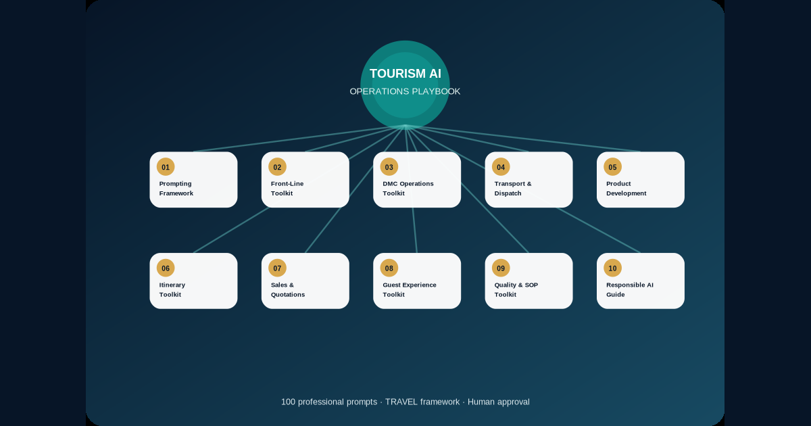

<div align="center">



# Tourism AI Operations Playbook

### 100 Responsible, Ready-to-Use AI Prompts, Templates and Workflows for Modern Tourism Teams

**Created and maintained by Ahmed Mahmoud**  
Tourism Operations · Product Development · Destination Management · Quality Improvement · Travel Technology

[Start the Playbook](START-HERE.md) · [Browse 100 Prompts](prompt-library/) · [Responsible Use](PRIVACY-AND-RESPONSIBLE-USE.md) · [Web Edition](https://ahmedqualityops.com/tourism-ai-operations-playbook.html)


</div>

## What this project is

The Tourism AI Operations Playbook is an open professional knowledge product for applying generative AI responsibly in real tourism work. It combines tourism operations experience with structured prompt engineering, verification controls, privacy safeguards and human approval points.

It is designed for DMCs, tour operators, guides, product teams, destination managers, transport and dispatch teams, travel sales professionals, guest-experience teams, quality managers, trainers, students and small tourism businesses.

This repository is not a collection of one-line prompts. Every template defines the AI role, business task, operating context, required inputs, output structure, limitations, missing-information behaviour, privacy rules, verification steps and accountable human approver.

## The 10-part Playbook

| Article | Toolkit | Main area | Prompts |
|---:|---|---|---:|
| 01 | [The Tourism Prompting Framework: How to Write Professional AI Prompts for Travel and Tourism](playbook/01-tourism-prompting-framework.md) | Prompt Engineering | 10 |
| 02 | [The Front-Line Tourism AI Toolkit: 10 Professional Prompt Templates for Tour Guides and Guest-Facing Teams](playbook/02-front-line-tourism-ai-toolkit.md) | Front-Line Service | 10 |
| 03 | [The DMC Operations AI Toolkit: 10 Ready-to-Use Prompts for Daily Tour Operations](playbook/03-dmc-operations-ai-toolkit.md) | DMC Operations | 10 |
| 04 | [The Tourism Transport and Dispatch AI Toolkit: 10 Prompts for Smarter Pickup, Routing, and Fleet Coordination](playbook/04-tourism-transport-dispatch-ai-toolkit.md) | Transport and Dispatch | 10 |
| 05 | [The Tourism Product Development AI Toolkit: 10 Prompts for Building Better Tours and Experiences](playbook/05-tourism-product-development-ai-toolkit.md) | Product Development | 10 |
| 06 | [The Tourism Itinerary AI Toolkit: 10 Prompts for Realistic and Guest-Centred Travel Planning](playbook/06-tourism-itinerary-ai-toolkit.md) | Itinerary Planning | 10 |
| 07 | [The Tourism Sales and Quotation AI Toolkit: 10 Prompts for B2B Proposals and Commercial Communication](playbook/07-tourism-sales-quotation-ai-toolkit.md) | Sales and Quotation | 10 |
| 08 | [The Guest Experience AI Toolkit: 10 Prompts for Communication, Complaints, and Service Recovery](playbook/08-guest-experience-ai-toolkit.md) | Guest Experience | 10 |
| 09 | [The Tourism Quality and SOP AI Toolkit: 10 Prompts for Process Improvement and Operational Excellence](playbook/09-tourism-quality-sop-ai-toolkit.md) | Quality and SOP | 10 |
| 10 | [Responsible AI for Tourism: A Practical Governance Guide for Travel Companies](playbook/10-responsible-ai-for-tourism.md) | Responsible AI Governance | 10 |

## Choose how you want to use it

- **Learn the method:** begin with [START-HERE.md](START-HERE.md) and Article 01.
- **Find a prompt quickly:** use the [prompt-library](prompt-library/) or the searchable [JSON dataset](data/prompts.json).
- **Train a tourism team:** use the materials in [templates](templates/) and [examples](examples/).
- **Publish a live edition:** enable GitHub Pages from the `/docs` folder.
- **Improve the project:** open an issue using the structured contribution templates.

## Responsible-use baseline

Never treat an AI output as an operational confirmation. Verify changing information—including opening hours, prices, availability, transfer times, visa rules, accessibility conditions, weather, events and supplier commitments—through approved or official sources.

Do not place unnecessary guest personal data, employee records, confidential supplier rates, contracts, payment details, credentials or security information into public AI tools. Every operational output must remain a draft until reviewed by the accountable human role.

Read the full [privacy and responsible-use policy](PRIVACY-AND-RESPONSIBLE-USE.md).

## Repository structure

```text
tourism-ai-operations-playbook/
├── README.md
├── START-HERE.md
├── playbook/                 # Ten complete chapters
├── prompt-library/           # 100 individually documented prompts
├── data/                     # JSON and CSV indexes
├── templates/                # Governance, review and training templates
├── examples/                 # Fictional tourism implementation scenarios
├── docs/                     # GitHub Pages-ready web edition
├── .github/                  # Issues, pull requests and automated QA
├── tools/                    # Repository validation script
├── CITATION.cff
├── CHANGELOG.md
├── ROADMAP.md
└── LICENSE
```

## Evidence of professional practice

This repository demonstrates:

- tourism-specific prompt engineering;
- operational documentation and process design;
- responsible-AI governance;
- version control and release management;
- structured datasets and reusable templates;
- product thinking and roadmap management;
- contributor and quality-assurance workflows;
- static web publishing through GitHub Pages.

## Contributing

Tourism professionals, trainers, operators, product specialists and responsible-AI practitioners are welcome to suggest improvements. Please read [CONTRIBUTING.md](CONTRIBUTING.md) before opening an issue or pull request.

Do not submit real guest data, confidential company documents, supplier rates, private contracts or copyrighted material you do not control.

### Keeping the prompt library and inventories in sync

The individual Markdown prompts are rendered from `data/prompts.json`; the chapter records in `data/articles.json` supply category navigation. After an approved dataset update, run:

```sh
python3 tools/render_prompt_library.py
python3 tools/refresh_inventory.py
python3 tools/validate_repository.py
```

Commit the generated prompt files, manifest and checksums together with the source change. The validator checks exact prompt text, metadata, local references and packaging inventories. The Repository Quality workflow runs the same validation on pushes and pull requests.

## Citation

Suggested citation:

> Mahmoud, Ahmed. *Tourism AI Operations Playbook: 100 Responsible, Ready-to-Use AI Prompts, Templates and Workflows for Modern Tourism Teams.* Ahmed Quality Ops, version 1.0.0, 2026.

A machine-readable citation is available in [CITATION.cff](CITATION.cff).

## Licensing

- Written content, prompt templates and original diagrams: **Creative Commons Attribution 4.0 International (CC BY 4.0)**.
- Utility code, validation scripts and web interaction code: **MIT License**.

Attribution to Ahmed Mahmoud and the Tourism AI Operations Playbook is required when reusing the written content. See [LICENSE](LICENSE) for details.

## Author

**Ahmed Mahmoud** is a tourism operations, product development and destination-management professional working across DMC operations, guest experience, transport planning, quality improvement, tourism technology and practical AI adoption.

Professional website: https://ahmedqualityops.com/
