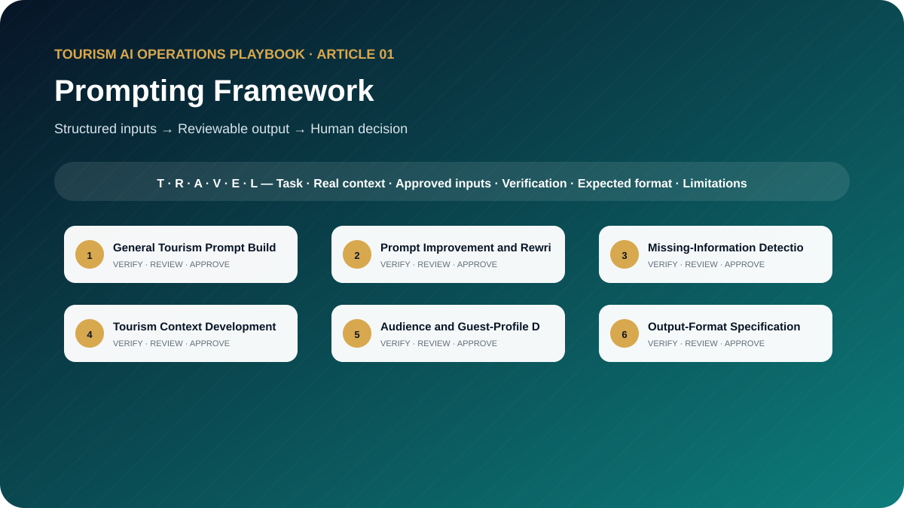

# The Tourism Prompting Framework: How to Write Professional AI Prompts for Travel and Tourism

**A Practical Guide to Roles, Context, Guest Profiles, Operational Data, Output Formats, and Verification Rules**



> **Edition:** 1.0.0  
> **Author:** Ahmed Mahmoud  
> **Prompt templates:** 10  
> **Primary audience:** Tourism professionals, trainers, managers and AI champions  
> **Web edition:** https://ahmedqualityops.com/tourism-prompting-framework.html

**Direct answer**

## Prompting Framework: the professional principle

Tourism prompt engineering is the practice of defining a travel task, supplying verified operating context and controlling the output so a qualified employee can review it safely.

**Who this guide is for**

## Target audience

Tourism trainers, operations managers, product teams, guides, sales teams, quality managers, students and small travel-business owners.

This is a working guide for people who already understand that tourism is delivered through connected handovers. The prompts are designed to improve preparation, consistency and visibility; they do not transfer authority from the trained employee to the AI system.

**Operational value**

## Why this topic matters in tourism

Tourism work combines live guests, changing operating conditions, multiple suppliers and information that can become outdated quickly. A vague instruction may produce polished text that is operationally unsafe. A structured prompt makes the AI expose missing facts, respect approved limits and return an output that a tourism professional can review efficiently.

This foundation article introduces the TRAVEL framework used throughout the series. It converts prompt engineering into six practical questions that tourism employees can apply before asking AI to prepare a briefing, itinerary, quotation, guest message, quality review or management report.

**The central control**

AI may organise information and propose a structure. It must not manufacture the confirmed operational reality. When the source of truth changes, the employee must update the inputs and verify the output again.

**Before copying a prompt**

## Responsible AI rules for this toolkit

- Use only approved and verified tourism information.
- Separate confirmed facts, working assumptions and recommendations.
- Never paste guest identity documents, payment data, private rates or confidential contracts into an unapproved tool.
- Require the AI to stop and ask for missing information instead of completing gaps.
- Name the person or department responsible for final approval.

Companies should adapt these rules to approved tools, information-security controls, local law, supplier contracts and internal authority. When the implications are legal, privacy-related or cybersecurity-related, qualified specialists should be consulted.

**Shared method**

## The TRAVEL prompting framework

Every template in this playbook follows one memorable structure. The aim is not to make prompts longer for their own sake. It is to place the information, controls and approval points that a tourism professional needs in the right order.

- **T — Task and tourism role**: state the professional perspective and the business decision to support.
- **R — Real operational context**: include the destination, service type, timing, guest journey stage and confirmed constraints.
- **A — Audience and approved inputs**: define the guest or client profile and provide only verified, permitted information.
- **V — Verifiable output rules**: require source labels, assumptions, uncertainty flags and a check against official or approved records.
- **E — Expected format and exceptions**: specify the exact structure, priority order, tone, length and escalation path.
- **L — Limitations, privacy and human sign-off**: prohibit invention, protect data and identify who approves the final output.

**In one sentence:** a professional tourism prompt identifies the task, supplies the real operating context, defines the audience and approved inputs, demands a verifiable structure, explains exceptions and keeps privacy plus final authority with a human.

**Copy-ready working library**

## Ten professional prompt templates

Each prompt contains editable placeholders and a built-in stop rule for missing information. Copy it, replace the placeholders with approved facts and keep the verification and human-approval sections intact. The templates are intentionally detailed because the omitted detail is often where a tourism failure begins.

**Prompt 01**

## General Tourism Prompt Builder

Turn a rough tourism request into a complete travel-format instruction that another employee can use consistently.

### When to use it

Use it for a controlled draft before information reaches a guest, supplier, colleague or manager.

**Example:** A DMC product executive needs a reusable prompt for reviewing a new half-day city tour.

### Required inputs

- rough request
- department
- destination
- service type
- audience
- verified facts
- operational constraints
- deadline
- approver

### Expected outputs

- improved prompt
- missing-information questions
- risk flags
- verification plan
- approval point

**Copy-and-Paste Template**

### General Tourism Prompt Builder

```
ROLE
Act as a senior tourism prompt architect in a professional tourism organisation.

TASK
Turn a rough tourism request into a complete travel-format instruction that another employee can use consistently.

CONTEXT
Destination/service: [Insert confirmed details]
Date, operating stage and guest/client profile: [Insert approved information]
Sources of truth: [List approved systems, confirmations, SOPs or official sources]

INPUTS
Provide: rough request; department; destination; service type; audience; verified facts; operational constraints; deadline; approver.
If an essential input is missing, contradictory or unconfirmed, stop and list what is required, its owner and source. Do not guess.

OUTPUT
Return: improved prompt; missing-information questions; risk flags; verification plan; approval point. Separate confirmed facts, assumptions, recommendations and pending items. Label dynamic facts with their source and verification date when supplied.

LIMITS
Do not add facts that were not supplied. Keep placeholders wherever evidence or authority is missing.

PRIVACY AND APPROVAL
Exclude unnecessary personal data, identity or payment details, confidential rates, contracts and security information. Finish with verification actions, unresolved questions and the final approver’s role. The output remains a draft until that person checks it against approved sources.
```

**Professional tourism trainer’s note**

Replace every placeholder and keep unresolved items visible until an authorised professional reviews them.

**Prompt 02**

## Prompt Improvement and Rewriting

Diagnose and rebuild an existing prompt so it is specific, reviewable and safe for tourism operations.

### When to use it

Use it for a controlled draft before information reaches a guest, supplier, colleague or manager.

**Example:** A transport team’s one-line route prompt keeps returning unrealistic pickup plans.

### Required inputs

- original prompt
- intended task
- expected user
- known failure
- approved information
- prohibited data
- desired output

### Expected outputs

- weakness analysis
- revised prompt
- change log
- test cases
- reviewer checklist

**Copy-and-Paste Template**

### Prompt Improvement and Rewriting

```
ROLE
Act as a tourism operations editor and prompt engineer in a professional tourism organisation.

TASK
Diagnose and rebuild an existing prompt so it is specific, reviewable and safe for tourism operations.

CONTEXT
Destination/service: [Insert confirmed details]
Date, operating stage and guest/client profile: [Insert approved information]
Sources of truth: [List approved systems, confirmations, SOPs or official sources]

INPUTS
Provide: original prompt; intended task; expected user; known failure; approved information; prohibited data; desired output.
If an essential input is missing, contradictory or unconfirmed, stop and list what is required, its owner and source. Do not guess.

OUTPUT
Return: weakness analysis; revised prompt; change log; test cases; reviewer checklist. Separate confirmed facts, assumptions, recommendations and pending items. Label dynamic facts with their source and verification date when supplied.

LIMITS
Preserve the user’s legitimate objective while removing ambiguity, hidden assumptions and unsafe instructions.

PRIVACY AND APPROVAL
Exclude unnecessary personal data, identity or payment details, confidential rates, contracts and security information. Finish with verification actions, unresolved questions and the final approver’s role. The output remains a draft until that person checks it against approved sources.
```

**Professional tourism trainer’s note**

Replace every placeholder and keep unresolved items visible until an authorised professional reviews them.

**Prompt 03**

## Missing-Information Detection

Review a planned ai task and identify every missing input that could affect safety, timing, guest expectation, cost or service delivery.

### When to use it

Use it for a controlled draft before information reaches a guest, supplier, colleague or manager.

**Example:** A coordinator asks for a daily briefing but has not supplied the attraction slot or vehicle confirmation.

### Required inputs

- draft request
- tour file extract
- confirmed inputs
- source systems
- decision required
- operating deadline

### Expected outputs

- critical missing data
- important missing data
- optional enhancements
- owner and source for each item

**Copy-and-Paste Template**

### Missing-Information Detection

```
ROLE
Act as a tourism operations control specialist in a professional tourism organisation.

TASK
Review a planned ai task and identify every missing input that could affect safety, timing, guest expectation, cost or service delivery.

CONTEXT
Destination/service: [Insert confirmed details]
Date, operating stage and guest/client profile: [Insert approved information]
Sources of truth: [List approved systems, confirmations, SOPs or official sources]

INPUTS
Provide: draft request; tour file extract; confirmed inputs; source systems; decision required; operating deadline.
If an essential input is missing, contradictory or unconfirmed, stop and list what is required, its owner and source. Do not guess.

OUTPUT
Return: critical missing data; important missing data; optional enhancements; owner and source for each item. Separate confirmed facts, assumptions, recommendations and pending items. Label dynamic facts with their source and verification date when supplied.

LIMITS
Do not solve the task. Stop after producing the information request and prioritisation.

PRIVACY AND APPROVAL
Exclude unnecessary personal data, identity or payment details, confidential rates, contracts and security information. Finish with verification actions, unresolved questions and the final approver’s role. The output remains a draft until that person checks it against approved sources.
```

**Professional tourism trainer’s note**

Replace every placeholder and keep unresolved items visible until an authorised professional reviews them.

**Prompt 04**

## Tourism Context Development

Convert scattered background notes into a precise operating context section for an ai prompt.

### When to use it

Use it for a controlled draft before information reaches a guest, supplier, colleague or manager.

**Example:** A team is preparing a prompt for a desert dinner operation during a peak event week.

### Required inputs

- destination
- product
- guest journey stage
- season
- service window
- suppliers
- team roles
- local rules
- known exceptions

### Expected outputs

- context statement
- boundary conditions
- dependencies
- assumptions requiring approval

**Copy-and-Paste Template**

### Tourism Context Development

```
ROLE
Act as a destination-management consultant in a professional tourism organisation.

TASK
Convert scattered background notes into a precise operating context section for an ai prompt.

CONTEXT
Destination/service: [Insert confirmed details]
Date, operating stage and guest/client profile: [Insert approved information]
Sources of truth: [List approved systems, confirmations, SOPs or official sources]

INPUTS
Provide: destination; product; guest journey stage; season; service window; suppliers; team roles; local rules; known exceptions.
If an essential input is missing, contradictory or unconfirmed, stop and list what is required, its owner and source. Do not guess.

OUTPUT
Return: context statement; boundary conditions; dependencies; assumptions requiring approval. Separate confirmed facts, assumptions, recommendations and pending items. Label dynamic facts with their source and verification date when supplied.

LIMITS
Do not describe dynamic destination conditions as confirmed unless a source and date are supplied.

PRIVACY AND APPROVAL
Exclude unnecessary personal data, identity or payment details, confidential rates, contracts and security information. Finish with verification actions, unresolved questions and the final approver’s role. The output remains a draft until that person checks it against approved sources.
```

**Professional tourism trainer’s note**

Replace every placeholder and keep unresolved items visible until an authorised professional reviews them.

**Prompt 05**

## Audience and Guest-Profile Definition

Create a respectful, operationally useful audience profile without stereotypes or unnecessary personal data.

### When to use it

Use it for a controlled draft before information reaches a guest, supplier, colleague or manager.

**Example:** A guide trainer needs to adapt one destination story for families and a corporate delegation.

### Required inputs

- market
- language
- age mix
- group type
- interests
- pace
- mobility
- dietary needs
- trip purpose
- service level

### Expected outputs

- guest-needs summary
- communication implications
- operational implications
- questions still required

**Copy-and-Paste Template**

### Audience and Guest-Profile Definition

```
ROLE
Act as a guest experience and segmentation specialist in a professional tourism organisation.

TASK
Create a respectful, operationally useful audience profile without stereotypes or unnecessary personal data.

CONTEXT
Destination/service: [Insert confirmed details]
Date, operating stage and guest/client profile: [Insert approved information]
Sources of truth: [List approved systems, confirmations, SOPs or official sources]

INPUTS
Provide: market; language; age mix; group type; interests; pace; mobility; dietary needs; trip purpose; service level.
If an essential input is missing, contradictory or unconfirmed, stop and list what is required, its owner and source. Do not guess.

OUTPUT
Return: guest-needs summary; communication implications; operational implications; questions still required. Separate confirmed facts, assumptions, recommendations and pending items. Label dynamic facts with their source and verification date when supplied.

LIMITS
Avoid assumptions based on nationality, age, disability, religion or spending level. Use only supplied evidence.

PRIVACY AND APPROVAL
Exclude unnecessary personal data, identity or payment details, confidential rates, contracts and security information. Finish with verification actions, unresolved questions and the final approver’s role. The output remains a draft until that person checks it against approved sources.
```

**Professional tourism trainer’s note**

Replace every placeholder and keep unresolved items visible until an authorised professional reviews them.

**Prompt 06**

## Output-Format Specification

Design the exact output structure an ai should follow so the result can enter a tourism workflow with minimal rework.

### When to use it

Use it for a controlled draft before information reaches a guest, supplier, colleague or manager.

**Example:** A duty manager wants every handover summary to follow the same exception-first structure.

### Required inputs

- business task
- receiving role
- channel
- required sections
- length
- tone
- fields
- priority logic
- template examples

### Expected outputs

- numbered output specification
- mandatory fields
- optional fields
- validation rules
- rejected-output conditions

**Copy-and-Paste Template**

### Output-Format Specification

```
ROLE
Act as a tourism workflow designer in a professional tourism organisation.

TASK
Design the exact output structure an ai should follow so the result can enter a tourism workflow with minimal rework.

CONTEXT
Destination/service: [Insert confirmed details]
Date, operating stage and guest/client profile: [Insert approved information]
Sources of truth: [List approved systems, confirmations, SOPs or official sources]

INPUTS
Provide: business task; receiving role; channel; required sections; length; tone; fields; priority logic; template examples.
If an essential input is missing, contradictory or unconfirmed, stop and list what is required, its owner and source. Do not guess.

OUTPUT
Return: numbered output specification; mandatory fields; optional fields; validation rules; rejected-output conditions. Separate confirmed facts, assumptions, recommendations and pending items. Label dynamic facts with their source and verification date when supplied.

LIMITS
Do not write the final business content; define the controlled format and acceptance criteria.

PRIVACY AND APPROVAL
Exclude unnecessary personal data, identity or payment details, confidential rates, contracts and security information. Finish with verification actions, unresolved questions and the final approver’s role. The output remains a draft until that person checks it against approved sources.
```

**Professional tourism trainer’s note**

Replace every placeholder and keep unresolved items visible until an authorised professional reviews them.

**Prompt 07**

## Operational Limitation Setting

Write clear limitations for a prompt so the ai cannot invent, approve or disclose information outside its role.

### When to use it

Use it for a controlled draft before information reaches a guest, supplier, colleague or manager.

**Example:** A sales team uses AI to draft proposals but must protect net rates and payment terms.

### Required inputs

- use case
- data category
- dynamic facts
- commercial authority
- safety implications
- company rules
- approver

### Expected outputs

- prohibited actions
- permitted actions
- uncertainty language
- escalation triggers
- human sign-off

**Copy-and-Paste Template**

### Operational Limitation Setting

```
ROLE
Act as a tourism risk and compliance reviewer in a professional tourism organisation.

TASK
Write clear limitations for a prompt so the ai cannot invent, approve or disclose information outside its role.

CONTEXT
Destination/service: [Insert confirmed details]
Date, operating stage and guest/client profile: [Insert approved information]
Sources of truth: [List approved systems, confirmations, SOPs or official sources]

INPUTS
Provide: use case; data category; dynamic facts; commercial authority; safety implications; company rules; approver.
If an essential input is missing, contradictory or unconfirmed, stop and list what is required, its owner and source. Do not guess.

OUTPUT
Return: prohibited actions; permitted actions; uncertainty language; escalation triggers; human sign-off. Separate confirmed facts, assumptions, recommendations and pending items. Label dynamic facts with their source and verification date when supplied.

LIMITS
Use direct rules. Never phrase a mandatory control as an optional suggestion.

PRIVACY AND APPROVAL
Exclude unnecessary personal data, identity or payment details, confidential rates, contracts and security information. Finish with verification actions, unresolved questions and the final approver’s role. The output remains a draft until that person checks it against approved sources.
```

**Professional tourism trainer’s note**

Replace every placeholder and keep unresolved items visible until an authorised professional reviews them.

**Prompt 08**

## Fact-Verification Review

Review an ai-generated tourism output line by line and create an evidence-based verification register.

### When to use it

Use it for a controlled draft before information reaches a guest, supplier, colleague or manager.

**Example:** A draft itinerary contains attraction hours, transfer estimates and accessibility statements.

### Required inputs

- AI output
- supplied sources
- official links
- source dates
- approved internal records
- intended use

### Expected outputs

- claim register
- source status
- dynamic-data flags
- contradictions
- required corrections
- release recommendation

**Copy-and-Paste Template**

### Fact-Verification Review

```
ROLE
Act as a tourism information-quality analyst in a professional tourism organisation.

TASK
Review an ai-generated tourism output line by line and create an evidence-based verification register.

CONTEXT
Destination/service: [Insert confirmed details]
Date, operating stage and guest/client profile: [Insert approved information]
Sources of truth: [List approved systems, confirmations, SOPs or official sources]

INPUTS
Provide: AI output; supplied sources; official links; source dates; approved internal records; intended use.
If an essential input is missing, contradictory or unconfirmed, stop and list what is required, its owner and source. Do not guess.

OUTPUT
Return: claim register; source status; dynamic-data flags; contradictions; required corrections; release recommendation. Separate confirmed facts, assumptions, recommendations and pending items. Label dynamic facts with their source and verification date when supplied.

LIMITS
Do not treat repeated online claims as verification. Prefer official, current and approved sources.

PRIVACY AND APPROVAL
Exclude unnecessary personal data, identity or payment details, confidential rates, contracts and security information. Finish with verification actions, unresolved questions and the final approver’s role. The output remains a draft until that person checks it against approved sources.
```

**Professional tourism trainer’s note**

Replace every placeholder and keep unresolved items visible until an authorised professional reviews them.

**Prompt 09**

## AI Hallucination Detection

Challenge an ai output for invented details, unsupported certainty, false precision and hidden assumptions.

### When to use it

Use it for a controlled draft before information reaches a guest, supplier, colleague or manager.

**Example:** A generated product brief includes a supplier capacity and a “guaranteed” view that nobody supplied.

### Required inputs

- prompt
- output
- source pack
- known facts
- operational rules
- confidence requirement

### Expected outputs

- suspected hallucinations
- unsupported claims
- ambiguous claims
- safe rewritten wording
- follow-up questions

**Copy-and-Paste Template**

### AI Hallucination Detection

```
ROLE
Act as a tourism quality auditor in a professional tourism organisation.

TASK
Challenge an ai output for invented details, unsupported certainty, false precision and hidden assumptions.

CONTEXT
Destination/service: [Insert confirmed details]
Date, operating stage and guest/client profile: [Insert approved information]
Sources of truth: [List approved systems, confirmations, SOPs or official sources]

INPUTS
Provide: prompt; output; source pack; known facts; operational rules; confidence requirement.
If an essential input is missing, contradictory or unconfirmed, stop and list what is required, its owner and source. Do not guess.

OUTPUT
Return: suspected hallucinations; unsupported claims; ambiguous claims; safe rewritten wording; follow-up questions. Separate confirmed facts, assumptions, recommendations and pending items. Label dynamic facts with their source and verification date when supplied.

LIMITS
Flag uncertainty rather than guessing whether a claim is true.

PRIVACY AND APPROVAL
Exclude unnecessary personal data, identity or payment details, confidential rates, contracts and security information. Finish with verification actions, unresolved questions and the final approver’s role. The output remains a draft until that person checks it against approved sources.
```

**Professional tourism trainer’s note**

Replace every placeholder and keep unresolved items visible until an authorised professional reviews them.

**Prompt 10**

## Final Prompt-Quality Assessment

Score a completed prompt against the travel framework and decide whether it is ready for controlled use.

### When to use it

Use it for a controlled draft before information reaches a guest, supplier, colleague or manager.

**Example:** A company wants to approve a pre-arrival message prompt for its central library.

### Required inputs

- final prompt
- use case
- department
- test outputs
- reviewer feedback
- risk level
- approved tools

### Expected outputs

- scorecard
- pass/fail by criterion
- critical defects
- improvement actions
- version recommendation

**Copy-and-Paste Template**

### Final Prompt-Quality Assessment

```
ROLE
Act as a tourism training assessor in a professional tourism organisation.

TASK
Score a completed prompt against the travel framework and decide whether it is ready for controlled use.

CONTEXT
Destination/service: [Insert confirmed details]
Date, operating stage and guest/client profile: [Insert approved information]
Sources of truth: [List approved systems, confirmations, SOPs or official sources]

INPUTS
Provide: final prompt; use case; department; test outputs; reviewer feedback; risk level; approved tools.
If an essential input is missing, contradictory or unconfirmed, stop and list what is required, its owner and source. Do not guess.

OUTPUT
Return: scorecard; pass/fail by criterion; critical defects; improvement actions; version recommendation. Separate confirmed facts, assumptions, recommendations and pending items. Label dynamic facts with their source and verification date when supplied.

LIMITS
A high overall score cannot override a critical privacy, safety, commercial or verification failure.

PRIVACY AND APPROVAL
Exclude unnecessary personal data, identity or payment details, confidential rates, contracts and security information. Finish with verification actions, unresolved questions and the final approver’s role. The output remains a draft until that person checks it against approved sources.
```

**Professional tourism trainer’s note**

Replace every placeholder and keep unresolved items visible until an authorised professional reviews them.

**Quality control**

## Common mistakes to avoid

1. **Mistake 1:** Starting with “write something professional” without defining the decision or audience.
2. **Mistake 2:** Combining several unrelated tasks in one prompt.
3. **Mistake 3:** Supplying unverified web facts as if they were approved operational data.
4. **Mistake 4:** Asking for a final answer without a verification table.
5. **Mistake 5:** Treating fluent language as proof that the content is correct.

A useful internal review question is: “Could a new employee read this output and mistake a proposal for a confirmation?” If the answer is yes, revise the prompt and output labels before use.

**From template to controlled workflow**

## Implementation guidance for tourism teams

Start with one low-risk use case, test the prompt with real but anonymised inputs, compare the output with an experienced employee’s work and record the improvements. Keep an approved prompt version, owner, review date and department scope. Build the library gradually instead of allowing every employee to create uncontrolled prompts.

1**Select**

Choose a low-risk, frequent task with a clear owner and source of truth.

2**Test**

Run realistic anonymised cases, including missing data and operational exceptions.

3**Approve**

Document the prompt version, permitted users, tool, reviewer and release criteria.

4**Measure**

Track quality, time saved, defects, escalations and employee feedback.

5**Improve**

Update the prompt when the process, destination, supplier or risk changes.

**Professional release gate**

## Final verification checklist

The task and intended business decision are clear. Required information came from approved sources. Dynamic facts have a source and verification date. Missing information is visible and assigned to an owner. Personal and confidential data were minimised. The output respects role and commercial authority. Safety, accessibility and cultural considerations were checked. Assumptions are separated from confirmed facts. The relevant tourism professional reviewed the output. The final approval and version are recorded.

**Conclusion**

## Use AI to strengthen tourism judgement, not to bypass it

The best result is not the longest response or the most impressive wording. It is an output that helps a trained tourism professional see the situation clearly, find missing information early, communicate consistently and make a controlled decision. Keep the TRAVEL framework, verification table, privacy boundaries and human sign-off visible every time the prompt is adapted.

**Frequently asked questions**

## Questions tourism teams ask

What is tourism prompt engineering?

It is the practice of giving an AI system a structured tourism task, verified operational context, approved inputs, output rules, limitations and human-review requirements so the result can support real work.

Why is a tourism-specific framework necessary?

Tourism outputs often influence live movements, guest expectations, supplier actions and commercial commitments. The framework forces the user to include operational details that a generic writing prompt normally misses.

Can a good prompt guarantee a correct answer?

No. A strong prompt reduces ambiguity and improves reviewability, but the output still requires qualified human verification against approved systems and official sources.

Should companies store prompts?

Yes. An approved prompt library improves consistency when it includes ownership, access rules, version history, data restrictions and scheduled reviews.

What should never be placed in a public AI tool?

Unnecessary personal data, passport details, payment information, confidential supplier rates, unpublished contracts, security procedures and any information prohibited by company policy.

**Continue the knowledge path**

## Related reading and connected projects

[Article 02**Front-Line Toolkit**

Ten detailed AI prompt templates for tour preparation, storytelling, multilingual communication, delays, complaints, role-play and post-tour reporting.](./02-front-line-tourism-ai-toolkit.md)[Article 03**DMC Operations Toolkit**

Ten copy-ready prompts designed around real DMC tour files, assignments, supplier confirmations, movement plans, disruptions and handovers.](./03-dmc-operations-ai-toolkit.md)[Article 10**Responsible AI Guide**

A practical tourism governance guide with ten templates for risk, verification, privacy, cultural sensitivity, approvals, policies and AI reviews.](./10-responsible-ai-for-tourism.md)[Existing insight or project**Article Tourism Operations Roles Real Difference**

Clarify the real tourism roles that should be named inside a professional prompt.](https://ahmedqualityops.com/article-tourism-operations-roles-real-difference.html)[Existing insight or project**Article Tour Guide Storytelling System**

See how verified facts become flexible destination storytelling.](https://ahmedqualityops.com/article-tour-guide-storytelling-system.html)[Existing insight or project**Article Tour Guide Quality Index**

Connect prompt quality with measurable guide preparation and delivery.](https://ahmedqualityops.com/article-tour-guide-quality-index.html)

[Series hub**Tourism AI Operations Playbook**](../README.md)

[Next article**Front-Line Toolkit →**](./02-front-line-tourism-ai-toolkit.md)

**Professional verification reminder:** Always compare AI output with approved internal systems, official sources and qualified human judgement before it affects a guest, supplier, employee or commercial commitment.
