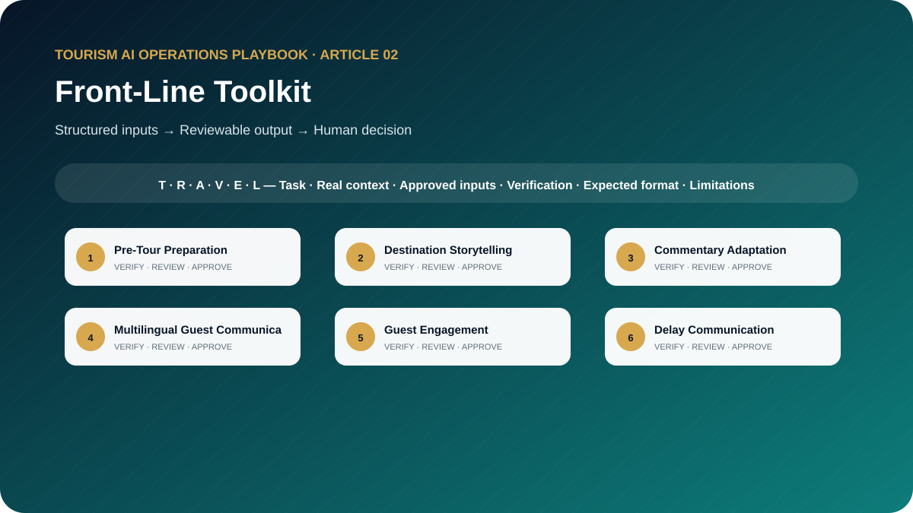

# The Front-Line Tourism AI Toolkit: 10 Professional Prompt Templates for Tour Guides and Guest-Facing Teams

**Ready-to-Use AI Prompts for Tour Preparation, Destination Storytelling, Guest Engagement, Complaints, Multilingual Communication, and Service Excellence**



> **Edition:** 1.0.0  
> **Author:** Ahmed Mahmoud  
> **Prompt templates:** 10  
> **Primary audience:** Tour guides, hotel representatives, concierge teams and attraction staff  
> **Web edition:** https://ahmedqualityops.com/front-line-tourism-ai-toolkit.html

**Direct answer**

## Front-Line Toolkit: the professional principle

Front-line teams can use AI to prepare, practise and communicate more consistently, while verified facts, empathy, safety and live decisions remain with the employee.

**Who this guide is for**

## Target audience

Tour guides, airport representatives, hotel representatives, concierge teams, attraction hosts, tour leaders, guide trainers and front-line supervisors.

This is a working guide for people who already understand that tourism is delivered through connected handovers. The prompts are designed to improve preparation, consistency and visibility; they do not transfer authority from the trained employee to the AI system.

**Operational value**

## Why this topic matters in tourism

Front-line employees have to combine destination knowledge, timing control, cultural sensitivity, safety, service recovery and natural communication. AI can help them prepare and practise, but it must not replace live judgement or invent facts that are shared with guests.

This toolkit focuses on employee execution at the moment of service. The prompts help a guide or representative prepare, adapt and report while keeping the human professional responsible for facts, tone, guest safety and operational decisions.

**The central control**

AI may organise information and propose a structure. It must not manufacture the confirmed operational reality. When the source of truth changes, the employee must update the inputs and verify the output again.

**Before copying a prompt**

## Responsible AI rules for this toolkit

- Use verified attraction facts and current company instructions.
- Do not enter guest names, passport details, room numbers or private contact information unless the tool and use are formally approved.
- Keep safety, cultural etiquette and supplier instructions exactly aligned with authorised guidance.
- Ask the AI to mark any sentence that requires checking before it is spoken to guests.
- Use AI as a preparation and coaching assistant, not as the final authority during a live incident.

Companies should adapt these rules to approved tools, information-security controls, local law, supplier contracts and internal authority. When the implications are legal, privacy-related or cybersecurity-related, qualified specialists should be consulted.

**Shared method**

## The TRAVEL prompting framework

Every template in this playbook follows one memorable structure. The aim is not to make prompts longer for their own sake. It is to place the information, controls and approval points that a tourism professional needs in the right order.

- **T — Task and tourism role**: state the professional perspective and the business decision to support.
- **R — Real operational context**: include the destination, service type, timing, guest journey stage and confirmed constraints.
- **A — Audience and approved inputs**: define the guest or client profile and provide only verified, permitted information.
- **V — Verifiable output rules**: require source labels, assumptions, uncertainty flags and a check against official or approved records.
- **E — Expected format and exceptions**: specify the exact structure, priority order, tone, length and escalation path.
- **L — Limitations, privacy and human sign-off**: prohibit invention, protect data and identify who approves the final output.

**In one sentence:** a professional tourism prompt identifies the task, supplies the real operating context, defines the audience and approved inputs, demands a verifiable structure, explains exceptions and keeps privacy plus final authority with a human.

**Copy-ready working library**

## Ten professional prompt templates

Each prompt contains editable placeholders and a built-in stop rule for missing information. Copy it, replace the placeholders with approved facts and keep the verification and human-approval sections intact. The templates are intentionally detailed because the omitted detail is often where a tourism failure begins.

**Prompt 01**

## Pre-Tour Preparation

Turn a confirmed tour file into a practical guide preparation brief.

### When to use it

Use it for a controlled draft before information reaches a guest, supplier, colleague or manager.

**Example:** A French-speaking family group has a city tour with two timed-entry attractions.

### Required inputs

- tour date
- product name
- verified itinerary
- guest profile
- language
- pickup data
- confirmed tickets
- guide notes
- weather source
- escalation contacts

### Expected outputs

- timeline
- guest-needs notes
- verified facts to prepare
- operational checks
- risk points
- questions for operations

**Copy-and-Paste Template**

### Pre-Tour Preparation

```
ROLE
Act as a licensed senior tour guide and operations trainer in a professional tourism organisation.

TASK
Turn a confirmed tour file into a practical guide preparation brief.

CONTEXT
Destination/service: [Insert confirmed details]
Date, operating stage and guest/client profile: [Insert approved information]
Sources of truth: [List approved systems, confirmations, SOPs or official sources]

INPUTS
Provide: tour date; product name; verified itinerary; guest profile; language; pickup data; confirmed tickets; guide notes; weather source; escalation contacts.
If an essential input is missing, contradictory or unconfirmed, stop and list what is required, its owner and source. Do not guess.

OUTPUT
Return: timeline; guest-needs notes; verified facts to prepare; operational checks; risk points; questions for operations. Separate confirmed facts, assumptions, recommendations and pending items. Label dynamic facts with their source and verification date when supplied.

LIMITS
Do not invent attraction hours, access, tickets or guest requirements. Remove direct identifiers.

PRIVACY AND APPROVAL
Exclude unnecessary personal data, identity or payment details, confidential rates, contracts and security information. Finish with verification actions, unresolved questions and the final approver’s role. The output remains a draft until that person checks it against approved sources.
```

**Professional tourism trainer’s note**

Replace every placeholder and keep unresolved items visible until an authorised professional reviews them.

**Prompt 02**

## Destination Storytelling

Build flexible short, medium and extended stories from verified destination facts.

### When to use it

Use it for a controlled draft before information reaches a guest, supplier, colleague or manager.

**Example:** A guide prepares three versions of a Louvre Abu Dhabi introduction.

### Required inputs

- attraction
- approved facts
- destination theme
- guest profile
- cultural guidance
- prohibited claims
- speaking duration

### Expected outputs

- story spine
- 90-second version
- 3-minute version
- interactive question
- fact-check table

**Copy-and-Paste Template**

### Destination Storytelling

```
ROLE
Act as a destination interpretation trainer in a professional tourism organisation.

TASK
Build flexible short, medium and extended stories from verified destination facts.

CONTEXT
Destination/service: [Insert confirmed details]
Date, operating stage and guest/client profile: [Insert approved information]
Sources of truth: [List approved systems, confirmations, SOPs or official sources]

INPUTS
Provide: attraction; approved facts; destination theme; guest profile; cultural guidance; prohibited claims; speaking duration.
If an essential input is missing, contradictory or unconfirmed, stop and list what is required, its owner and source. Do not guess.

OUTPUT
Return: story spine; 90-second version; 3-minute version; interactive question; fact-check table. Separate confirmed facts, assumptions, recommendations and pending items. Label dynamic facts with their source and verification date when supplied.

LIMITS
Use only supplied facts. Mark interpretation separately from historical fact and avoid stereotypes.

PRIVACY AND APPROVAL
Exclude unnecessary personal data, identity or payment details, confidential rates, contracts and security information. Finish with verification actions, unresolved questions and the final approver’s role. The output remains a draft until that person checks it against approved sources.
```

**Professional tourism trainer’s note**

Replace every placeholder and keep unresolved items visible until an authorised professional reviews them.

**Prompt 03**

## Commentary Adaptation

Adapt approved commentary for a specific group while preserving factual accuracy and cultural respect.

### When to use it

Use it for a controlled draft before information reaches a guest, supplier, colleague or manager.

**Example:** The same mosque visit must be adapted for school students and architecture professionals.

### Required inputs

- base commentary
- verified facts
- group type
- language level
- interests
- time available
- pace
- sensitive topics

### Expected outputs

- adapted commentary
- changes made
- engagement questions
- details omitted
- verification flags

**Copy-and-Paste Template**

### Commentary Adaptation

```
ROLE
Act as a tour guide coach in a professional tourism organisation.

TASK
Adapt approved commentary for a specific group while preserving factual accuracy and cultural respect.

CONTEXT
Destination/service: [Insert confirmed details]
Date, operating stage and guest/client profile: [Insert approved information]
Sources of truth: [List approved systems, confirmations, SOPs or official sources]

INPUTS
Provide: base commentary; verified facts; group type; language level; interests; time available; pace; sensitive topics.
If an essential input is missing, contradictory or unconfirmed, stop and list what is required, its owner and source. Do not guess.

OUTPUT
Return: adapted commentary; changes made; engagement questions; details omitted; verification flags. Separate confirmed facts, assumptions, recommendations and pending items. Label dynamic facts with their source and verification date when supplied.

LIMITS
Do not assume interests from nationality or age. Keep mandatory safety and etiquette wording intact.

PRIVACY AND APPROVAL
Exclude unnecessary personal data, identity or payment details, confidential rates, contracts and security information. Finish with verification actions, unresolved questions and the final approver’s role. The output remains a draft until that person checks it against approved sources.
```

**Professional tourism trainer’s note**

Replace every placeholder and keep unresolved items visible until an authorised professional reviews them.

**Prompt 04**

## Multilingual Guest Communication

Draft and quality-check a guest-facing message in the required languages.

### When to use it

Use it for a controlled draft before information reaches a guest, supplier, colleague or manager.

**Example:** An airport representative sends a pickup meeting-point update in English and French.

### Required inputs

- approved source message
- target language
- channel
- formality
- guest action
- timing
- local terminology
- emergency contact format

### Expected outputs

- source-language revision
- translation
- back-translation summary
- terminology notes
- bilingual review flags

**Copy-and-Paste Template**

### Multilingual Guest Communication

```
ROLE
Act as a bilingual tourism communication specialist in a professional tourism organisation.

TASK
Draft and quality-check a guest-facing message in the required languages.

CONTEXT
Destination/service: [Insert confirmed details]
Date, operating stage and guest/client profile: [Insert approved information]
Sources of truth: [List approved systems, confirmations, SOPs or official sources]

INPUTS
Provide: approved source message; target language; channel; formality; guest action; timing; local terminology; emergency contact format.
If an essential input is missing, contradictory or unconfirmed, stop and list what is required, its owner and source. Do not guess.

OUTPUT
Return: source-language revision; translation; back-translation summary; terminology notes; bilingual review flags. Separate confirmed facts, assumptions, recommendations and pending items. Label dynamic facts with their source and verification date when supplied.

LIMITS
Do not translate names, codes, legal terms or safety wording inaccurately. Require competent human review.

PRIVACY AND APPROVAL
Exclude unnecessary personal data, identity or payment details, confidential rates, contracts and security information. Finish with verification actions, unresolved questions and the final approver’s role. The output remains a draft until that person checks it against approved sources.
```

**Professional tourism trainer’s note**

Replace every placeholder and keep unresolved items visible until an authorised professional reviews them.

**Prompt 05**

## Guest Engagement

Prepare respectful questions, participation moments and observation cues for a live tour.

### When to use it

Use it for a controlled draft before information reaches a guest, supplier, colleague or manager.

**Example:** A guide wants to engage a mixed-age group during a 90-minute heritage walking tour.

### Required inputs

- tour route
- group profile
- interests
- time
- cultural boundaries
- accessibility needs
- guide style

### Expected outputs

- opening question
- stop-by-stop engagement ideas
- optional activities
- quiet-group alternatives
- signs to change approach

**Copy-and-Paste Template**

### Guest Engagement

```
ROLE
Act as a experience-design trainer for tour guides in a professional tourism organisation.

TASK
Prepare respectful questions, participation moments and observation cues for a live tour.

CONTEXT
Destination/service: [Insert confirmed details]
Date, operating stage and guest/client profile: [Insert approved information]
Sources of truth: [List approved systems, confirmations, SOPs or official sources]

INPUTS
Provide: tour route; group profile; interests; time; cultural boundaries; accessibility needs; guide style.
If an essential input is missing, contradictory or unconfirmed, stop and list what is required, its owner and source. Do not guess.

OUTPUT
Return: opening question; stop-by-stop engagement ideas; optional activities; quiet-group alternatives; signs to change approach. Separate confirmed facts, assumptions, recommendations and pending items. Label dynamic facts with their source and verification date when supplied.

LIMITS
Never pressure guests to disclose personal information or participate.

PRIVACY AND APPROVAL
Exclude unnecessary personal data, identity or payment details, confidential rates, contracts and security information. Finish with verification actions, unresolved questions and the final approver’s role. The output remains a draft until that person checks it against approved sources.
```

**Professional tourism trainer’s note**

Replace every placeholder and keep unresolved items visible until an authorised professional reviews them.

**Prompt 06**

## Delay Communication

Prepare staged guest communication for a confirmed or developing delay.

### When to use it

Use it for a controlled draft before information reaches a guest, supplier, colleague or manager.

**Example:** A vehicle is late at a hotel and operations can only confirm that an update will follow in ten minutes.

### Required inputs

- confirmed facts
- cause category
- current delay range
- guest location
- next update time
- available alternatives
- escalation contact
- authority

### Expected outputs

- immediate message
- next-update message
- guide speaking notes
- questions to operations
- recovery boundary

**Copy-and-Paste Template**

### Delay Communication

```
ROLE
Act as a front-line service recovery coach in a professional tourism organisation.

TASK
Prepare staged guest communication for a confirmed or developing delay.

CONTEXT
Destination/service: [Insert confirmed details]
Date, operating stage and guest/client profile: [Insert approved information]
Sources of truth: [List approved systems, confirmations, SOPs or official sources]

INPUTS
Provide: confirmed facts; cause category; current delay range; guest location; next update time; available alternatives; escalation contact; authority.
If an essential input is missing, contradictory or unconfirmed, stop and list what is required, its owner and source. Do not guess.

OUTPUT
Return: immediate message; next-update message; guide speaking notes; questions to operations; recovery boundary. Separate confirmed facts, assumptions, recommendations and pending items. Label dynamic facts with their source and verification date when supplied.

LIMITS
Do not state a cause or new time unless confirmed. Do not promise compensation.

PRIVACY AND APPROVAL
Exclude unnecessary personal data, identity or payment details, confidential rates, contracts and security information. Finish with verification actions, unresolved questions and the final approver’s role. The output remains a draft until that person checks it against approved sources.
```

**Professional tourism trainer’s note**

Replace every placeholder and keep unresolved items visible until an authorised professional reviews them.

**Prompt 07**

## Complaint Handling

Help a front-line employee listen, clarify, stabilise and escalate a guest complaint.

### When to use it

Use it for a controlled draft before information reaches a guest, supplier, colleague or manager.

**Example:** A guest says the tour was rushed and an attraction stop was shorter than expected.

### Required inputs

- guest statement anonymised
- confirmed facts
- service standard
- employee authority
- available actions
- escalation route

### Expected outputs

- acknowledgement wording
- clarification questions
- immediate safe action
- escalation brief
- documentation notes

**Copy-and-Paste Template**

### Complaint Handling

```
ROLE
Act as a tourism complaint-handling trainer in a professional tourism organisation.

TASK
Help a front-line employee listen, clarify, stabilise and escalate a guest complaint.

CONTEXT
Destination/service: [Insert confirmed details]
Date, operating stage and guest/client profile: [Insert approved information]
Sources of truth: [List approved systems, confirmations, SOPs or official sources]

INPUTS
Provide: guest statement anonymised; confirmed facts; service standard; employee authority; available actions; escalation route.
If an essential input is missing, contradictory or unconfirmed, stop and list what is required, its owner and source. Do not guess.

OUTPUT
Return: acknowledgement wording; clarification questions; immediate safe action; escalation brief; documentation notes. Separate confirmed facts, assumptions, recommendations and pending items. Label dynamic facts with their source and verification date when supplied.

LIMITS
Do not admit unverified liability or offer unauthorised compensation.

PRIVACY AND APPROVAL
Exclude unnecessary personal data, identity or payment details, confidential rates, contracts and security information. Finish with verification actions, unresolved questions and the final approver’s role. The output remains a draft until that person checks it against approved sources.
```

**Professional tourism trainer’s note**

Replace every placeholder and keep unresolved items visible until an authorised professional reviews them.

**Prompt 08**

## Ethical Recommendations

Prepare transparent, guest-centred recommendations without hidden pressure or conflicts.

### When to use it

Use it for a controlled draft before information reaches a guest, supplier, colleague or manager.

**Example:** A concierge is recommending three optional evening experiences.

### Required inputs

- guest interests
- location
- verified options
- time
- budget band
- accessibility
- company relationship
- commission policy

### Expected outputs

- balanced shortlist
- reasons
- limitations
- relationship disclosure
- questions to refine

**Copy-and-Paste Template**

### Ethical Recommendations

```
ROLE
Act as a responsible destination specialist in a professional tourism organisation.

TASK
Prepare transparent, guest-centred recommendations without hidden pressure or conflicts.

CONTEXT
Destination/service: [Insert confirmed details]
Date, operating stage and guest/client profile: [Insert approved information]
Sources of truth: [List approved systems, confirmations, SOPs or official sources]

INPUTS
Provide: guest interests; location; verified options; time; budget band; accessibility; company relationship; commission policy.
If an essential input is missing, contradictory or unconfirmed, stop and list what is required, its owner and source. Do not guess.

OUTPUT
Return: balanced shortlist; reasons; limitations; relationship disclosure; questions to refine. Separate confirmed facts, assumptions, recommendations and pending items. Label dynamic facts with their source and verification date when supplied.

LIMITS
Do not invent availability, quality ratings or “local favourite” claims. Disclose relevant commercial relationships.

PRIVACY AND APPROVAL
Exclude unnecessary personal data, identity or payment details, confidential rates, contracts and security information. Finish with verification actions, unresolved questions and the final approver’s role. The output remains a draft until that person checks it against approved sources.
```

**Professional tourism trainer’s note**

Replace every placeholder and keep unresolved items visible until an authorised professional reviews them.

**Prompt 09**

## Training Role-Play

Create a role-play that tests knowledge, empathy, timing and escalation.

### When to use it

Use it for a controlled draft before information reaches a guest, supplier, colleague or manager.

**Example:** New guides practise responding when an attraction access rule changes during the tour.

### Required inputs

- training objective
- employee role
- guest profile
- scenario
- facts available
- hidden complication
- authority
- assessment rubric

### Expected outputs

- trainer brief
- learner brief
- staged guest responses
- escalation trigger
- model debrief
- scoring guide

**Copy-and-Paste Template**

### Training Role-Play

```
ROLE
Act as a tourism trainer and realistic guest simulator in a professional tourism organisation.

TASK
Create a role-play that tests knowledge, empathy, timing and escalation.

CONTEXT
Destination/service: [Insert confirmed details]
Date, operating stage and guest/client profile: [Insert approved information]
Sources of truth: [List approved systems, confirmations, SOPs or official sources]

INPUTS
Provide: training objective; employee role; guest profile; scenario; facts available; hidden complication; authority; assessment rubric.
If an essential input is missing, contradictory or unconfirmed, stop and list what is required, its owner and source. Do not guess.

OUTPUT
Return: trainer brief; learner brief; staged guest responses; escalation trigger; model debrief; scoring guide. Separate confirmed facts, assumptions, recommendations and pending items. Label dynamic facts with their source and verification date when supplied.

LIMITS
Use a fictional scenario and avoid demeaning cultural, disability or demographic stereotypes.

PRIVACY AND APPROVAL
Exclude unnecessary personal data, identity or payment details, confidential rates, contracts and security information. Finish with verification actions, unresolved questions and the final approver’s role. The output remains a draft until that person checks it against approved sources.
```

**Professional tourism trainer’s note**

Replace every placeholder and keep unresolved items visible until an authorised professional reviews them.

**Prompt 10**

## Post-Tour Reporting

Convert structured tour notes into a concise evidence-based end-of-tour report.

### When to use it

Use it for a controlled draft before information reaches a guest, supplier, colleague or manager.

**Example:** A guide reports a late departure, a recovered ticket issue and positive feedback about storytelling.

### Required inputs

- tour reference without personal identifiers
- plan
- actual timings
- incidents
- guest feedback
- supplier issues
- unresolved actions
- evidence

### Expected outputs

- executive summary
- timing variance
- guest-experience notes
- incident log
- follow-up owners
- improvement suggestions

**Copy-and-Paste Template**

### Post-Tour Reporting

```
ROLE
Act as a guide operations reporting coach in a professional tourism organisation.

TASK
Convert structured tour notes into a concise evidence-based end-of-tour report.

CONTEXT
Destination/service: [Insert confirmed details]
Date, operating stage and guest/client profile: [Insert approved information]
Sources of truth: [List approved systems, confirmations, SOPs or official sources]

INPUTS
Provide: tour reference without personal identifiers; plan; actual timings; incidents; guest feedback; supplier issues; unresolved actions; evidence.
If an essential input is missing, contradictory or unconfirmed, stop and list what is required, its owner and source. Do not guess.

OUTPUT
Return: executive summary; timing variance; guest-experience notes; incident log; follow-up owners; improvement suggestions. Separate confirmed facts, assumptions, recommendations and pending items. Label dynamic facts with their source and verification date when supplied.

LIMITS
Separate observed facts, guest statements and guide interpretation.

PRIVACY AND APPROVAL
Exclude unnecessary personal data, identity or payment details, confidential rates, contracts and security information. Finish with verification actions, unresolved questions and the final approver’s role. The output remains a draft until that person checks it against approved sources.
```

**Professional tourism trainer’s note**

Replace every placeholder and keep unresolved items visible until an authorised professional reviews them.

**Quality control**

## Common mistakes to avoid

1. **Mistake 1:** Reading AI wording to guests without adapting it naturally.
2. **Mistake 2:** Using outdated attraction hours or access rules.
3. **Mistake 3:** Translating sensitive cultural information without a bilingual review.
4. **Mistake 4:** Writing complaint replies before establishing the facts.
5. **Mistake 5:** Allowing the tool to promise compensation or supplier action.

A useful internal review question is: “Could a new employee read this output and mistake a proposal for a confirmation?” If the answer is yes, revise the prompt and output labels before use.

**From template to controlled workflow**

## Implementation guidance for tourism teams

Introduce the toolkit during guide training. Trainers should model one prompt, compare weak and strong inputs, then run role-play with the generated output. Approved destination facts, escalation contacts and service standards should remain outside the prompt as controlled company references.

1**Select**

Choose a low-risk, frequent task with a clear owner and source of truth.

2**Test**

Run realistic anonymised cases, including missing data and operational exceptions.

3**Approve**

Document the prompt version, permitted users, tool, reviewer and release criteria.

4**Measure**

Track quality, time saved, defects, escalations and employee feedback.

5**Improve**

Update the prompt when the process, destination, supplier or risk changes.

**Professional release gate**

## Final verification checklist

The task and intended business decision are clear. Required information came from approved sources. Dynamic facts have a source and verification date. Missing information is visible and assigned to an owner. Personal and confidential data were minimised. The output respects role and commercial authority. Safety, accessibility and cultural considerations were checked. Assumptions are separated from confirmed facts. The relevant tourism professional reviewed the output. The final approval and version are recorded.

**Conclusion**

## Use AI to strengthen tourism judgement, not to bypass it

The best result is not the longest response or the most impressive wording. It is an output that helps a trained tourism professional see the situation clearly, find missing information early, communicate consistently and make a controlled decision. Keep the TRAVEL framework, verification table, privacy boundaries and human sign-off visible every time the prompt is adapted.

**Frequently asked questions**

## Questions tourism teams ask

Can tour guides use AI during a live tour?

It may support approved low-risk tasks, but a guide should not depend on it for safety decisions, live operational changes or unverified attraction information.

How is this different from the guest-experience toolkit?

This article focuses on what the employee prepares and does. The guest-experience toolkit focuses on the company’s complete customer journey, feedback and service-recovery system.

Can AI translate guest messages?

Yes, as a draft. Important instructions, cultural content, legal wording, health and safety messages should be checked by a competent speaker or approved translation process.

Will AI replace destination storytelling?

No. It can help organise verified facts and practise variations, but the guide’s local understanding, timing, empathy and interaction create the experience.

What is the safest first use?

Pre-tour preparation with anonymised group information and a checklist that is verified against the confirmed tour file.

**Continue the knowledge path**

## Related reading and connected projects

[Article 01**Prompting Framework**

Learn the TRAVEL prompting framework and use ten professional templates to create safer, clearer and more useful AI instructions for tourism work.](./01-tourism-prompting-framework.md)[Article 03**DMC Operations Toolkit**

Ten copy-ready prompts designed around real DMC tour files, assignments, supplier confirmations, movement plans, disruptions and handovers.](./03-dmc-operations-ai-toolkit.md)[Article 08**Guest Experience Toolkit**

Ten practical prompts covering pre-arrival communication, pickup reminders, delays, complaints, recovery, reviews and journey improvement.](./08-guest-experience-ai-toolkit.md)[Article 10**Responsible AI Guide**

A practical tourism governance guide with ten templates for risk, verification, privacy, cultural sensitivity, approvals, policies and AI reviews.](./10-responsible-ai-for-tourism.md)[Existing insight or project**Article Tour Guide Storytelling System**

Build flexible stories from verified attraction facts.](https://ahmedqualityops.com/article-tour-guide-storytelling-system.html)[Existing insight or project**Article Tour Guide Quality Index**

Measure preparation, delivery, safety and guest care.](https://ahmedqualityops.com/article-tour-guide-quality-index.html)[Existing insight or project**Article Assignment Engine Dmc Operations**

Understand how guide capability should match the operation.](https://ahmedqualityops.com/article-assignment-engine-dmc-operations.html)

[Series hub**Tourism AI Operations Playbook**](../README.md)

[Previous article**← Prompting Framework**](./01-tourism-prompting-framework.md)[Next article**DMC Operations Toolkit →**](./03-dmc-operations-ai-toolkit.md)

**Professional verification reminder:** Always compare AI output with approved internal systems, official sources and qualified human judgement before it affects a guest, supplier, employee or commercial commitment.
