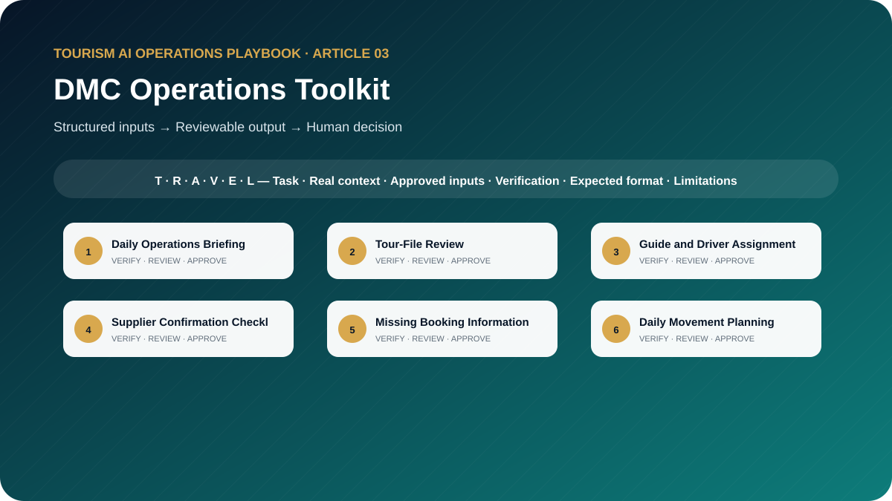

# The DMC Operations AI Toolkit: 10 Ready-to-Use Prompts for Daily Tour Operations

**Professional AI Templates for Dispatch, Guide Assignment, Supplier Coordination, Tour Monitoring, Delays, and Operational Reporting**



> **Edition:** 1.0.0  
> **Author:** Ahmed Mahmoud  
> **Prompt templates:** 10  
> **Primary audience:** DMC operations managers, coordinators, dispatchers and duty managers  
> **Web edition:** https://ahmedqualityops.com/dmc-operations-ai-prompts.html

**Direct answer**

## DMC Operations Toolkit: the professional principle

DMC operations teams can use AI to organise files, identify gaps and structure briefs, but confirmations, assignments and disruption decisions must stay in approved systems.

**Who this guide is for**

## Target audience

DMC operations managers, coordinators, dispatchers, reservations teams, duty managers, guide supervisors and transport controllers.

This is a working guide for people who already understand that tourism is delivered through connected handovers. The prompts are designed to improve preparation, consistency and visibility; they do not transfer authority from the trained employee to the AI system.

**Operational value**

## Why this topic matters in tourism

A DMC operations desk turns bookings into coordinated movements across people, vehicles, attractions, meals and suppliers. The work is time-sensitive and exception-heavy. AI can help organise information and expose gaps, but it cannot confirm a supplier, allocate an unavailable person or approve an operational risk.

The prompts follow the daily DMC control cycle: review the tour file, confirm resources, prepare the movement, monitor exceptions, hand over unresolved items and close the day with evidence. They use AI for structure and analysis while keeping the live operation in approved systems and human hands.

**The central control**

AI may organise information and propose a structure. It must not manufacture the confirmed operational reality. When the source of truth changes, the employee must update the inputs and verify the output again.

**Before copying a prompt**

## Responsible AI rules for this toolkit

- Use the booking system, supplier confirmations and duty log as the source of truth.
- Remove unnecessary guest personal data before using AI.
- Do not treat a generated assignment as a confirmed allocation.
- Show conflicts, missing data and assumptions in separate sections.
- Require duty-manager approval for decisions that change service, cost, safety or guest commitments.

Companies should adapt these rules to approved tools, information-security controls, local law, supplier contracts and internal authority. When the implications are legal, privacy-related or cybersecurity-related, qualified specialists should be consulted.

**Shared method**

## The TRAVEL prompting framework

Every template in this playbook follows one memorable structure. The aim is not to make prompts longer for their own sake. It is to place the information, controls and approval points that a tourism professional needs in the right order.

- **T — Task and tourism role**: state the professional perspective and the business decision to support.
- **R — Real operational context**: include the destination, service type, timing, guest journey stage and confirmed constraints.
- **A — Audience and approved inputs**: define the guest or client profile and provide only verified, permitted information.
- **V — Verifiable output rules**: require source labels, assumptions, uncertainty flags and a check against official or approved records.
- **E — Expected format and exceptions**: specify the exact structure, priority order, tone, length and escalation path.
- **L — Limitations, privacy and human sign-off**: prohibit invention, protect data and identify who approves the final output.

**In one sentence:** a professional tourism prompt identifies the task, supplies the real operating context, defines the audience and approved inputs, demands a verifiable structure, explains exceptions and keeps privacy plus final authority with a human.

**Copy-ready working library**

## Ten professional prompt templates

Each prompt contains editable placeholders and a built-in stop rule for missing information. Copy it, replace the placeholders with approved facts and keep the verification and human-approval sections intact. The templates are intentionally detailed because the omitted detail is often where a tourism failure begins.

**Prompt 01**

## Daily Operations Briefing

Create an exception-first briefing from confirmed movements and resource data.

### When to use it

Use it for a controlled draft before information reaches a guest, supplier, colleague or manager.

**Example:** A DMC has twelve movements, two language requests and one pending attraction slot.

### Required inputs

- date
- movements
- guest counts
- pickup windows
- guides
- drivers
- vehicles
- tickets
- suppliers
- alerts
- duty contacts

### Expected outputs

- priority overview
- movement table
- unresolved confirmations
- timing conflicts
- risk actions
- owner matrix

**Copy-and-Paste Template**

### Daily Operations Briefing

```
ROLE
Act as a DMC duty manager in a professional tourism organisation.

TASK
Create an exception-first briefing from confirmed movements and resource data.

CONTEXT
Destination/service: [Insert confirmed details]
Date, operating stage and guest/client profile: [Insert approved information]
Sources of truth: [List approved systems, confirmations, SOPs or official sources]

INPUTS
Provide: date; movements; guest counts; pickup windows; guides; drivers; vehicles; tickets; suppliers; alerts; duty contacts.
If an essential input is missing, contradictory or unconfirmed, stop and list what is required, its owner and source. Do not guess.

OUTPUT
Return: priority overview; movement table; unresolved confirmations; timing conflicts; risk actions; owner matrix. Separate confirmed facts, assumptions, recommendations and pending items. Label dynamic facts with their source and verification date when supplied.

LIMITS
Do not confirm resources or timings that are not marked confirmed.

PRIVACY AND APPROVAL
Exclude unnecessary personal data, identity or payment details, confidential rates, contracts and security information. Finish with verification actions, unresolved questions and the final approver’s role. The output remains a draft until that person checks it against approved sources.
```

**Professional tourism trainer’s note**

Replace every placeholder and keep unresolved items visible until an authorised professional reviews them.

**Prompt 02**

## Tour-File Review

Review a tour file for completeness, contradictions and delivery risk.

### When to use it

Use it for a controlled draft before information reaches a guest, supplier, colleague or manager.

**Example:** A multi-day group file is transferred from reservations to operations 72 hours before arrival.

### Required inputs

- booking extract
- itinerary
- vouchers
- pickup details
- guest needs
- tickets
- supplier confirmations
- commercial notes permitted
- SOP

### Expected outputs

- critical gaps
- inconsistencies
- guest-impact risks
- questions by owner
- release status

**Copy-and-Paste Template**

### Tour-File Review

```
ROLE
Act as a senior DMC operations auditor in a professional tourism organisation.

TASK
Review a tour file for completeness, contradictions and delivery risk.

CONTEXT
Destination/service: [Insert confirmed details]
Date, operating stage and guest/client profile: [Insert approved information]
Sources of truth: [List approved systems, confirmations, SOPs or official sources]

INPUTS
Provide: booking extract; itinerary; vouchers; pickup details; guest needs; tickets; supplier confirmations; commercial notes permitted; SOP.
If an essential input is missing, contradictory or unconfirmed, stop and list what is required, its owner and source. Do not guess.

OUTPUT
Return: critical gaps; inconsistencies; guest-impact risks; questions by owner; release status. Separate confirmed facts, assumptions, recommendations and pending items. Label dynamic facts with their source and verification date when supplied.

LIMITS
Do not expose payment data or infer missing services from package names.

PRIVACY AND APPROVAL
Exclude unnecessary personal data, identity or payment details, confidential rates, contracts and security information. Finish with verification actions, unresolved questions and the final approver’s role. The output remains a draft until that person checks it against approved sources.
```

**Professional tourism trainer’s note**

Replace every placeholder and keep unresolved items visible until an authorised professional reviews them.

**Prompt 03**

## Guide and Driver Assignment

Produce a ranked assignment recommendation based on confirmed capability and constraints.

### When to use it

Use it for a controlled draft before information reaches a guest, supplier, colleague or manager.

**Example:** A French guide is needed on Yas Island while another operation requires off-road competence.

### Required inputs

- operations list
- available staff
- language
- licences
- product competence
- location
- working hours
- vehicle class
- conflicts
- priorities

### Expected outputs

- constraint check
- ranked options
- conflicts
- rationale
- unassigned operations
- approval table

**Copy-and-Paste Template**

### Guide and Driver Assignment

```
ROLE
Act as a DMC assignment controller in a professional tourism organisation.

TASK
Produce a ranked assignment recommendation based on confirmed capability and constraints.

CONTEXT
Destination/service: [Insert confirmed details]
Date, operating stage and guest/client profile: [Insert approved information]
Sources of truth: [List approved systems, confirmations, SOPs or official sources]

INPUTS
Provide: operations list; available staff; language; licences; product competence; location; working hours; vehicle class; conflicts; priorities.
If an essential input is missing, contradictory or unconfirmed, stop and list what is required, its owner and source. Do not guess.

OUTPUT
Return: constraint check; ranked options; conflicts; rationale; unassigned operations; approval table. Separate confirmed facts, assumptions, recommendations and pending items. Label dynamic facts with their source and verification date when supplied.

LIMITS
A recommendation is not a confirmed assignment. Never override legal hours, licences or availability.

PRIVACY AND APPROVAL
Exclude unnecessary personal data, identity or payment details, confidential rates, contracts and security information. Finish with verification actions, unresolved questions and the final approver’s role. The output remains a draft until that person checks it against approved sources.
```

**Professional tourism trainer’s note**

Replace every placeholder and keep unresolved items visible until an authorised professional reviews them.

**Prompt 04**

## Supplier Confirmation Checklist

Build a service-specific confirmation checklist and follow-up tracker.

### When to use it

Use it for a controlled draft before information reaches a guest, supplier, colleague or manager.

**Example:** Operations needs final confirmation from a restaurant and attraction for a 40-person group.

### Required inputs

- service type
- booking details
- supplier
- contracted inclusions
- service date
- contact channel
- cut-off
- special requirements

### Expected outputs

- confirmation message
- checklist
- pending items
- deadline
- escalation trigger
- evidence field

**Copy-and-Paste Template**

### Supplier Confirmation Checklist

```
ROLE
Act as a supplier coordination supervisor in a professional tourism organisation.

TASK
Build a service-specific confirmation checklist and follow-up tracker.

CONTEXT
Destination/service: [Insert confirmed details]
Date, operating stage and guest/client profile: [Insert approved information]
Sources of truth: [List approved systems, confirmations, SOPs or official sources]

INPUTS
Provide: service type; booking details; supplier; contracted inclusions; service date; contact channel; cut-off; special requirements.
If an essential input is missing, contradictory or unconfirmed, stop and list what is required, its owner and source. Do not guess.

OUTPUT
Return: confirmation message; checklist; pending items; deadline; escalation trigger; evidence field. Separate confirmed facts, assumptions, recommendations and pending items. Label dynamic facts with their source and verification date when supplied.

LIMITS
Do not insert rates or terms that were not supplied and authorised.

PRIVACY AND APPROVAL
Exclude unnecessary personal data, identity or payment details, confidential rates, contracts and security information. Finish with verification actions, unresolved questions and the final approver’s role. The output remains a draft until that person checks it against approved sources.
```

**Professional tourism trainer’s note**

Replace every placeholder and keep unresolved items visible until an authorised professional reviews them.

**Prompt 05**

## Missing Booking Information Detection

Detect missing booking information before operational release.

### When to use it

Use it for a controlled draft before information reaches a guest, supplier, colleague or manager.

**Example:** A private transfer file has flight number but no terminal, contact method or child-seat confirmation.

### Required inputs

- tour file
- mandatory-field standard
- itinerary
- guest requirements
- supplier status
- internal notes

### Expected outputs

- stop-release items
- high-priority gaps
- lower-priority questions
- owner
- required-by time

**Copy-and-Paste Template**

### Missing Booking Information Detection

```
ROLE
Act as a DMC reservations-to-operations controller in a professional tourism organisation.

TASK
Detect missing booking information before operational release.

CONTEXT
Destination/service: [Insert confirmed details]
Date, operating stage and guest/client profile: [Insert approved information]
Sources of truth: [List approved systems, confirmations, SOPs or official sources]

INPUTS
Provide: tour file; mandatory-field standard; itinerary; guest requirements; supplier status; internal notes.
If an essential input is missing, contradictory or unconfirmed, stop and list what is required, its owner and source. Do not guess.

OUTPUT
Return: stop-release items; high-priority gaps; lower-priority questions; owner; required-by time. Separate confirmed facts, assumptions, recommendations and pending items. Label dynamic facts with their source and verification date when supplied.

LIMITS
Do not fill gaps with typical values or past booking patterns.

PRIVACY AND APPROVAL
Exclude unnecessary personal data, identity or payment details, confidential rates, contracts and security information. Finish with verification actions, unresolved questions and the final approver’s role. The output remains a draft until that person checks it against approved sources.
```

**Professional tourism trainer’s note**

Replace every placeholder and keep unresolved items visible until an authorised professional reviews them.

**Prompt 06**

## Daily Movement Planning

Turn confirmed services into a coordinated movement plan with handovers and buffers.

### When to use it

Use it for a controlled draft before information reaches a guest, supplier, colleague or manager.

**Example:** An incentive group splits into two activities and reunites for dinner.

### Required inputs

- service list
- locations
- confirmed times
- pickup windows
- resources
- tickets
- meal slots
- access rules
- buffers
- constraints

### Expected outputs

- chronological movement board
- resource view
- handovers
- critical path
- contingency notes
- approval fields

**Copy-and-Paste Template**

### Daily Movement Planning

```
ROLE
Act as a destination operations planner in a professional tourism organisation.

TASK
Turn confirmed services into a coordinated movement plan with handovers and buffers.

CONTEXT
Destination/service: [Insert confirmed details]
Date, operating stage and guest/client profile: [Insert approved information]
Sources of truth: [List approved systems, confirmations, SOPs or official sources]

INPUTS
Provide: service list; locations; confirmed times; pickup windows; resources; tickets; meal slots; access rules; buffers; constraints.
If an essential input is missing, contradictory or unconfirmed, stop and list what is required, its owner and source. Do not guess.

OUTPUT
Return: chronological movement board; resource view; handovers; critical path; contingency notes; approval fields. Separate confirmed facts, assumptions, recommendations and pending items. Label dynamic facts with their source and verification date when supplied.

LIMITS
Travel times and access must be supplied or marked for external verification.

PRIVACY AND APPROVAL
Exclude unnecessary personal data, identity or payment details, confidential rates, contracts and security information. Finish with verification actions, unresolved questions and the final approver’s role. The output remains a draft until that person checks it against approved sources.
```

**Professional tourism trainer’s note**

Replace every placeholder and keep unresolved items visible until an authorised professional reviews them.

**Prompt 07**

## Operational Risk Assessment

Assess a day of operations using likelihood, impact, detectability and control readiness.

### When to use it

Use it for a controlled draft before information reaches a guest, supplier, colleague or manager.

**Example:** A desert operation faces high temperature, a late flight and limited backup vehicles.

### Required inputs

- movement plan
- guest profile
- weather and event alerts
- suppliers
- resources
- known issues
- contingency
- escalation

### Expected outputs

- risk register
- top risks
- preventive controls
- trigger points
- owners
- residual risk

**Copy-and-Paste Template**

### Operational Risk Assessment

```
ROLE
Act as a tourism operations risk facilitator in a professional tourism organisation.

TASK
Assess a day of operations using likelihood, impact, detectability and control readiness.

CONTEXT
Destination/service: [Insert confirmed details]
Date, operating stage and guest/client profile: [Insert approved information]
Sources of truth: [List approved systems, confirmations, SOPs or official sources]

INPUTS
Provide: movement plan; guest profile; weather and event alerts; suppliers; resources; known issues; contingency; escalation.
If an essential input is missing, contradictory or unconfirmed, stop and list what is required, its owner and source. Do not guess.

OUTPUT
Return: risk register; top risks; preventive controls; trigger points; owners; residual risk. Separate confirmed facts, assumptions, recommendations and pending items. Label dynamic facts with their source and verification date when supplied.

LIMITS
Do not down-score a risk because a control is only planned rather than confirmed.

PRIVACY AND APPROVAL
Exclude unnecessary personal data, identity or payment details, confidential rates, contracts and security information. Finish with verification actions, unresolved questions and the final approver’s role. The output remains a draft until that person checks it against approved sources.
```

**Professional tourism trainer’s note**

Replace every placeholder and keep unresolved items visible until an authorised professional reviews them.

**Prompt 08**

## Disruption Response Planning

Prepare response options for a confirmed disruption without making unauthorised commitments.

### When to use it

Use it for a controlled draft before information reaches a guest, supplier, colleague or manager.

**Example:** An attraction closes unexpectedly while three groups are already in transfer.

### Required inputs

- incident facts
- affected services
- guests
- time pressure
- available resources
- supplier response
- policy
- authority
- communication channels

### Expected outputs

- stabilisation steps
- option comparison
- decision deadline
- communications
- escalation
- documentation

**Copy-and-Paste Template**

### Disruption Response Planning

```
ROLE
Act as a DMC incident coordination adviser in a professional tourism organisation.

TASK
Prepare response options for a confirmed disruption without making unauthorised commitments.

CONTEXT
Destination/service: [Insert confirmed details]
Date, operating stage and guest/client profile: [Insert approved information]
Sources of truth: [List approved systems, confirmations, SOPs or official sources]

INPUTS
Provide: incident facts; affected services; guests; time pressure; available resources; supplier response; policy; authority; communication channels.
If an essential input is missing, contradictory or unconfirmed, stop and list what is required, its owner and source. Do not guess.

OUTPUT
Return: stabilisation steps; option comparison; decision deadline; communications; escalation; documentation. Separate confirmed facts, assumptions, recommendations and pending items. Label dynamic facts with their source and verification date when supplied.

LIMITS
Separate confirmed, likely and unknown information. Flag cost and service changes for approval.

PRIVACY AND APPROVAL
Exclude unnecessary personal data, identity or payment details, confidential rates, contracts and security information. Finish with verification actions, unresolved questions and the final approver’s role. The output remains a draft until that person checks it against approved sources.
```

**Professional tourism trainer’s note**

Replace every placeholder and keep unresolved items visible until an authorised professional reviews them.

**Prompt 09**

## Shift Handover

Convert open operational notes into a clear handover for the next shift.

### When to use it

Use it for a controlled draft before information reaches a guest, supplier, colleague or manager.

**Example:** The evening shift hands over two delayed bags, a pending driver and tomorrow’s early VIP arrival.

### Required inputs

- open issues
- current status
- last action
- next action
- owner
- deadline
- guest impact
- supplier contact
- evidence location

### Expected outputs

- red-amber-green summary
- item cards
- deadlines
- escalation watch
- completed items excluded

**Copy-and-Paste Template**

### Shift Handover

```
ROLE
Act as a DMC control-room supervisor in a professional tourism organisation.

TASK
Convert open operational notes into a clear handover for the next shift.

CONTEXT
Destination/service: [Insert confirmed details]
Date, operating stage and guest/client profile: [Insert approved information]
Sources of truth: [List approved systems, confirmations, SOPs or official sources]

INPUTS
Provide: open issues; current status; last action; next action; owner; deadline; guest impact; supplier contact; evidence location.
If an essential input is missing, contradictory or unconfirmed, stop and list what is required, its owner and source. Do not guess.

OUTPUT
Return: red-amber-green summary; item cards; deadlines; escalation watch; completed items excluded. Separate confirmed facts, assumptions, recommendations and pending items. Label dynamic facts with their source and verification date when supplied.

LIMITS
Do not close or downgrade an item without evidence.

PRIVACY AND APPROVAL
Exclude unnecessary personal data, identity or payment details, confidential rates, contracts and security information. Finish with verification actions, unresolved questions and the final approver’s role. The output remains a draft until that person checks it against approved sources.
```

**Professional tourism trainer’s note**

Replace every placeholder and keep unresolved items visible until an authorised professional reviews them.

**Prompt 10**

## End-of-Day Operations Reporting

Prepare a factual daily report that supports management review and improvement.

### When to use it

Use it for a controlled draft before information reaches a guest, supplier, colleague or manager.

**Example:** Management needs a concise report after 28 movements and three recovered exceptions.

### Required inputs

- planned movements
- completed movements
- timing data
- incidents
- recoveries
- complaints
- supplier issues
- costs authorised
- open actions

### Expected outputs

- headline performance
- variances
- incident summaries
- root-cause hypotheses labelled
- actions
- next-day watchlist

**Copy-and-Paste Template**

### End-of-Day Operations Reporting

```
ROLE
Act as a DMC operations performance analyst in a professional tourism organisation.

TASK
Prepare a factual daily report that supports management review and improvement.

CONTEXT
Destination/service: [Insert confirmed details]
Date, operating stage and guest/client profile: [Insert approved information]
Sources of truth: [List approved systems, confirmations, SOPs or official sources]

INPUTS
Provide: planned movements; completed movements; timing data; incidents; recoveries; complaints; supplier issues; costs authorised; open actions.
If an essential input is missing, contradictory or unconfirmed, stop and list what is required, its owner and source. Do not guess.

OUTPUT
Return: headline performance; variances; incident summaries; root-cause hypotheses labelled; actions; next-day watchlist. Separate confirmed facts, assumptions, recommendations and pending items. Label dynamic facts with their source and verification date when supplied.

LIMITS
Do not attribute cause without evidence or identify guests unnecessarily.

PRIVACY AND APPROVAL
Exclude unnecessary personal data, identity or payment details, confidential rates, contracts and security information. Finish with verification actions, unresolved questions and the final approver’s role. The output remains a draft until that person checks it against approved sources.
```

**Professional tourism trainer’s note**

Replace every placeholder and keep unresolved items visible until an authorised professional reviews them.

**Quality control**

## Common mistakes to avoid

1. **Mistake 1:** Pasting an entire booking export with personal information.
2. **Mistake 2:** Allowing AI to guess pickup times or vehicle availability.
3. **Mistake 3:** Creating a polished briefing that hides unresolved items.
4. **Mistake 4:** Ignoring language, licence, capacity or location constraints in assignments.
5. **Mistake 5:** Closing an incident without recording ownership and next action.

A useful internal review question is: “Could a new employee read this output and mistake a proposal for a confirmation?” If the answer is yes, revise the prompt and output labels before use.

**From template to controlled workflow**

## Implementation guidance for tourism teams

Pilot the prompts on completed operations before using them on a live day. Compare the AI output with the actual operation log, identify what the prompt missed and add local rules. Once approved, connect each prompt to a clear operating stage and a named reviewer.

1**Select**

Choose a low-risk, frequent task with a clear owner and source of truth.

2**Test**

Run realistic anonymised cases, including missing data and operational exceptions.

3**Approve**

Document the prompt version, permitted users, tool, reviewer and release criteria.

4**Measure**

Track quality, time saved, defects, escalations and employee feedback.

5**Improve**

Update the prompt when the process, destination, supplier or risk changes.

**Professional release gate**

## Final verification checklist

The task and intended business decision are clear. Required information came from approved sources. Dynamic facts have a source and verification date. Missing information is visible and assigned to an owner. Personal and confidential data were minimised. The output respects role and commercial authority. Safety, accessibility and cultural considerations were checked. Assumptions are separated from confirmed facts. The relevant tourism professional reviewed the output. The final approval and version are recorded.

**Conclusion**

## Use AI to strengthen tourism judgement, not to bypass it

The best result is not the longest response or the most impressive wording. It is an output that helps a trained tourism professional see the situation clearly, find missing information early, communicate consistently and make a controlled decision. Keep the TRAVEL framework, verification table, privacy boundaries and human sign-off visible every time the prompt is adapted.

**Frequently asked questions**

## Questions tourism teams ask

Can AI dispatch tours automatically?

Not safely on prompt output alone. It can structure options and flag conflicts, while confirmed availability, licences, capacities and changes remain under operational control.

What data should a DMC remove?

Remove information that is not necessary for the task, including passport numbers, payment details, private contacts and sensitive guest notes.

How can AI help a shift handover?

It can convert structured notes into a priority-based handover that identifies owner, deadline, risk, current status and the next required action.

Should supplier confirmations be entered?

Only the minimum approved operational details and only in a company-approved tool. Confidential rates or contract terms should be excluded unless authorised.

What is the main human approval point?

The duty manager or authorised coordinator must approve any allocation, timing, supplier, service or recovery decision before action.

**Continue the knowledge path**

## Related reading and connected projects

[Article 02**Front-Line Toolkit**

Ten detailed AI prompt templates for tour preparation, storytelling, multilingual communication, delays, complaints, role-play and post-tour reporting.](./02-front-line-tourism-ai-toolkit.md)[Article 04**Transport & Dispatch Toolkit**

Ten detailed prompts for hotel pickup sequencing, zone planning, vehicle checks, driver briefings, late vehicles, drop-offs and fleet reporting.](./04-tourism-transport-dispatch-ai-toolkit.md)[Article 09**Quality & SOP Toolkit**

Ten tourism-specific AI prompts for SOPs, process maps, Five Whys, fishbone analysis, incidents, CAPA, audits, training and quality reporting.](./09-tourism-quality-sop-ai-toolkit.md)[Article 10**Responsible AI Guide**

A practical tourism governance guide with ten templates for risk, verification, privacy, cultural sensitivity, approvals, policies and AI reviews.](./10-responsible-ai-for-tourism.md)[Existing insight or project**Article Assignment Engine Dmc Operations**

Review the capability and constraint logic behind assignments.](https://ahmedqualityops.com/article-assignment-engine-dmc-operations.html)[Existing insight or project**Article Fleet Control Tower Operations Dashboard**

See the operational signals required for fleet control.](https://ahmedqualityops.com/article-fleet-control-tower-operations-dashboard.html)[Existing insight or project**Index**

Explore a practical pickup and dispatch planning concept.](https://ahmedqualityops.com/infradispatch/index.html)

[Series hub**Tourism AI Operations Playbook**](../README.md)

[Previous article**← Front-Line Toolkit**](./02-front-line-tourism-ai-toolkit.md)[Next article**Transport & Dispatch Toolkit →**](./04-tourism-transport-dispatch-ai-toolkit.md)

**Professional verification reminder:** Always compare AI output with approved internal systems, official sources and qualified human judgement before it affects a guest, supplier, employee or commercial commitment.
