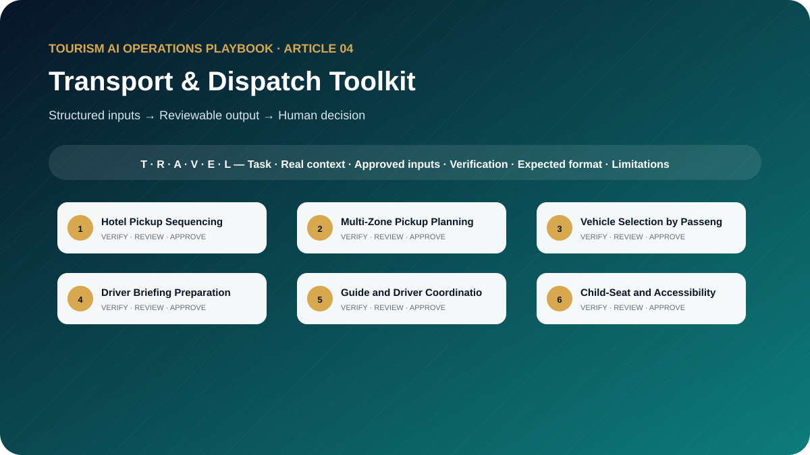

# The Tourism Transport and Dispatch AI Toolkit: 10 Prompts for Smarter Pickup, Routing, and Fleet Coordination

**Ready-to-Use AI Templates for Hotel Pickup Planning, Vehicle Allocation, Driver Briefings, Route Risks, and Transport Reporting**



> **Edition:** 1.0.0  
> **Author:** Ahmed Mahmoud  
> **Prompt templates:** 10  
> **Primary audience:** Transport coordinators, dispatchers, fleet supervisors, drivers and guides  
> **Web edition:** https://ahmedqualityops.com/tourism-transport-dispatch-ai-prompts.html

**Direct answer**

## Transport & Dispatch Toolkit: the professional principle

AI can support pickup and fleet planning by testing supplied constraints; dispatchers must still verify routes, capacity, access, availability and live conditions.

**Who this guide is for**

## Target audience

Transport coordinators, dispatchers, fleet supervisors, DMC operations teams, guides, driver coordinators and tour-operation managers.

This is a working guide for people who already understand that tourism is delivered through connected handovers. The prompts are designed to improve preparation, consistency and visibility; they do not transfer authority from the trained employee to the AI system.

**Operational value**

## Why this topic matters in tourism

Tourism transport is more than drawing the shortest route. A workable plan must consider pickup windows, hotel access, guest count, luggage, vehicle capacity, child seats, accessibility, driver hours, attraction slots, separate drop-offs and live road conditions. AI can organise the planning logic but cannot replace verified routing or dispatch authority.

These prompts mirror the questions a transport controller asks before releasing a movement. They are designed to complement structured tools such as InfraDispatch, not to advertise or replace them. The output should become a reviewable planning draft, driver briefing or exception report.

**The central control**

AI may organise information and propose a structure. It must not manufacture the confirmed operational reality. When the source of truth changes, the employee must update the inputs and verify the output again.

**Before copying a prompt**

## Responsible AI rules for this toolkit

- Use confirmed hotel locations and approved geocodes.
- Verify live routes, access restrictions and travel times with approved mapping and operational sources.
- Never exceed licensed passenger capacity or ignore luggage, mobility or child-seat requirements.
- Do not expose guest contact details in an unapproved prompt.
- Require dispatcher approval before a route or vehicle plan is issued.

Companies should adapt these rules to approved tools, information-security controls, local law, supplier contracts and internal authority. When the implications are legal, privacy-related or cybersecurity-related, qualified specialists should be consulted.

**Shared method**

## The TRAVEL prompting framework

Every template in this playbook follows one memorable structure. The aim is not to make prompts longer for their own sake. It is to place the information, controls and approval points that a tourism professional needs in the right order.

- **T — Task and tourism role**: state the professional perspective and the business decision to support.
- **R — Real operational context**: include the destination, service type, timing, guest journey stage and confirmed constraints.
- **A — Audience and approved inputs**: define the guest or client profile and provide only verified, permitted information.
- **V — Verifiable output rules**: require source labels, assumptions, uncertainty flags and a check against official or approved records.
- **E — Expected format and exceptions**: specify the exact structure, priority order, tone, length and escalation path.
- **L — Limitations, privacy and human sign-off**: prohibit invention, protect data and identify who approves the final output.

**In one sentence:** a professional tourism prompt identifies the task, supplies the real operating context, defines the audience and approved inputs, demands a verifiable structure, explains exceptions and keeps privacy plus final authority with a human.

**Copy-ready working library**

## Ten professional prompt templates

Each prompt contains editable placeholders and a built-in stop rule for missing information. Copy it, replace the placeholders with approved facts and keep the verification and human-approval sections intact. The templates are intentionally detailed because the omitted detail is often where a tourism failure begins.

**Prompt 01**

## Hotel Pickup Sequencing

Propose a pickup sequence that protects the confirmed arrival commitment.

### When to use it

Use it for a controlled draft before information reaches a guest, supplier, colleague or manager.

**Example:** Eight hotels must feed one city tour with a fixed attraction slot.

### Required inputs

- hotels with verified coordinates
- pickup window
- guest count
- loading time
- attraction arrival
- route evidence
- vehicle
- access notes

### Expected outputs

- sequence table
- reason
- pickup times as proposals
- total buffer
- risk flags
- verification list

**Copy-and-Paste Template**

### Hotel Pickup Sequencing

```
ROLE
Act as a tourism transport planner in a professional tourism organisation.

TASK
Propose a pickup sequence that protects the confirmed arrival commitment.

CONTEXT
Destination/service: [Insert confirmed details]
Date, operating stage and guest/client profile: [Insert approved information]
Sources of truth: [List approved systems, confirmations, SOPs or official sources]

INPUTS
Provide: hotels with verified coordinates; pickup window; guest count; loading time; attraction arrival; route evidence; vehicle; access notes.
If an essential input is missing, contradictory or unconfirmed, stop and list what is required, its owner and source. Do not guess.

OUTPUT
Return: sequence table; reason; pickup times as proposals; total buffer; risk flags; verification list. Separate confirmed facts, assumptions, recommendations and pending items. Label dynamic facts with their source and verification date when supplied.

LIMITS
Do not invent locations or live traffic. Mark all times as draft until dispatcher verification.

PRIVACY AND APPROVAL
Exclude unnecessary personal data, identity or payment details, confidential rates, contracts and security information. Finish with verification actions, unresolved questions and the final approver’s role. The output remains a draft until that person checks it against approved sources.
```

**Professional tourism trainer’s note**

Replace every placeholder and keep unresolved items visible until an authorised professional reviews them.

**Prompt 02**

## Multi-Zone Pickup Planning

Decide whether a movement should remain combined or split by operating zone.

### When to use it

Use it for a controlled draft before information reaches a guest, supplier, colleague or manager.

**Example:** Bookings span Abu Dhabi city, Yas Island and Saadiyat with a 60-minute pickup window.

### Required inputs

- zone map
- hotels
- guests
- service window
- vehicle options
- route evidence
- maximum zones
- split rules
- cost authority

### Expected outputs

- combined plan
- split alternatives
- comparison
- critical constraint
- recommended draft
- approval point

**Copy-and-Paste Template**

### Multi-Zone Pickup Planning

```
ROLE
Act as a DMC dispatch controller in a professional tourism organisation.

TASK
Decide whether a movement should remain combined or split by operating zone.

CONTEXT
Destination/service: [Insert confirmed details]
Date, operating stage and guest/client profile: [Insert approved information]
Sources of truth: [List approved systems, confirmations, SOPs or official sources]

INPUTS
Provide: zone map; hotels; guests; service window; vehicle options; route evidence; maximum zones; split rules; cost authority.
If an essential input is missing, contradictory or unconfirmed, stop and list what is required, its owner and source. Do not guess.

OUTPUT
Return: combined plan; split alternatives; comparison; critical constraint; recommended draft; approval point. Separate confirmed facts, assumptions, recommendations and pending items. Label dynamic facts with their source and verification date when supplied.

LIMITS
Do not optimise cost by violating pickup windows, capacity or guest-service standards.

PRIVACY AND APPROVAL
Exclude unnecessary personal data, identity or payment details, confidential rates, contracts and security information. Finish with verification actions, unresolved questions and the final approver’s role. The output remains a draft until that person checks it against approved sources.
```

**Professional tourism trainer’s note**

Replace every placeholder and keep unresolved items visible until an authorised professional reviews them.

**Prompt 03**

## Vehicle Selection by Passenger Capacity

Shortlist compliant vehicle categories for a confirmed movement.

### When to use it

Use it for a controlled draft before information reaches a guest, supplier, colleague or manager.

**Example:** A private airport transfer has six guests, nine bags, one infant and a guide.

### Required inputs

- passengers
- infants
- child seats
- luggage
- wheelchairs
- equipment
- guide seat
- vehicle capacities
- road and access rules

### Expected outputs

- capacity calculation
- suitable categories
- excluded categories
- required equipment
- confirmation checklist

**Copy-and-Paste Template**

### Vehicle Selection by Passenger Capacity

```
ROLE
Act as a fleet allocation specialist in a professional tourism organisation.

TASK
Shortlist compliant vehicle categories for a confirmed movement.

CONTEXT
Destination/service: [Insert confirmed details]
Date, operating stage and guest/client profile: [Insert approved information]
Sources of truth: [List approved systems, confirmations, SOPs or official sources]

INPUTS
Provide: passengers; infants; child seats; luggage; wheelchairs; equipment; guide seat; vehicle capacities; road and access rules.
If an essential input is missing, contradictory or unconfirmed, stop and list what is required, its owner and source. Do not guess.

OUTPUT
Return: capacity calculation; suitable categories; excluded categories; required equipment; confirmation checklist. Separate confirmed facts, assumptions, recommendations and pending items. Label dynamic facts with their source and verification date when supplied.

LIMITS
Never exceed approved capacity or assume a foldable mobility device fits.

PRIVACY AND APPROVAL
Exclude unnecessary personal data, identity or payment details, confidential rates, contracts and security information. Finish with verification actions, unresolved questions and the final approver’s role. The output remains a draft until that person checks it against approved sources.
```

**Professional tourism trainer’s note**

Replace every placeholder and keep unresolved items visible until an authorised professional reviews them.

**Prompt 04**

## Driver Briefing Preparation

Prepare a concise driver briefing from confirmed movement data.

### When to use it

Use it for a controlled draft before information reaches a guest, supplier, colleague or manager.

**Example:** A driver handles hotel pickups, a mosque stop and a separate airport drop-off.

### Required inputs

- driver
- vehicle
- date
- pickups
- contacts through approved channel
- route
- parking
- guest count
- special needs
- guide
- escalation

### Expected outputs

- one-page briefing
- movement timeline
- location notes
- must-confirm list
- exception procedure

**Copy-and-Paste Template**

### Driver Briefing Preparation

```
ROLE
Act as a tourism dispatch supervisor in a professional tourism organisation.

TASK
Prepare a concise driver briefing from confirmed movement data.

CONTEXT
Destination/service: [Insert confirmed details]
Date, operating stage and guest/client profile: [Insert approved information]
Sources of truth: [List approved systems, confirmations, SOPs or official sources]

INPUTS
Provide: driver; vehicle; date; pickups; contacts through approved channel; route; parking; guest count; special needs; guide; escalation.
If an essential input is missing, contradictory or unconfirmed, stop and list what is required, its owner and source. Do not guess.

OUTPUT
Return: one-page briefing; movement timeline; location notes; must-confirm list; exception procedure. Separate confirmed facts, assumptions, recommendations and pending items. Label dynamic facts with their source and verification date when supplied.

LIMITS
Exclude unnecessary guest personal data and do not include unverified route instructions.

PRIVACY AND APPROVAL
Exclude unnecessary personal data, identity or payment details, confidential rates, contracts and security information. Finish with verification actions, unresolved questions and the final approver’s role. The output remains a draft until that person checks it against approved sources.
```

**Professional tourism trainer’s note**

Replace every placeholder and keep unresolved items visible until an authorised professional reviews them.

**Prompt 05**

## Guide and Driver Coordination

Define the handovers and communication points between guide and driver.

### When to use it

Use it for a controlled draft before information reaches a guest, supplier, colleague or manager.

**Example:** A large coach tour requires remote parking and timed guide-driver reconnection.

### Required inputs

- movement plan
- guide
- driver
- vehicle
- pickup roles
- parking rules
- guest count
- attraction process
- communication channel

### Expected outputs

- pre-service check
- meeting points
- communication timeline
- responsibility matrix
- lost-contact protocol

**Copy-and-Paste Template**

### Guide and Driver Coordination

```
ROLE
Act as a tour movement coordinator in a professional tourism organisation.

TASK
Define the handovers and communication points between guide and driver.

CONTEXT
Destination/service: [Insert confirmed details]
Date, operating stage and guest/client profile: [Insert approved information]
Sources of truth: [List approved systems, confirmations, SOPs or official sources]

INPUTS
Provide: movement plan; guide; driver; vehicle; pickup roles; parking rules; guest count; attraction process; communication channel.
If an essential input is missing, contradictory or unconfirmed, stop and list what is required, its owner and source. Do not guess.

OUTPUT
Return: pre-service check; meeting points; communication timeline; responsibility matrix; lost-contact protocol. Separate confirmed facts, assumptions, recommendations and pending items. Label dynamic facts with their source and verification date when supplied.

LIMITS
Do not assign tasks that conflict with licence, safety or company role definitions.

PRIVACY AND APPROVAL
Exclude unnecessary personal data, identity or payment details, confidential rates, contracts and security information. Finish with verification actions, unresolved questions and the final approver’s role. The output remains a draft until that person checks it against approved sources.
```

**Professional tourism trainer’s note**

Replace every placeholder and keep unresolved items visible until an authorised professional reviews them.

**Prompt 06**

## Child-Seat and Accessibility Checks

Build a mandatory readiness check for child restraints and mobility needs.

### When to use it

Use it for a controlled draft before information reaches a guest, supplier, colleague or manager.

**Example:** A family and a wheelchair user are booked on the same private vehicle.

### Required inputs

- guest requirements confirmed
- ages or restraint category
- wheelchair dimensions
- transfer ability
- assistance
- vehicle
- supplier confirmation
- policy

### Expected outputs

- requirement summary
- confirmation questions
- fit check
- loading plan
- unresolved safety items
- no-go conditions

**Copy-and-Paste Template**

### Child-Seat and Accessibility Checks

```
ROLE
Act as a accessible transport coordinator in a professional tourism organisation.

TASK
Build a mandatory readiness check for child restraints and mobility needs.

CONTEXT
Destination/service: [Insert confirmed details]
Date, operating stage and guest/client profile: [Insert approved information]
Sources of truth: [List approved systems, confirmations, SOPs or official sources]

INPUTS
Provide: guest requirements confirmed; ages or restraint category; wheelchair dimensions; transfer ability; assistance; vehicle; supplier confirmation; policy.
If an essential input is missing, contradictory or unconfirmed, stop and list what is required, its owner and source. Do not guess.

OUTPUT
Return: requirement summary; confirmation questions; fit check; loading plan; unresolved safety items; no-go conditions. Separate confirmed facts, assumptions, recommendations and pending items. Label dynamic facts with their source and verification date when supplied.

LIMITS
Never infer requirements from appearance or age alone; obtain direct and approved confirmation.

PRIVACY AND APPROVAL
Exclude unnecessary personal data, identity or payment details, confidential rates, contracts and security information. Finish with verification actions, unresolved questions and the final approver’s role. The output remains a draft until that person checks it against approved sources.
```

**Professional tourism trainer’s note**

Replace every placeholder and keep unresolved items visible until an authorised professional reviews them.

**Prompt 07**

## Late-Vehicle Response

Prepare a timed response plan for a late or uncontactable vehicle.

### When to use it

Use it for a controlled draft before information reaches a guest, supplier, colleague or manager.

**Example:** A vehicle is absent ten minutes before pickup for an airport departure.

### Required inputs

- planned time
- current time
- driver status
- location evidence
- guests
- service deadline
- backups
- contact channels
- authority

### Expected outputs

- first five minutes
- next update
- backup trigger
- guest message
- supplier escalation
- incident log

**Copy-and-Paste Template**

### Late-Vehicle Response

```
ROLE
Act as a transport duty controller in a professional tourism organisation.

TASK
Prepare a timed response plan for a late or uncontactable vehicle.

CONTEXT
Destination/service: [Insert confirmed details]
Date, operating stage and guest/client profile: [Insert approved information]
Sources of truth: [List approved systems, confirmations, SOPs or official sources]

INPUTS
Provide: planned time; current time; driver status; location evidence; guests; service deadline; backups; contact channels; authority.
If an essential input is missing, contradictory or unconfirmed, stop and list what is required, its owner and source. Do not guess.

OUTPUT
Return: first five minutes; next update; backup trigger; guest message; supplier escalation; incident log. Separate confirmed facts, assumptions, recommendations and pending items. Label dynamic facts with their source and verification date when supplied.

LIMITS
Do not report a new ETA without evidence or promise compensation.

PRIVACY AND APPROVAL
Exclude unnecessary personal data, identity or payment details, confidential rates, contracts and security information. Finish with verification actions, unresolved questions and the final approver’s role. The output remains a draft until that person checks it against approved sources.
```

**Professional tourism trainer’s note**

Replace every placeholder and keep unresolved items visible until an authorised professional reviews them.

**Prompt 08**

## Route-Risk Analysis

Challenge a planned route for access, timing and operational failure points.

### When to use it

Use it for a controlled draft before information reaches a guest, supplier, colleague or manager.

**Example:** A coach route crosses an event zone and includes a hotel with restricted bus access.

### Required inputs

- route stops
- vehicle class
- verified travel times
- closures
- event restrictions
- parking
- turning
- loading
- weather
- backup routes

### Expected outputs

- risk-by-leg table
- critical bottlenecks
- verification calls
- backup logic
- dispatcher decision

**Copy-and-Paste Template**

### Route-Risk Analysis

```
ROLE
Act as a tourism route-risk reviewer in a professional tourism organisation.

TASK
Challenge a planned route for access, timing and operational failure points.

CONTEXT
Destination/service: [Insert confirmed details]
Date, operating stage and guest/client profile: [Insert approved information]
Sources of truth: [List approved systems, confirmations, SOPs or official sources]

INPUTS
Provide: route stops; vehicle class; verified travel times; closures; event restrictions; parking; turning; loading; weather; backup routes.
If an essential input is missing, contradictory or unconfirmed, stop and list what is required, its owner and source. Do not guess.

OUTPUT
Return: risk-by-leg table; critical bottlenecks; verification calls; backup logic; dispatcher decision. Separate confirmed facts, assumptions, recommendations and pending items. Label dynamic facts with their source and verification date when supplied.

LIMITS
Use current approved road information; do not claim live conditions from general knowledge.

PRIVACY AND APPROVAL
Exclude unnecessary personal data, identity or payment details, confidential rates, contracts and security information. Finish with verification actions, unresolved questions and the final approver’s role. The output remains a draft until that person checks it against approved sources.
```

**Professional tourism trainer’s note**

Replace every placeholder and keep unresolved items visible until an authorised professional reviews them.

**Prompt 09**

## Separate Drop-Off Planning

Design a controlled multi-drop return plan after a shared tour.

### When to use it

Use it for a controlled draft before information reaches a guest, supplier, colleague or manager.

**Example:** A shared evening tour ends with city hotels, Yas hotels and an airport passenger.

### Required inputs

- drop-off locations
- guest groups anonymised
- time constraints
- route evidence
- guide position
- vehicle hours
- safety rules
- luggage

### Expected outputs

- drop order
- estimated draft windows
- handover points
- guest communication
- exceptions
- final confirmation list

**Copy-and-Paste Template**

### Separate Drop-Off Planning

```
ROLE
Act as a guest movement planner in a professional tourism organisation.

TASK
Design a controlled multi-drop return plan after a shared tour.

CONTEXT
Destination/service: [Insert confirmed details]
Date, operating stage and guest/client profile: [Insert approved information]
Sources of truth: [List approved systems, confirmations, SOPs or official sources]

INPUTS
Provide: drop-off locations; guest groups anonymised; time constraints; route evidence; guide position; vehicle hours; safety rules; luggage.
If an essential input is missing, contradictory or unconfirmed, stop and list what is required, its owner and source. Do not guess.

OUTPUT
Return: drop order; estimated draft windows; handover points; guest communication; exceptions; final confirmation list. Separate confirmed facts, assumptions, recommendations and pending items. Label dynamic facts with their source and verification date when supplied.

LIMITS
Do not change a contracted drop-off or split guests without approval.

PRIVACY AND APPROVAL
Exclude unnecessary personal data, identity or payment details, confidential rates, contracts and security information. Finish with verification actions, unresolved questions and the final approver’s role. The output remains a draft until that person checks it against approved sources.
```

**Professional tourism trainer’s note**

Replace every placeholder and keep unresolved items visible until an authorised professional reviews them.

**Prompt 10**

## Daily Fleet-Performance Reporting

Analyse planned versus actual fleet delivery and identify actionable patterns.

### When to use it

Use it for a controlled draft before information reaches a guest, supplier, colleague or manager.

**Example:** A fleet supervisor reviews 35 movements across coaches, minibuses and private vehicles.

### Required inputs

- movements
- planned and actual times
- distance if approved
- vehicle
- capacity
- delays
- cause evidence
- complaints
- recovery
- downtime

### Expected outputs

- KPI table
- variance
- utilisation
- cause categories
- recurring risks
- actions
- data-quality notes

**Copy-and-Paste Template**

### Daily Fleet-Performance Reporting

```
ROLE
Act as a tourism fleet performance analyst in a professional tourism organisation.

TASK
Analyse planned versus actual fleet delivery and identify actionable patterns.

CONTEXT
Destination/service: [Insert confirmed details]
Date, operating stage and guest/client profile: [Insert approved information]
Sources of truth: [List approved systems, confirmations, SOPs or official sources]

INPUTS
Provide: movements; planned and actual times; distance if approved; vehicle; capacity; delays; cause evidence; complaints; recovery; downtime.
If an essential input is missing, contradictory or unconfirmed, stop and list what is required, its owner and source. Do not guess.

OUTPUT
Return: KPI table; variance; utilisation; cause categories; recurring risks; actions; data-quality notes. Separate confirmed facts, assumptions, recommendations and pending items. Label dynamic facts with their source and verification date when supplied.

LIMITS
Do not infer driver fault from a delay code alone.

PRIVACY AND APPROVAL
Exclude unnecessary personal data, identity or payment details, confidential rates, contracts and security information. Finish with verification actions, unresolved questions and the final approver’s role. The output remains a draft until that person checks it against approved sources.
```

**Professional tourism trainer’s note**

Replace every placeholder and keep unresolved items visible until an authorised professional reviews them.

**Quality control**

## Common mistakes to avoid

1. **Mistake 1:** Optimising distance while missing the attraction arrival commitment.
2. **Mistake 2:** Treating every passenger seat as usable without luggage or equipment checks.
3. **Mistake 3:** Combining distant zones into an unrealistic pickup run.
4. **Mistake 4:** Failing to plan separate drop-offs or guide positioning.
5. **Mistake 5:** Using AI travel-time estimates as live traffic confirmation.

A useful internal review question is: “Could a new employee read this output and mistake a proposal for a confirmation?” If the answer is yes, revise the prompt and output labels before use.

**From template to controlled workflow**

## Implementation guidance for tourism teams

Create a standard input sheet containing verified locations, passenger counts, service windows, capacity rules and special requirements. Use the prompts to produce a draft, then validate it in the dispatch tool and with the assigned driver. Record actual timings so planning rules improve over time.

1**Select**

Choose a low-risk, frequent task with a clear owner and source of truth.

2**Test**

Run realistic anonymised cases, including missing data and operational exceptions.

3**Approve**

Document the prompt version, permitted users, tool, reviewer and release criteria.

4**Measure**

Track quality, time saved, defects, escalations and employee feedback.

5**Improve**

Update the prompt when the process, destination, supplier or risk changes.

**Professional release gate**

## Final verification checklist

The task and intended business decision are clear. Required information came from approved sources. Dynamic facts have a source and verification date. Missing information is visible and assigned to an owner. Personal and confidential data were minimised. The output respects role and commercial authority. Safety, accessibility and cultural considerations were checked. Assumptions are separated from confirmed facts. The relevant tourism professional reviewed the output. The final approval and version are recorded.

**Conclusion**

## Use AI to strengthen tourism judgement, not to bypass it

The best result is not the longest response or the most impressive wording. It is an output that helps a trained tourism professional see the situation clearly, find missing information early, communicate consistently and make a controlled decision. Keep the TRAVEL framework, verification table, privacy boundaries and human sign-off visible every time the prompt is adapted.

**Frequently asked questions**

## Questions tourism teams ask

Can AI calculate the best pickup route?

It can propose a sequence from verified inputs, but live travel time, access, road rules and operational feasibility must be checked in approved tools.

How does this connect with InfraDispatch?

The prompts can prepare, challenge and explain a dispatch plan, while InfraDispatch provides a structured operational concept for pickup, route and briefing workflows.

Can AI select the vehicle?

It can shortlist suitable vehicle categories from approved capacity rules. Dispatch must confirm the actual vehicle, licence, condition, availability and driver.

What about child seats and accessibility?

They must be treated as mandatory planning constraints and confirmed with the supplier, never as optional notes.

What data should be in a fleet report?

Planned versus actual timing, utilisation, delays, causes, service failures, recovery actions and recurring improvement opportunities.

**Continue the knowledge path**

## Related reading and connected projects

[Article 03**DMC Operations Toolkit**

Ten copy-ready prompts designed around real DMC tour files, assignments, supplier confirmations, movement plans, disruptions and handovers.](./03-dmc-operations-ai-toolkit.md)[Article 08**Guest Experience Toolkit**

Ten practical prompts covering pre-arrival communication, pickup reminders, delays, complaints, recovery, reviews and journey improvement.](./08-guest-experience-ai-toolkit.md)[Article 09**Quality & SOP Toolkit**

Ten tourism-specific AI prompts for SOPs, process maps, Five Whys, fishbone analysis, incidents, CAPA, audits, training and quality reporting.](./09-tourism-quality-sop-ai-toolkit.md)[Article 10**Responsible AI Guide**

A practical tourism governance guide with ten templates for risk, verification, privacy, cultural sensitivity, approvals, policies and AI reviews.](./10-responsible-ai-for-tourism.md)[Existing insight or project**Index**

See the InfraDispatch pickup and drop-off planning workflow.](https://ahmedqualityops.com/infradispatch/index.html)[Existing insight or project**Article Fleet Control Tower Operations Dashboard**

Understand the signals a fleet control tower should display.](https://ahmedqualityops.com/article-fleet-control-tower-operations-dashboard.html)[Existing insight or project**Article Assignment Engine Dmc Operations**

Connect the right driver and guide to the right movement.](https://ahmedqualityops.com/article-assignment-engine-dmc-operations.html)

[Series hub**Tourism AI Operations Playbook**](../README.md)

[Previous article**← DMC Operations Toolkit**](./03-dmc-operations-ai-toolkit.md)[Next article**Product Development Toolkit →**](./05-tourism-product-development-ai-toolkit.md)

**Professional verification reminder:** Always compare AI output with approved internal systems, official sources and qualified human judgement before it affects a guest, supplier, employee or commercial commitment.
