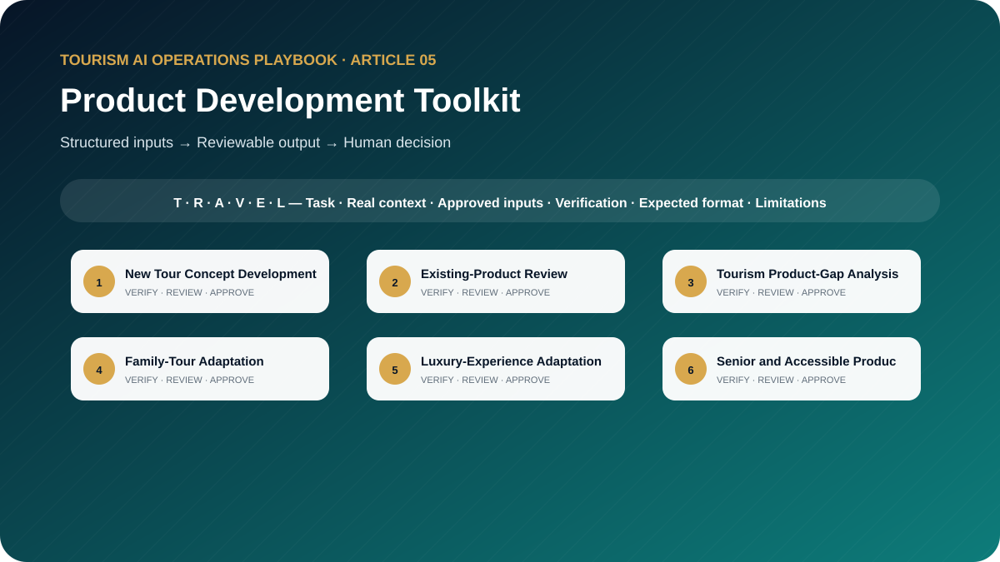

# The Tourism Product Development AI Toolkit: 10 Prompts for Building Better Tours and Experiences

**Professional AI Templates for Itinerary Design, Product Review, Market Adaptation, Seasonal Planning, and Experience Innovation**



> **Edition:** 1.0.0  
> **Author:** Ahmed Mahmoud  
> **Prompt templates:** 10  
> **Primary audience:** Product managers, tour operators, DMCs and destination professionals  
> **Web edition:** https://ahmedqualityops.com/tourism-product-development-ai-prompts.html

**Direct answer**

## Product Development Toolkit: the professional principle

AI is most useful in tourism product development when it organises evidence, explores options and exposes feasibility questions instead of inventing demand or suppliers.

**Who this guide is for**

## Target audience

Tourism product managers, tour operators, DMC product teams, destination managers, contracting teams and experience designers.

This is a working guide for people who already understand that tourism is delivered through connected handovers. The prompts are designed to improve preparation, consistency and visibility; they do not transfer authority from the trained employee to the AI system.

**Operational value**

## Why this topic matters in tourism

A strong tourism product must be desirable, feasible, safe, commercially understandable and deliverable by the destination network. AI is useful for structured ideation and comparison, but weak when asked to invent market evidence, supplier availability or operating conditions.

This toolkit moves from idea to decision. The prompts help teams define a concept, examine an existing product, adapt it for a segment, compare market positioning and run a feasibility gate before investment or launch.

**The central control**

AI may organise information and propose a structure. It must not manufacture the confirmed operational reality. When the source of truth changes, the employee must update the inputs and verify the output again.

**Before copying a prompt**

## Responsible AI rules for this toolkit

- Separate creative concepts from confirmed product components.
- Use verified market, destination and supplier evidence.
- Do not invent demand statistics, competitor inclusions or attraction access.
- Include operational ownership, capacity, seasonality and contingency in every concept.
- Require commercial, operations, safety and product approval before launch.

Companies should adapt these rules to approved tools, information-security controls, local law, supplier contracts and internal authority. When the implications are legal, privacy-related or cybersecurity-related, qualified specialists should be consulted.

**Shared method**

## The TRAVEL prompting framework

Every template in this playbook follows one memorable structure. The aim is not to make prompts longer for their own sake. It is to place the information, controls and approval points that a tourism professional needs in the right order.

- **T — Task and tourism role**: state the professional perspective and the business decision to support.
- **R — Real operational context**: include the destination, service type, timing, guest journey stage and confirmed constraints.
- **A — Audience and approved inputs**: define the guest or client profile and provide only verified, permitted information.
- **V — Verifiable output rules**: require source labels, assumptions, uncertainty flags and a check against official or approved records.
- **E — Expected format and exceptions**: specify the exact structure, priority order, tone, length and escalation path.
- **L — Limitations, privacy and human sign-off**: prohibit invention, protect data and identify who approves the final output.

**In one sentence:** a professional tourism prompt identifies the task, supplies the real operating context, defines the audience and approved inputs, demands a verifiable structure, explains exceptions and keeps privacy plus final authority with a human.

**Copy-ready working library**

## Ten professional prompt templates

Each prompt contains editable placeholders and a built-in stop rule for missing information. Copy it, replace the placeholders with approved facts and keep the verification and human-approval sections intact. The templates are intentionally detailed because the omitted detail is often where a tourism failure begins.

**Prompt 01**

## New Tour Concept Development

Develop differentiated tour concepts around a defined guest problem and destination capability.

### When to use it

Use it for a controlled draft before information reaches a guest, supplier, colleague or manager.

**Example:** A DMC wants a new Abu Dhabi evening experience for repeat visitors.

### Required inputs

- destination
- target segment
- guest need
- verified assets
- season
- duration
- budget band
- operating constraints
- brand position

### Expected outputs

- three concepts
- value proposition
- journey outline
- required partners
- risks
- evidence gaps
- next validation

**Copy-and-Paste Template**

### New Tour Concept Development

```
ROLE
Act as a senior tourism product manager in a professional tourism organisation.

TASK
Develop differentiated tour concepts around a defined guest problem and destination capability.

CONTEXT
Destination/service: [Insert confirmed details]
Date, operating stage and guest/client profile: [Insert approved information]
Sources of truth: [List approved systems, confirmations, SOPs or official sources]

INPUTS
Provide: destination; target segment; guest need; verified assets; season; duration; budget band; operating constraints; brand position.
If an essential input is missing, contradictory or unconfirmed, stop and list what is required, its owner and source. Do not guess.

OUTPUT
Return: three concepts; value proposition; journey outline; required partners; risks; evidence gaps; next validation. Separate confirmed facts, assumptions, recommendations and pending items. Label dynamic facts with their source and verification date when supplied.

LIMITS
Label all unconfirmed components and do not invent demand or supplier availability.

PRIVACY AND APPROVAL
Exclude unnecessary personal data, identity or payment details, confidential rates, contracts and security information. Finish with verification actions, unresolved questions and the final approver’s role. The output remains a draft until that person checks it against approved sources.
```

**Professional tourism trainer’s note**

Replace every placeholder and keep unresolved items visible until an authorised professional reviews them.

**Prompt 02**

## Existing-Product Review

Diagnose an existing tour using guest value, delivery, commercial and partner evidence.

### When to use it

Use it for a controlled draft before information reaches a guest, supplier, colleague or manager.

**Example:** A city tour sells well but receives repeated comments about rushing.

### Required inputs

- product description
- itinerary
- sales
- feedback
- incidents
- costs allowed
- supplier performance
- competitor evidence
- objectives

### Expected outputs

- strengths
- friction points
- evidence table
- redesign options
- quick wins
- test plan

**Copy-and-Paste Template**

### Existing-Product Review

```
ROLE
Act as a tourism product performance reviewer in a professional tourism organisation.

TASK
Diagnose an existing tour using guest value, delivery, commercial and partner evidence.

CONTEXT
Destination/service: [Insert confirmed details]
Date, operating stage and guest/client profile: [Insert approved information]
Sources of truth: [List approved systems, confirmations, SOPs or official sources]

INPUTS
Provide: product description; itinerary; sales; feedback; incidents; costs allowed; supplier performance; competitor evidence; objectives.
If an essential input is missing, contradictory or unconfirmed, stop and list what is required, its owner and source. Do not guess.

OUTPUT
Return: strengths; friction points; evidence table; redesign options; quick wins; test plan. Separate confirmed facts, assumptions, recommendations and pending items. Label dynamic facts with their source and verification date when supplied.

LIMITS
Separate evidence from interpretation and avoid deleting a component only because feedback volume is low.

PRIVACY AND APPROVAL
Exclude unnecessary personal data, identity or payment details, confidential rates, contracts and security information. Finish with verification actions, unresolved questions and the final approver’s role. The output remains a draft until that person checks it against approved sources.
```

**Professional tourism trainer’s note**

Replace every placeholder and keep unresolved items visible until an authorised professional reviews them.

**Prompt 03**

## Tourism Product-Gap Analysis

Identify credible product gaps from supplied market and operational evidence.

### When to use it

Use it for a controlled draft before information reaches a guest, supplier, colleague or manager.

**Example:** A destination team examines products for French-speaking stopover guests.

### Required inputs

- current portfolio
- segments
- demand evidence
- air connectivity
- seasonality
- destination assets
- competitor set
- capability
- constraints

### Expected outputs

- gap matrix
- underserved needs
- evidence strength
- concept directions
- feasibility questions
- priority

**Copy-and-Paste Template**

### Tourism Product-Gap Analysis

```
ROLE
Act as a destination product strategist in a professional tourism organisation.

TASK
Identify credible product gaps from supplied market and operational evidence.

CONTEXT
Destination/service: [Insert confirmed details]
Date, operating stage and guest/client profile: [Insert approved information]
Sources of truth: [List approved systems, confirmations, SOPs or official sources]

INPUTS
Provide: current portfolio; segments; demand evidence; air connectivity; seasonality; destination assets; competitor set; capability; constraints.
If an essential input is missing, contradictory or unconfirmed, stop and list what is required, its owner and source. Do not guess.

OUTPUT
Return: gap matrix; underserved needs; evidence strength; concept directions; feasibility questions; priority. Separate confirmed facts, assumptions, recommendations and pending items. Label dynamic facts with their source and verification date when supplied.

LIMITS
Do not call an idea a market gap without evidence of unmet need and deliverability.

PRIVACY AND APPROVAL
Exclude unnecessary personal data, identity or payment details, confidential rates, contracts and security information. Finish with verification actions, unresolved questions and the final approver’s role. The output remains a draft until that person checks it against approved sources.
```

**Professional tourism trainer’s note**

Replace every placeholder and keep unresolved items visible until an authorised professional reviews them.

**Prompt 04**

## Family-Tour Adaptation

Adapt a confirmed base product for families without reducing it to child entertainment.

### When to use it

Use it for a controlled draft before information reaches a guest, supplier, colleague or manager.

**Example:** A full-day heritage tour needs a version for families with children aged six to twelve.

### Required inputs

- base product
- age range
- family structure
- duration
- transport
- meals
- rest
- safety
- learning interests
- price constraints

### Expected outputs

- adapted flow
- child and adult value
- pace
- facilities
- safety
- packing notes
- supplier checks

**Copy-and-Paste Template**

### Family-Tour Adaptation

```
ROLE
Act as a family tourism product designer in a professional tourism organisation.

TASK
Adapt a confirmed base product for families without reducing it to child entertainment.

CONTEXT
Destination/service: [Insert confirmed details]
Date, operating stage and guest/client profile: [Insert approved information]
Sources of truth: [List approved systems, confirmations, SOPs or official sources]

INPUTS
Provide: base product; age range; family structure; duration; transport; meals; rest; safety; learning interests; price constraints.
If an essential input is missing, contradictory or unconfirmed, stop and list what is required, its owner and source. Do not guess.

OUTPUT
Return: adapted flow; child and adult value; pace; facilities; safety; packing notes; supplier checks. Separate confirmed facts, assumptions, recommendations and pending items. Label dynamic facts with their source and verification date when supplied.

LIMITS
Do not assume all families have the same needs or market the product as suitable without facility verification.

PRIVACY AND APPROVAL
Exclude unnecessary personal data, identity or payment details, confidential rates, contracts and security information. Finish with verification actions, unresolved questions and the final approver’s role. The output remains a draft until that person checks it against approved sources.
```

**Professional tourism trainer’s note**

Replace every placeholder and keep unresolved items visible until an authorised professional reviews them.

**Prompt 05**

## Luxury-Experience Adaptation

Redesign a product around privacy, time value, personalisation and service detail.

### When to use it

Use it for a controlled draft before information reaches a guest, supplier, colleague or manager.

**Example:** A standard cultural tour is being considered for a small high-end delegation.

### Required inputs

- base product
- guest expectations
- privacy
- transport
- access
- host skills
- dining
- flexibility
- confirmed premium options
- budget

### Expected outputs

- experience concept
- signature moments
- service choreography
- privacy controls
- contingency
- validation list

**Copy-and-Paste Template**

### Luxury-Experience Adaptation

```
ROLE
Act as a luxury travel product specialist in a professional tourism organisation.

TASK
Redesign a product around privacy, time value, personalisation and service detail.

CONTEXT
Destination/service: [Insert confirmed details]
Date, operating stage and guest/client profile: [Insert approved information]
Sources of truth: [List approved systems, confirmations, SOPs or official sources]

INPUTS
Provide: base product; guest expectations; privacy; transport; access; host skills; dining; flexibility; confirmed premium options; budget.
If an essential input is missing, contradictory or unconfirmed, stop and list what is required, its owner and source. Do not guess.

OUTPUT
Return: experience concept; signature moments; service choreography; privacy controls; contingency; validation list. Separate confirmed facts, assumptions, recommendations and pending items. Label dynamic facts with their source and verification date when supplied.

LIMITS
Do not describe a service as exclusive, private or VIP unless contractually confirmed.

PRIVACY AND APPROVAL
Exclude unnecessary personal data, identity or payment details, confidential rates, contracts and security information. Finish with verification actions, unresolved questions and the final approver’s role. The output remains a draft until that person checks it against approved sources.
```

**Professional tourism trainer’s note**

Replace every placeholder and keep unresolved items visible until an authorised professional reviews them.

**Prompt 06**

## Senior and Accessible Product Design

Design an itinerary and service model around verified mobility, sensory and pacing needs.

### When to use it

Use it for a controlled draft before information reaches a guest, supplier, colleague or manager.

**Example:** A heritage district product is adapted for seniors and guests with varied mobility.

### Required inputs

- guest requirements
- base concept
- transport
- surfaces
- distances
- seating
- toilets
- audio/visual needs
- carers
- supplier evidence

### Expected outputs

- barrier register
- adjusted flow
- assistance plan
- communication
- emergency considerations
- confirmation questions

**Copy-and-Paste Template**

### Senior and Accessible Product Design

```
ROLE
Act as a inclusive tourism product consultant in a professional tourism organisation.

TASK
Design an itinerary and service model around verified mobility, sensory and pacing needs.

CONTEXT
Destination/service: [Insert confirmed details]
Date, operating stage and guest/client profile: [Insert approved information]
Sources of truth: [List approved systems, confirmations, SOPs or official sources]

INPUTS
Provide: guest requirements; base concept; transport; surfaces; distances; seating; toilets; audio/visual needs; carers; supplier evidence.
If an essential input is missing, contradictory or unconfirmed, stop and list what is required, its owner and source. Do not guess.

OUTPUT
Return: barrier register; adjusted flow; assistance plan; communication; emergency considerations; confirmation questions. Separate confirmed facts, assumptions, recommendations and pending items. Label dynamic facts with their source and verification date when supplied.

LIMITS
Do not claim universal accessibility or make medical assumptions.

PRIVACY AND APPROVAL
Exclude unnecessary personal data, identity or payment details, confidential rates, contracts and security information. Finish with verification actions, unresolved questions and the final approver’s role. The output remains a draft until that person checks it against approved sources.
```

**Professional tourism trainer’s note**

Replace every placeholder and keep unresolved items visible until an authorised professional reviews them.

**Prompt 07**

## Seasonal Tourism Planning

Adapt a product portfolio to climate, daylight, holidays, events and capacity evidence.

### When to use it

Use it for a controlled draft before information reaches a guest, supplier, colleague or manager.

**Example:** A desert and city portfolio is prepared for summer, shoulder and peak winter periods.

### Required inputs

- season
- weather source
- daylight
- local calendar
- demand history
- opening periods
- supplier capacity
- guest segments
- risks

### Expected outputs

- seasonal changes
- operating windows
- product opportunities
- no-go triggers
- staffing impact
- verification calendar

**Copy-and-Paste Template**

### Seasonal Tourism Planning

```
ROLE
Act as a seasonality and operations planner in a professional tourism organisation.

TASK
Adapt a product portfolio to climate, daylight, holidays, events and capacity evidence.

CONTEXT
Destination/service: [Insert confirmed details]
Date, operating stage and guest/client profile: [Insert approved information]
Sources of truth: [List approved systems, confirmations, SOPs or official sources]

INPUTS
Provide: season; weather source; daylight; local calendar; demand history; opening periods; supplier capacity; guest segments; risks.
If an essential input is missing, contradictory or unconfirmed, stop and list what is required, its owner and source. Do not guess.

OUTPUT
Return: seasonal changes; operating windows; product opportunities; no-go triggers; staffing impact; verification calendar. Separate confirmed facts, assumptions, recommendations and pending items. Label dynamic facts with their source and verification date when supplied.

LIMITS
Do not present weather or event patterns as guaranteed.

PRIVACY AND APPROVAL
Exclude unnecessary personal data, identity or payment details, confidential rates, contracts and security information. Finish with verification actions, unresolved questions and the final approver’s role. The output remains a draft until that person checks it against approved sources.
```

**Professional tourism trainer’s note**

Replace every placeholder and keep unresolved items visible until an authorised professional reviews them.

**Prompt 08**

## Event-Based Experience Development

Create a complementary experience around a confirmed event without disrupting core logistics.

### When to use it

Use it for a controlled draft before information reaches a guest, supplier, colleague or manager.

**Example:** A DMC explores experiences around a major conference on Yas Island.

### Required inputs

- event details verified
- audience
- venue
- arrival patterns
- schedule
- destination assets
- transport
- capacity
- rights restrictions

### Expected outputs

- concepts
- pre/post-event flow
- movement plan
- partner needs
- risk
- sale conditions
- go/no-go checklist

**Copy-and-Paste Template**

### Event-Based Experience Development

```
ROLE
Act as a event tourism product manager in a professional tourism organisation.

TASK
Create a complementary experience around a confirmed event without disrupting core logistics.

CONTEXT
Destination/service: [Insert confirmed details]
Date, operating stage and guest/client profile: [Insert approved information]
Sources of truth: [List approved systems, confirmations, SOPs or official sources]

INPUTS
Provide: event details verified; audience; venue; arrival patterns; schedule; destination assets; transport; capacity; rights restrictions.
If an essential input is missing, contradictory or unconfirmed, stop and list what is required, its owner and source. Do not guess.

OUTPUT
Return: concepts; pre/post-event flow; movement plan; partner needs; risk; sale conditions; go/no-go checklist. Separate confirmed facts, assumptions, recommendations and pending items. Label dynamic facts with their source and verification date when supplied.

LIMITS
Do not imply official event partnership, access or ticket availability without confirmation.

PRIVACY AND APPROVAL
Exclude unnecessary personal data, identity or payment details, confidential rates, contracts and security information. Finish with verification actions, unresolved questions and the final approver’s role. The output remains a draft until that person checks it against approved sources.
```

**Professional tourism trainer’s note**

Replace every placeholder and keep unresolved items visible until an authorised professional reviews them.

**Prompt 09**

## Competitor Product Comparison

Compare verified public competitor products fairly and identify positioning choices.

### When to use it

Use it for a controlled draft before information reaches a guest, supplier, colleague or manager.

**Example:** A tour operator reviews three public city-tour offers before repositioning its own.

### Required inputs

- own product
- named competitors
- dated source extracts
- inclusions
- duration
- price only if verified
- reviews
- segment
- objective

### Expected outputs

- comparison table
- evidence and date
- differentiation
- blind spots
- questions
- ethical limits

**Copy-and-Paste Template**

### Competitor Product Comparison

```
ROLE
Act as a tourism market intelligence analyst in a professional tourism organisation.

TASK
Compare verified public competitor products fairly and identify positioning choices.

CONTEXT
Destination/service: [Insert confirmed details]
Date, operating stage and guest/client profile: [Insert approved information]
Sources of truth: [List approved systems, confirmations, SOPs or official sources]

INPUTS
Provide: own product; named competitors; dated source extracts; inclusions; duration; price only if verified; reviews; segment; objective.
If an essential input is missing, contradictory or unconfirmed, stop and list what is required, its owner and source. Do not guess.

OUTPUT
Return: comparison table; evidence and date; differentiation; blind spots; questions; ethical limits. Separate confirmed facts, assumptions, recommendations and pending items. Label dynamic facts with their source and verification date when supplied.

LIMITS
Do not copy proprietary material or guess hidden costs, quality or performance.

PRIVACY AND APPROVAL
Exclude unnecessary personal data, identity or payment details, confidential rates, contracts and security information. Finish with verification actions, unresolved questions and the final approver’s role. The output remains a draft until that person checks it against approved sources.
```

**Professional tourism trainer’s note**

Replace every placeholder and keep unresolved items visible until an authorised professional reviews them.

**Prompt 10**

## Product Feasibility Assessment

Assess whether a product is ready for pilot, revision or rejection.

### When to use it

Use it for a controlled draft before information reaches a guest, supplier, colleague or manager.

**Example:** A new sunrise desert product reaches the final concept-approval meeting.

### Required inputs

- concept
- guest need
- itinerary
- suppliers
- capacity
- skills
- transport
- safety
- costing status
- demand evidence
- contingency

### Expected outputs

- scorecard
- critical blockers
- assumptions
- pilot requirements
- owners
- gate decision recommendation

**Copy-and-Paste Template**

### Product Feasibility Assessment

```
ROLE
Act as a cross-functional tourism product gate reviewer in a professional tourism organisation.

TASK
Assess whether a product is ready for pilot, revision or rejection.

CONTEXT
Destination/service: [Insert confirmed details]
Date, operating stage and guest/client profile: [Insert approved information]
Sources of truth: [List approved systems, confirmations, SOPs or official sources]

INPUTS
Provide: concept; guest need; itinerary; suppliers; capacity; skills; transport; safety; costing status; demand evidence; contingency.
If an essential input is missing, contradictory or unconfirmed, stop and list what is required, its owner and source. Do not guess.

OUTPUT
Return: scorecard; critical blockers; assumptions; pilot requirements; owners; gate decision recommendation. Separate confirmed facts, assumptions, recommendations and pending items. Label dynamic facts with their source and verification date when supplied.

LIMITS
A positive concept score cannot override an unresolved safety, legal, capacity or supplier blocker.

PRIVACY AND APPROVAL
Exclude unnecessary personal data, identity or payment details, confidential rates, contracts and security information. Finish with verification actions, unresolved questions and the final approver’s role. The output remains a draft until that person checks it against approved sources.
```

**Professional tourism trainer’s note**

Replace every placeholder and keep unresolved items visible until an authorised professional reviews them.

**Quality control**

## Common mistakes to avoid

1. **Mistake 1:** Starting with an attraction list instead of a guest need.
2. **Mistake 2:** Copying a competitor without understanding the delivery model.
3. **Mistake 3:** Designing luxury as simply adding a higher price.
4. **Mistake 4:** Treating accessibility as a late adjustment.
5. **Mistake 5:** Ignoring guide, transport and supplier capacity during peak periods.

A useful internal review question is: “Could a new employee read this output and mistake a proposal for a confirmation?” If the answer is yes, revise the prompt and output labels before use.

**From template to controlled workflow**

## Implementation guidance for tourism teams

Run a cross-functional workshop with product, operations, sales and contracting. Use one prompt to create structured options, then score them against guest value, differentiation, feasibility, risk and evidence. Move only the strongest concept into supplier validation and costing.

1**Select**

Choose a low-risk, frequent task with a clear owner and source of truth.

2**Test**

Run realistic anonymised cases, including missing data and operational exceptions.

3**Approve**

Document the prompt version, permitted users, tool, reviewer and release criteria.

4**Measure**

Track quality, time saved, defects, escalations and employee feedback.

5**Improve**

Update the prompt when the process, destination, supplier or risk changes.

**Professional release gate**

## Final verification checklist

The task and intended business decision are clear. Required information came from approved sources. Dynamic facts have a source and verification date. Missing information is visible and assigned to an owner. Personal and confidential data were minimised. The output respects role and commercial authority. Safety, accessibility and cultural considerations were checked. Assumptions are separated from confirmed facts. The relevant tourism professional reviewed the output. The final approval and version are recorded.

**Conclusion**

## Use AI to strengthen tourism judgement, not to bypass it

The best result is not the longest response or the most impressive wording. It is an output that helps a trained tourism professional see the situation clearly, find missing information early, communicate consistently and make a controlled decision. Keep the TRAVEL framework, verification table, privacy boundaries and human sign-off visible every time the prompt is adapted.

**Frequently asked questions**

## Questions tourism teams ask

Can AI create a complete tourism product?

It can support concept development and review, but verified destination knowledge, contracting, costing, safety and operational testing remain human responsibilities.

How should competitor information be used?

Record only observable and verified information, cite the source and compare positioning rather than copying protected or uncertain details.

What makes a product feasible?

Confirmed components, realistic timing, capacity, access, skills, transport, safety, contingency, commercial logic and a clear operating owner.

Can AI predict demand?

It can organise supplied data and create hypotheses. It should not manufacture forecasts or present assumptions as market evidence.

When should a product be piloted?

Before full launch, especially when it has new suppliers, complex transfers, unfamiliar guest segments or sensitive operating conditions.

**Continue the knowledge path**

## Related reading and connected projects

[Article 01**Prompting Framework**

Learn the TRAVEL prompting framework and use ten professional templates to create safer, clearer and more useful AI instructions for tourism work.](./01-tourism-prompting-framework.md)[Article 06**Itinerary Toolkit**

Ten copy-ready AI prompts for one-day, multi-day, stopover, cruise, family, luxury, accessible and weather-resilient itineraries.](./06-tourism-itinerary-ai-toolkit.md)[Article 07**Sales & Quotation Toolkit**

Ten detailed prompts for tourism quotations, B2B proposals, discovery, follow-ups, objections, reactivation and commercial quality review.](./07-tourism-sales-quotation-ai-toolkit.md)[Article 08**Guest Experience Toolkit**

Ten practical prompts covering pre-arrival communication, pickup reminders, delays, complaints, recovery, reviews and journey improvement.](./08-guest-experience-ai-toolkit.md)[Existing insight or project**Article Air Connectivity Dmc Market Intelligence**

Use air-connectivity signals to prepare for emerging guest markets.](https://ahmedqualityops.com/article-air-connectivity-dmc-market-intelligence.html)[Existing insight or project**Article Destination Experience Journey Map**

Design the product around the full destination journey.](https://ahmedqualityops.com/article-destination-experience-journey-map.html)[Existing insight or project**Infraquote**

Connect approved product components with structured quotation logic.](https://ahmedqualityops.com/infraquote.html)

[Series hub**Tourism AI Operations Playbook**](../README.md)

[Previous article**← Transport & Dispatch Toolkit**](./04-tourism-transport-dispatch-ai-toolkit.md)[Next article**Itinerary Toolkit →**](./06-tourism-itinerary-ai-toolkit.md)

**Professional verification reminder:** Always compare AI output with approved internal systems, official sources and qualified human judgement before it affects a guest, supplier, employee or commercial commitment.
