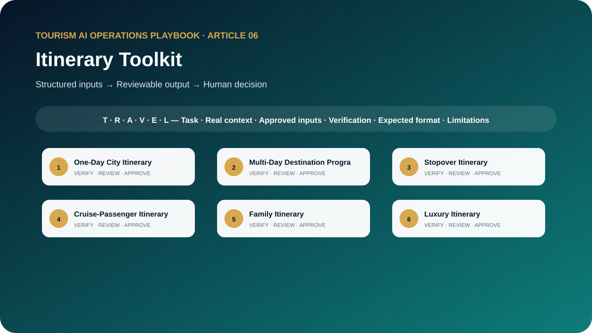

# The Tourism Itinerary AI Toolkit: 10 Prompts for Realistic and Guest-Centred Travel Planning

**Ready-to-Use AI Templates for Multi-Day Programs, Timing, Transfers, Meals, Attractions, Guest Preferences, and Operational Feasibility**



> **Edition:** 1.0.0  
> **Author:** Ahmed Mahmoud  
> **Prompt templates:** 10  
> **Primary audience:** Itinerary planners, product teams, travel designers and operations teams  
> **Web edition:** https://ahmedqualityops.com/tourism-itinerary-ai-prompts.html

**Direct answer**

## Itinerary Toolkit: the professional principle

AI can create an itinerary draft, but every hour, ticket, transfer, availability and access condition must be verified before sale or operation.

**Who this guide is for**

## Target audience

Itinerary planners, DMC product and reservations teams, travel consultants, tour operators, destination managers and group coordinators.

This is a working guide for people who already understand that tourism is delivered through connected handovers. The prompts are designed to improve preparation, consistency and visibility; they do not transfer authority from the trained employee to the AI system.

**Operational value**

## Why this topic matters in tourism

An attractive itinerary can still fail when transfer times, opening hours, meal needs, mobility, check-in, traffic, prayer or event conditions are ignored. AI can organise a programme around supplied facts, but it should never be trusted to invent the dynamic details that make the programme deliverable.

These prompts treat an itinerary as an operational sequence, not a wish list. Each template requires confirmed inputs, identifies uncertain elements and produces a timing table, guest-experience logic, contingency notes and a final verification register.

**The central control**

AI may organise information and propose a structure. It must not manufacture the confirmed operational reality. When the source of truth changes, the employee must update the inputs and verify the output again.

**Before copying a prompt**

## Responsible AI rules for this toolkit

- Do not invent operating hours, ticket prices, transfer times, supplier confirmations, accessibility conditions or availability.
- Label every dynamic item that requires official verification.
- Include realistic buffers for arrivals, loading, security, walking, meals and transitions.
- Match pace and content to the supplied guest profile.
- Require product or operations approval before the itinerary is sold or issued.

Companies should adapt these rules to approved tools, information-security controls, local law, supplier contracts and internal authority. When the implications are legal, privacy-related or cybersecurity-related, qualified specialists should be consulted.

**Shared method**

## The TRAVEL prompting framework

Every template in this playbook follows one memorable structure. The aim is not to make prompts longer for their own sake. It is to place the information, controls and approval points that a tourism professional needs in the right order.

- **T — Task and tourism role**: state the professional perspective and the business decision to support.
- **R — Real operational context**: include the destination, service type, timing, guest journey stage and confirmed constraints.
- **A — Audience and approved inputs**: define the guest or client profile and provide only verified, permitted information.
- **V — Verifiable output rules**: require source labels, assumptions, uncertainty flags and a check against official or approved records.
- **E — Expected format and exceptions**: specify the exact structure, priority order, tone, length and escalation path.
- **L — Limitations, privacy and human sign-off**: prohibit invention, protect data and identify who approves the final output.

**In one sentence:** a professional tourism prompt identifies the task, supplies the real operating context, defines the audience and approved inputs, demands a verifiable structure, explains exceptions and keeps privacy plus final authority with a human.

**Copy-ready working library**

## Ten professional prompt templates

Each prompt contains editable placeholders and a built-in stop rule for missing information. Copy it, replace the placeholders with approved facts and keep the verification and human-approval sections intact. The templates are intentionally detailed because the omitted detail is often where a tourism failure begins.

**Prompt 01**

## One-Day City Itinerary

Build a realistic one-day programme from confirmed attractions and guest priorities.

### When to use it

Use it for a controlled draft before information reaches a guest, supplier, colleague or manager.

**Example:** A first-time couple wants a balanced Abu Dhabi city day.

### Required inputs

- date
- city
- guest profile
- hotel
- service window
- verified hours
- tickets
- travel-time evidence
- meals
- mobility
- must-see priorities

### Expected outputs

- timed itinerary
- experience rationale
- transfer and buffer table
- meal plan
- verification register
- backup

**Copy-and-Paste Template**

### One-Day City Itinerary

```
ROLE
Act as a destination itinerary planner in a professional tourism organisation.

TASK
Build a realistic one-day programme from confirmed attractions and guest priorities.

CONTEXT
Destination/service: [Insert confirmed details]
Date, operating stage and guest/client profile: [Insert approved information]
Sources of truth: [List approved systems, confirmations, SOPs or official sources]

INPUTS
Provide: date; city; guest profile; hotel; service window; verified hours; tickets; travel-time evidence; meals; mobility; must-see priorities.
If an essential input is missing, contradictory or unconfirmed, stop and list what is required, its owner and source. Do not guess.

OUTPUT
Return: timed itinerary; experience rationale; transfer and buffer table; meal plan; verification register; backup. Separate confirmed facts, assumptions, recommendations and pending items. Label dynamic facts with their source and verification date when supplied.

LIMITS
Do not invent hours, prices, transfer times, availability or accessibility.

PRIVACY AND APPROVAL
Exclude unnecessary personal data, identity or payment details, confidential rates, contracts and security information. Finish with verification actions, unresolved questions and the final approver’s role. The output remains a draft until that person checks it against approved sources.
```

**Professional tourism trainer’s note**

Replace every placeholder and keep unresolved items visible until an authorised professional reviews them.

**Prompt 02**

## Multi-Day Destination Programme

Sequence a multi-day programme with progressive pacing and efficient geography.

### When to use it

Use it for a controlled draft before information reaches a guest, supplier, colleague or manager.

**Example:** A five-night group combines culture, desert, Yas Island and free time.

### Required inputs

- dates
- nights
- hotels
- flights
- segments
- confirmed attractions
- transfers
- meals
- free time
- special needs
- supplier status

### Expected outputs

- day-by-day flow
- daily themes
- logistics table
- energy curve
- confirmations
- alternatives

**Copy-and-Paste Template**

### Multi-Day Destination Programme

```
ROLE
Act as a DMC programme designer in a professional tourism organisation.

TASK
Sequence a multi-day programme with progressive pacing and efficient geography.

CONTEXT
Destination/service: [Insert confirmed details]
Date, operating stage and guest/client profile: [Insert approved information]
Sources of truth: [List approved systems, confirmations, SOPs or official sources]

INPUTS
Provide: dates; nights; hotels; flights; segments; confirmed attractions; transfers; meals; free time; special needs; supplier status.
If an essential input is missing, contradictory or unconfirmed, stop and list what is required, its owner and source. Do not guess.

OUTPUT
Return: day-by-day flow; daily themes; logistics table; energy curve; confirmations; alternatives. Separate confirmed facts, assumptions, recommendations and pending items. Label dynamic facts with their source and verification date when supplied.

LIMITS
Keep arrival and departure days realistic and flag every unconfirmed component.

PRIVACY AND APPROVAL
Exclude unnecessary personal data, identity or payment details, confidential rates, contracts and security information. Finish with verification actions, unresolved questions and the final approver’s role. The output remains a draft until that person checks it against approved sources.
```

**Professional tourism trainer’s note**

Replace every placeholder and keep unresolved items visible until an authorised professional reviews them.

**Prompt 03**

## Stopover Itinerary

Design a low-risk stopover programme around immigration, baggage and flight cut-offs.

### When to use it

Use it for a controlled draft before information reaches a guest, supplier, colleague or manager.

**Example:** A traveller has an eight-hour international connection and wants a city visit.

### Required inputs

- airport
- arrival/departure confirmed
- connection type
- baggage
- visa status to be verified
- guest profile
- transport
- verified sites
- risk tolerance

### Expected outputs

- eligibility questions
- usable window
- itinerary options
- return buffer
- no-go triggers
- verification

**Copy-and-Paste Template**

### Stopover Itinerary

```
ROLE
Act as a airport stopover specialist in a professional tourism organisation.

TASK
Design a low-risk stopover programme around immigration, baggage and flight cut-offs.

CONTEXT
Destination/service: [Insert confirmed details]
Date, operating stage and guest/client profile: [Insert approved information]
Sources of truth: [List approved systems, confirmations, SOPs or official sources]

INPUTS
Provide: airport; arrival/departure confirmed; connection type; baggage; visa status to be verified; guest profile; transport; verified sites; risk tolerance.
If an essential input is missing, contradictory or unconfirmed, stop and list what is required, its owner and source. Do not guess.

OUTPUT
Return: eligibility questions; usable window; itinerary options; return buffer; no-go triggers; verification. Separate confirmed facts, assumptions, recommendations and pending items. Label dynamic facts with their source and verification date when supplied.

LIMITS
Do not advise that a guest may enter a country without official visa and airline verification.

PRIVACY AND APPROVAL
Exclude unnecessary personal data, identity or payment details, confidential rates, contracts and security information. Finish with verification actions, unresolved questions and the final approver’s role. The output remains a draft until that person checks it against approved sources.
```

**Professional tourism trainer’s note**

Replace every placeholder and keep unresolved items visible until an authorised professional reviews them.

**Prompt 04**

## Cruise-Passenger Itinerary

Prepare a shore programme that protects all-aboard time and port procedures.

### When to use it

Use it for a controlled draft before information reaches a guest, supplier, colleague or manager.

**Example:** A private shore excursion visits a mosque, museum and market.

### Required inputs

- ship date
- berth
- disembarkation estimate
- all-aboard
- guest profile
- verified sites
- transport
- group size
- port rules

### Expected outputs

- critical timeline
- route
- buffers
- guide/driver coordination
- fallback levels
- return decision points

**Copy-and-Paste Template**

### Cruise-Passenger Itinerary

```
ROLE
Act as a shore excursion operations planner in a professional tourism organisation.

TASK
Prepare a shore programme that protects all-aboard time and port procedures.

CONTEXT
Destination/service: [Insert confirmed details]
Date, operating stage and guest/client profile: [Insert approved information]
Sources of truth: [List approved systems, confirmations, SOPs or official sources]

INPUTS
Provide: ship date; berth; disembarkation estimate; all-aboard; guest profile; verified sites; transport; group size; port rules.
If an essential input is missing, contradictory or unconfirmed, stop and list what is required, its owner and source. Do not guess.

OUTPUT
Return: critical timeline; route; buffers; guide/driver coordination; fallback levels; return decision points. Separate confirmed facts, assumptions, recommendations and pending items. Label dynamic facts with their source and verification date when supplied.

LIMITS
Never use scheduled docking alone as a guaranteed guest-ready time.

PRIVACY AND APPROVAL
Exclude unnecessary personal data, identity or payment details, confidential rates, contracts and security information. Finish with verification actions, unresolved questions and the final approver’s role. The output remains a draft until that person checks it against approved sources.
```

**Professional tourism trainer’s note**

Replace every placeholder and keep unresolved items visible until an authorised professional reviews them.

**Prompt 05**

## Family Itinerary

Create a comfortable programme that balances adult interest, child engagement and rest.

### When to use it

Use it for a controlled draft before information reaches a guest, supplier, colleague or manager.

**Example:** Parents with two children want a two-day city and theme-park programme.

### Required inputs

- family composition
- ages
- routines
- interests
- date
- hotel
- verified attractions
- meal needs
- stroller
- transport
- budget

### Expected outputs

- paced itinerary
- engagement ideas
- rest and toilet points
- packing
- safety
- backup

**Copy-and-Paste Template**

### Family Itinerary

```
ROLE
Act as a family travel itinerary specialist in a professional tourism organisation.

TASK
Create a comfortable programme that balances adult interest, child engagement and rest.

CONTEXT
Destination/service: [Insert confirmed details]
Date, operating stage and guest/client profile: [Insert approved information]
Sources of truth: [List approved systems, confirmations, SOPs or official sources]

INPUTS
Provide: family composition; ages; routines; interests; date; hotel; verified attractions; meal needs; stroller; transport; budget.
If an essential input is missing, contradictory or unconfirmed, stop and list what is required, its owner and source. Do not guess.

OUTPUT
Return: paced itinerary; engagement ideas; rest and toilet points; packing; safety; backup. Separate confirmed facts, assumptions, recommendations and pending items. Label dynamic facts with their source and verification date when supplied.

LIMITS
Do not assume age automatically determines ability or interest.

PRIVACY AND APPROVAL
Exclude unnecessary personal data, identity or payment details, confidential rates, contracts and security information. Finish with verification actions, unresolved questions and the final approver’s role. The output remains a draft until that person checks it against approved sources.
```

**Professional tourism trainer’s note**

Replace every placeholder and keep unresolved items visible until an authorised professional reviews them.

**Prompt 06**

## Luxury Itinerary

Design a discreet, flexible programme around time value and confirmed premium services.

### When to use it

Use it for a controlled draft before information reaches a guest, supplier, colleague or manager.

**Example:** A senior executive has one free day between meetings.

### Required inputs

- guest preferences
- privacy
- dates
- hotel
- transport
- hosts
- confirmed access
- dining
- flexibility
- dislikes
- budget authority

### Expected outputs

- service choreography
- timed but flexible flow
- personalisation
- privacy notes
- backup
- concierge confirmations

**Copy-and-Paste Template**

### Luxury Itinerary

```
ROLE
Act as a luxury destination planner in a professional tourism organisation.

TASK
Design a discreet, flexible programme around time value and confirmed premium services.

CONTEXT
Destination/service: [Insert confirmed details]
Date, operating stage and guest/client profile: [Insert approved information]
Sources of truth: [List approved systems, confirmations, SOPs or official sources]

INPUTS
Provide: guest preferences; privacy; dates; hotel; transport; hosts; confirmed access; dining; flexibility; dislikes; budget authority.
If an essential input is missing, contradictory or unconfirmed, stop and list what is required, its owner and source. Do not guess.

OUTPUT
Return: service choreography; timed but flexible flow; personalisation; privacy notes; backup; concierge confirmations. Separate confirmed facts, assumptions, recommendations and pending items. Label dynamic facts with their source and verification date when supplied.

LIMITS
Do not use “exclusive”, “private access” or “guaranteed” without written confirmation.

PRIVACY AND APPROVAL
Exclude unnecessary personal data, identity or payment details, confidential rates, contracts and security information. Finish with verification actions, unresolved questions and the final approver’s role. The output remains a draft until that person checks it against approved sources.
```

**Professional tourism trainer’s note**

Replace every placeholder and keep unresolved items visible until an authorised professional reviews them.

**Prompt 07**

## Accessible Itinerary

Build a programme from the guest’s stated access requirements and verified facility evidence.

### When to use it

Use it for a controlled draft before information reaches a guest, supplier, colleague or manager.

**Example:** A wheelchair user and companion plan a museum and waterfront day.

### Required inputs

- guest requirements
- mobility device
- transfers
- walking tolerance
- sensory needs
- companion
- verified access
- transport
- toilets
- rest

### Expected outputs

- barrier-free draft
- transfer details
- distance and surface notes
- assistance
- direct-confirmation list
- alternatives

**Copy-and-Paste Template**

### Accessible Itinerary

```
ROLE
Act as a inclusive itinerary and mobility planner in a professional tourism organisation.

TASK
Build a programme from the guest’s stated access requirements and verified facility evidence.

CONTEXT
Destination/service: [Insert confirmed details]
Date, operating stage and guest/client profile: [Insert approved information]
Sources of truth: [List approved systems, confirmations, SOPs or official sources]

INPUTS
Provide: guest requirements; mobility device; transfers; walking tolerance; sensory needs; companion; verified access; transport; toilets; rest.
If an essential input is missing, contradictory or unconfirmed, stop and list what is required, its owner and source. Do not guess.

OUTPUT
Return: barrier-free draft; transfer details; distance and surface notes; assistance; direct-confirmation list; alternatives. Separate confirmed facts, assumptions, recommendations and pending items. Label dynamic facts with their source and verification date when supplied.

LIMITS
Never infer medical needs or describe a venue as accessible without current evidence.

PRIVACY AND APPROVAL
Exclude unnecessary personal data, identity or payment details, confidential rates, contracts and security information. Finish with verification actions, unresolved questions and the final approver’s role. The output remains a draft until that person checks it against approved sources.
```

**Professional tourism trainer’s note**

Replace every placeholder and keep unresolved items visible until an authorised professional reviews them.

**Prompt 08**

## Weather Backup Plan

Create pre-approved alternatives and decision triggers for weather-sensitive services.

### When to use it

Use it for a controlled draft before information reaches a guest, supplier, colleague or manager.

**Example:** A desert dinner may be affected by wind and low visibility.

### Required inputs

- original itinerary
- weather source
- thresholds
- indoor options verified
- tickets
- transport
- guest profile
- communication
- cost authority

### Expected outputs

- trigger table
- alternative schedules
- decision owner
- guest messages
- supplier actions
- cost flags

**Copy-and-Paste Template**

### Weather Backup Plan

```
ROLE
Act as a tourism contingency planner in a professional tourism organisation.

TASK
Create pre-approved alternatives and decision triggers for weather-sensitive services.

CONTEXT
Destination/service: [Insert confirmed details]
Date, operating stage and guest/client profile: [Insert approved information]
Sources of truth: [List approved systems, confirmations, SOPs or official sources]

INPUTS
Provide: original itinerary; weather source; thresholds; indoor options verified; tickets; transport; guest profile; communication; cost authority.
If an essential input is missing, contradictory or unconfirmed, stop and list what is required, its owner and source. Do not guess.

OUTPUT
Return: trigger table; alternative schedules; decision owner; guest messages; supplier actions; cost flags. Separate confirmed facts, assumptions, recommendations and pending items. Label dynamic facts with their source and verification date when supplied.

LIMITS
Do not forecast beyond the supplied official information or guarantee conditions.

PRIVACY AND APPROVAL
Exclude unnecessary personal data, identity or payment details, confidential rates, contracts and security information. Finish with verification actions, unresolved questions and the final approver’s role. The output remains a draft until that person checks it against approved sources.
```

**Professional tourism trainer’s note**

Replace every placeholder and keep unresolved items visible until an authorised professional reviews them.

**Prompt 09**

## Itinerary Timing and Feasibility Audit

Stress-test an itinerary leg by leg before release.

### When to use it

Use it for a controlled draft before information reaches a guest, supplier, colleague or manager.

**Example:** A sales itinerary has six stops in nine hours and an airport drop-off.

### Required inputs

- draft itinerary
- verified hours
- tickets
- travel-time sources
- group size
- vehicle
- walking
- entry
- meals
- service window
- rules

### Expected outputs

- leg audit
- unrealistic timings
- missing buffers
- critical path
- corrections
- release recommendation

**Copy-and-Paste Template**

### Itinerary Timing and Feasibility Audit

```
ROLE
Act as a senior DMC operations auditor in a professional tourism organisation.

TASK
Stress-test an itinerary leg by leg before release.

CONTEXT
Destination/service: [Insert confirmed details]
Date, operating stage and guest/client profile: [Insert approved information]
Sources of truth: [List approved systems, confirmations, SOPs or official sources]

INPUTS
Provide: draft itinerary; verified hours; tickets; travel-time sources; group size; vehicle; walking; entry; meals; service window; rules.
If an essential input is missing, contradictory or unconfirmed, stop and list what is required, its owner and source. Do not guess.

OUTPUT
Return: leg audit; unrealistic timings; missing buffers; critical path; corrections; release recommendation. Separate confirmed facts, assumptions, recommendations and pending items. Label dynamic facts with their source and verification date when supplied.

LIMITS
Any missing dynamic fact must remain a blocker or explicit verification action.

PRIVACY AND APPROVAL
Exclude unnecessary personal data, identity or payment details, confidential rates, contracts and security information. Finish with verification actions, unresolved questions and the final approver’s role. The output remains a draft until that person checks it against approved sources.
```

**Professional tourism trainer’s note**

Replace every placeholder and keep unresolved items visible until an authorised professional reviews them.

**Prompt 10**

## Final Itinerary Quality Review

Complete a final quality gate across guest value, operations, clarity and verification.

### When to use it

Use it for a controlled draft before information reaches a guest, supplier, colleague or manager.

**Example:** A multi-day programme is ready to move from proposal to operations.

### Required inputs

- final programme
- guest profile
- confirmations
- inclusions
- exclusions
- timing audit
- accessibility
- contingency
- communication

### Expected outputs

- quality scorecard
- defects
- final checks
- guest-facing clarity edits
- approval record

**Copy-and-Paste Template**

### Final Itinerary Quality Review

```
ROLE
Act as a tourism product and guest-experience reviewer in a professional tourism organisation.

TASK
Complete a final quality gate across guest value, operations, clarity and verification.

CONTEXT
Destination/service: [Insert confirmed details]
Date, operating stage and guest/client profile: [Insert approved information]
Sources of truth: [List approved systems, confirmations, SOPs or official sources]

INPUTS
Provide: final programme; guest profile; confirmations; inclusions; exclusions; timing audit; accessibility; contingency; communication.
If an essential input is missing, contradictory or unconfirmed, stop and list what is required, its owner and source. Do not guess.

OUTPUT
Return: quality scorecard; defects; final checks; guest-facing clarity edits; approval record. Separate confirmed facts, assumptions, recommendations and pending items. Label dynamic facts with their source and verification date when supplied.

LIMITS
Do not approve when a critical supplier, ticket, transfer or access item is unresolved.

PRIVACY AND APPROVAL
Exclude unnecessary personal data, identity or payment details, confidential rates, contracts and security information. Finish with verification actions, unresolved questions and the final approver’s role. The output remains a draft until that person checks it against approved sources.
```

**Professional tourism trainer’s note**

Replace every placeholder and keep unresolved items visible until an authorised professional reviews them.

**Quality control**

## Common mistakes to avoid

1. **Mistake 1:** Fitting too many attractions into the available day.
2. **Mistake 2:** Using map travel time without loading, parking or entry processes.
3. **Mistake 3:** Assuming an attraction is accessible because its website is unclear.
4. **Mistake 4:** Ignoring flight, cruise or hotel cut-off risks.
5. **Mistake 5:** Presenting a suggested restaurant or supplier as confirmed.

A useful internal review question is: “Could a new employee read this output and mistake a proposal for a confirmation?” If the answer is yes, revise the prompt and output labels before use.

**From template to controlled workflow**

## Implementation guidance for tourism teams

Use a two-stage method. First, create the guest-centred flow and desired experience. Second, complete an operational audit with official hours, reservations, travel-time evidence, accessibility checks and supplier confirmation. Version the itinerary after every material change.

1**Select**

Choose a low-risk, frequent task with a clear owner and source of truth.

2**Test**

Run realistic anonymised cases, including missing data and operational exceptions.

3**Approve**

Document the prompt version, permitted users, tool, reviewer and release criteria.

4**Measure**

Track quality, time saved, defects, escalations and employee feedback.

5**Improve**

Update the prompt when the process, destination, supplier or risk changes.

**Professional release gate**

## Final verification checklist

The task and intended business decision are clear. Required information came from approved sources. Dynamic facts have a source and verification date. Missing information is visible and assigned to an owner. Personal and confidential data were minimised. The output respects role and commercial authority. Safety, accessibility and cultural considerations were checked. Assumptions are separated from confirmed facts. The relevant tourism professional reviewed the output. The final approval and version are recorded.

**Conclusion**

## Use AI to strengthen tourism judgement, not to bypass it

The best result is not the longest response or the most impressive wording. It is an output that helps a trained tourism professional see the situation clearly, find missing information early, communicate consistently and make a controlled decision. Keep the TRAVEL framework, verification table, privacy boundaries and human sign-off visible every time the prompt is adapted.

**Frequently asked questions**

## Questions tourism teams ask

Can AI create a tourism itinerary?

Yes, as a structured draft from verified inputs. A qualified planner must verify all dynamic, commercial and operational details before use.

Why should transfer times be treated carefully?

Travel time changes with route, traffic, vehicle access, loading, parking and group movement. The planner should use current approved evidence and add operational buffers.

How much should an itinerary include?

Only what can be enjoyed and delivered comfortably within the real service window. Guest value is more important than the number of stops.

What makes an accessible itinerary?

Verified step-free access, transport, toilets, walking surfaces, seating, assistance, sensory needs and direct confirmation of the guest’s requirements.

How should weather backups work?

Use pre-verified alternatives with clear decision times, communication ownership, cost implications and reservation rules.

**Continue the knowledge path**

## Related reading and connected projects

[Article 04**Transport & Dispatch Toolkit**

Ten detailed prompts for hotel pickup sequencing, zone planning, vehicle checks, driver briefings, late vehicles, drop-offs and fleet reporting.](./04-tourism-transport-dispatch-ai-toolkit.md)[Article 05**Product Development Toolkit**

Ten professional prompts for tour concepts, product gaps, family, luxury and accessible adaptations, seasons, events, competitors and feasibility.](./05-tourism-product-development-ai-toolkit.md)[Article 07**Sales & Quotation Toolkit**

Ten detailed prompts for tourism quotations, B2B proposals, discovery, follow-ups, objections, reactivation and commercial quality review.](./07-tourism-sales-quotation-ai-toolkit.md)[Article 10**Responsible AI Guide**

A practical tourism governance guide with ten templates for risk, verification, privacy, cultural sensitivity, approvals, policies and AI reviews.](./10-responsible-ai-for-tourism.md)[Existing insight or project**Article Destination Experience Journey Map**

Map each itinerary moment across the complete guest journey.](https://ahmedqualityops.com/article-destination-experience-journey-map.html)[Existing insight or project**Article City Tour Quotation Professional**

See how a city-tour programme becomes a professional quotation.](https://ahmedqualityops.com/article-city-tour-quotation-professional.html)[Existing insight or project**Infrasky**

Review a weather- and sky-aware planning concept for stargazing operations.](https://ahmedqualityops.com/infrasky.html)

[Series hub**Tourism AI Operations Playbook**](../README.md)

[Previous article**← Product Development Toolkit**](./05-tourism-product-development-ai-toolkit.md)[Next article**Sales & Quotation Toolkit →**](./07-tourism-sales-quotation-ai-toolkit.md)

**Professional verification reminder:** Always compare AI output with approved internal systems, official sources and qualified human judgement before it affects a guest, supplier, employee or commercial commitment.
