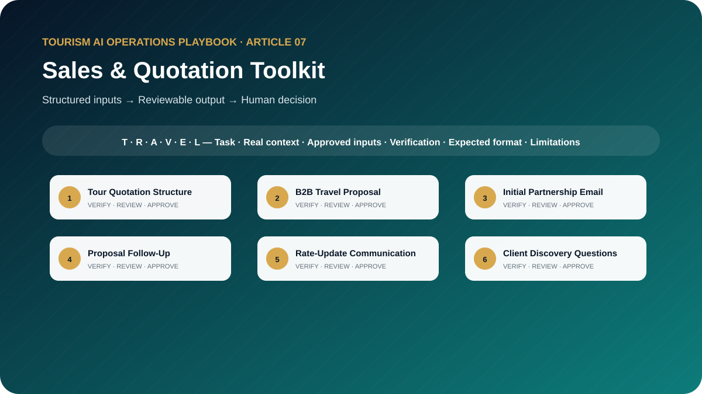

# The Tourism Sales and Quotation AI Toolkit: 10 Prompts for B2B Proposals and Commercial Communication

**Professional AI Templates for Tour Quotations, Sales Emails, Client Proposals, Follow-Ups, Objection Handling, and Partnership Development**



> **Edition:** 1.0.0  
> **Author:** Ahmed Mahmoud  
> **Prompt templates:** 10  
> **Primary audience:** Travel sales teams, quotation specialists, account managers and contracting teams  
> **Web edition:** https://ahmedqualityops.com/tourism-sales-quotation-ai-prompts.html

**Direct answer**

## Sales & Quotation Toolkit: the professional principle

AI can improve commercial structure and communication, but it must not create rates, terms, tax, margin, currency conversions or commitments.

**Who this guide is for**

## Target audience

DMC sales teams, travel consultants, product and contracting teams, quotation specialists, account managers and small tour operators.

This is a working guide for people who already understand that tourism is delivered through connected handovers. The prompts are designed to improve preparation, consistency and visibility; they do not transfer authority from the trained employee to the AI system.

**Operational value**

## Why this topic matters in tourism

Tourism sales communication must be persuasive without creating unauthorised promises. AI can improve structure, clarity and preparation, but commercial figures and conditions must come from approved calculations, contracts and management decisions.

This toolkit separates the commercial message from the commercial truth. It helps users draft professional documents around approved rates, inclusions and terms while preventing the model from inventing the details that create financial or contractual exposure.

**The central control**

AI may organise information and propose a structure. It must not manufacture the confirmed operational reality. When the source of truth changes, the employee must update the inputs and verify the output again.

**Before copying a prompt**

## Responsible AI rules for this toolkit

- AI must not invent rates, markups, taxes, currency conversions, cancellation conditions, payment terms or contractual commitments.
- Use only approved product and rate-sheet inputs.
- Show exclusions, validity, assumptions and pending confirmations clearly.
- Protect confidential net rates and partner terms in accordance with company policy.
- Require commercial approval before sending a proposal or commitment.

Companies should adapt these rules to approved tools, information-security controls, local law, supplier contracts and internal authority. When the implications are legal, privacy-related or cybersecurity-related, qualified specialists should be consulted.

**Shared method**

## The TRAVEL prompting framework

Every template in this playbook follows one memorable structure. The aim is not to make prompts longer for their own sake. It is to place the information, controls and approval points that a tourism professional needs in the right order.

- **T — Task and tourism role**: state the professional perspective and the business decision to support.
- **R — Real operational context**: include the destination, service type, timing, guest journey stage and confirmed constraints.
- **A — Audience and approved inputs**: define the guest or client profile and provide only verified, permitted information.
- **V — Verifiable output rules**: require source labels, assumptions, uncertainty flags and a check against official or approved records.
- **E — Expected format and exceptions**: specify the exact structure, priority order, tone, length and escalation path.
- **L — Limitations, privacy and human sign-off**: prohibit invention, protect data and identify who approves the final output.

**In one sentence:** a professional tourism prompt identifies the task, supplies the real operating context, defines the audience and approved inputs, demands a verifiable structure, explains exceptions and keeps privacy plus final authority with a human.

**Copy-ready working library**

## Ten professional prompt templates

Each prompt contains editable placeholders and a built-in stop rule for missing information. Copy it, replace the placeholders with approved facts and keep the verification and human-approval sections intact. The templates are intentionally detailed because the omitted detail is often where a tourism failure begins.

**Prompt 01**

## Tour Quotation Structure

Build a professional quotation structure around approved commercial inputs.

### When to use it

Use it for a controlled draft before information reaches a guest, supplier, colleague or manager.

**Example:** A DMC prepares a three-day group quotation for an overseas tour operator.

### Required inputs

- client
- request
- itinerary
- approved net costs
- pricing output supplied
- inclusions
- exclusions
- validity
- terms
- pending confirmations

### Expected outputs

- cover summary
- programme
- price table placeholders
- inclusions
- exclusions
- conditions
- next step
- approval checklist

**Copy-and-Paste Template**

### Tour Quotation Structure

```
ROLE
Act as a tourism quotation specialist in a professional tourism organisation.

TASK
Build a professional quotation structure around approved commercial inputs.

CONTEXT
Destination/service: [Insert confirmed details]
Date, operating stage and guest/client profile: [Insert approved information]
Sources of truth: [List approved systems, confirmations, SOPs or official sources]

INPUTS
Provide: client; request; itinerary; approved net costs; pricing output supplied; inclusions; exclusions; validity; terms; pending confirmations.
If an essential input is missing, contradictory or unconfirmed, stop and list what is required, its owner and source. Do not guess.

OUTPUT
Return: cover summary; programme; price table placeholders; inclusions; exclusions; conditions; next step; approval checklist. Separate confirmed facts, assumptions, recommendations and pending items. Label dynamic facts with their source and verification date when supplied.

LIMITS
Do not calculate or invent rates, margin, tax, currency or terms.

PRIVACY AND APPROVAL
Exclude unnecessary personal data, identity or payment details, confidential rates, contracts and security information. Finish with verification actions, unresolved questions and the final approver’s role. The output remains a draft until that person checks it against approved sources.
```

**Professional tourism trainer’s note**

Replace every placeholder and keep unresolved items visible until an authorised professional reviews them.

**Prompt 02**

## B2B Travel Proposal

Turn approved products and commercial inputs into a client-specific b2b proposal.

### When to use it

Use it for a controlled draft before information reaches a guest, supplier, colleague or manager.

**Example:** A hotel-desk operator is considering a new attraction-ticket partnership.

### Required inputs

- client profile
- market
- objectives
- traveller profile
- approved products
- differentiators
- rates supplied
- operations proof
- terms

### Expected outputs

- executive proposal
- client-fit rationale
- programme options
- service model
- commercial section
- next actions

**Copy-and-Paste Template**

### B2B Travel Proposal

```
ROLE
Act as a destination sales manager in a professional tourism organisation.

TASK
Turn approved products and commercial inputs into a client-specific b2b proposal.

CONTEXT
Destination/service: [Insert confirmed details]
Date, operating stage and guest/client profile: [Insert approved information]
Sources of truth: [List approved systems, confirmations, SOPs or official sources]

INPUTS
Provide: client profile; market; objectives; traveller profile; approved products; differentiators; rates supplied; operations proof; terms.
If an essential input is missing, contradictory or unconfirmed, stop and list what is required, its owner and source. Do not guess.

OUTPUT
Return: executive proposal; client-fit rationale; programme options; service model; commercial section; next actions. Separate confirmed facts, assumptions, recommendations and pending items. Label dynamic facts with their source and verification date when supplied.

LIMITS
Do not claim market leadership, exclusivity or results without evidence.

PRIVACY AND APPROVAL
Exclude unnecessary personal data, identity or payment details, confidential rates, contracts and security information. Finish with verification actions, unresolved questions and the final approver’s role. The output remains a draft until that person checks it against approved sources.
```

**Professional tourism trainer’s note**

Replace every placeholder and keep unresolved items visible until an authorised professional reviews them.

**Prompt 03**

## Initial Partnership Email

Write a concise, credible first-contact email with a specific reason to speak.

### When to use it

Use it for a controlled draft before information reaches a guest, supplier, colleague or manager.

**Example:** A DMC approaches a European tour operator serving French-speaking groups.

### Required inputs

- recipient role
- company
- verified relevance
- destination capability
- proposed value
- proof
- requested next step
- tone

### Expected outputs

- subject options
- email
- short LinkedIn version
- personalisation gaps
- follow-up date

**Copy-and-Paste Template**

### Initial Partnership Email

```
ROLE
Act as a B2B tourism account manager in a professional tourism organisation.

TASK
Write a concise, credible first-contact email with a specific reason to speak.

CONTEXT
Destination/service: [Insert confirmed details]
Date, operating stage and guest/client profile: [Insert approved information]
Sources of truth: [List approved systems, confirmations, SOPs or official sources]

INPUTS
Provide: recipient role; company; verified relevance; destination capability; proposed value; proof; requested next step; tone.
If an essential input is missing, contradictory or unconfirmed, stop and list what is required, its owner and source. Do not guess.

OUTPUT
Return: subject options; email; short LinkedIn version; personalisation gaps; follow-up date. Separate confirmed facts, assumptions, recommendations and pending items. Label dynamic facts with their source and verification date when supplied.

LIMITS
Do not invent shared contacts, achievements or knowledge of the recipient.

PRIVACY AND APPROVAL
Exclude unnecessary personal data, identity or payment details, confidential rates, contracts and security information. Finish with verification actions, unresolved questions and the final approver’s role. The output remains a draft until that person checks it against approved sources.
```

**Professional tourism trainer’s note**

Replace every placeholder and keep unresolved items visible until an authorised professional reviews them.

**Prompt 04**

## Proposal Follow-Up

Prepare a value-adding follow-up based on the actual proposal stage.

### When to use it

Use it for a controlled draft before information reaches a guest, supplier, colleague or manager.

**Example:** A client has not replied ten days after receiving a seasonal programme.

### Required inputs

- proposal date
- client questions
- viewed status if known
- decision timeline
- approved updates
- outstanding items
- next step

### Expected outputs

- follow-up email
- call agenda
- decision questions
- useful attachment suggestion
- escalation timing

**Copy-and-Paste Template**

### Proposal Follow-Up

```
ROLE
Act as a consultative tourism sales manager in a professional tourism organisation.

TASK
Prepare a value-adding follow-up based on the actual proposal stage.

CONTEXT
Destination/service: [Insert confirmed details]
Date, operating stage and guest/client profile: [Insert approved information]
Sources of truth: [List approved systems, confirmations, SOPs or official sources]

INPUTS
Provide: proposal date; client questions; viewed status if known; decision timeline; approved updates; outstanding items; next step.
If an essential input is missing, contradictory or unconfirmed, stop and list what is required, its owner and source. Do not guess.

OUTPUT
Return: follow-up email; call agenda; decision questions; useful attachment suggestion; escalation timing. Separate confirmed facts, assumptions, recommendations and pending items. Label dynamic facts with their source and verification date when supplied.

LIMITS
Do not create false urgency or claim limited availability without evidence.

PRIVACY AND APPROVAL
Exclude unnecessary personal data, identity or payment details, confidential rates, contracts and security information. Finish with verification actions, unresolved questions and the final approver’s role. The output remains a draft until that person checks it against approved sources.
```

**Professional tourism trainer’s note**

Replace every placeholder and keep unresolved items visible until an authorised professional reviews them.

**Prompt 05**

## Rate-Update Communication

Explain an approved rate change clearly while protecting the relationship.

### When to use it

Use it for a controlled draft before information reaches a guest, supplier, colleague or manager.

**Example:** Transport rates change for new bookings from the next season.

### Required inputs

- partner
- affected services
- old/new approved rates
- effective date
- reason authorised
- existing bookings
- validity
- contacts

### Expected outputs

- partner notice
- summary table
- action required
- FAQ
- internal send checklist

**Copy-and-Paste Template**

### Rate-Update Communication

```
ROLE
Act as a tourism contracting communication specialist in a professional tourism organisation.

TASK
Explain an approved rate change clearly while protecting the relationship.

CONTEXT
Destination/service: [Insert confirmed details]
Date, operating stage and guest/client profile: [Insert approved information]
Sources of truth: [List approved systems, confirmations, SOPs or official sources]

INPUTS
Provide: partner; affected services; old/new approved rates; effective date; reason authorised; existing bookings; validity; contacts.
If an essential input is missing, contradictory or unconfirmed, stop and list what is required, its owner and source. Do not guess.

OUTPUT
Return: partner notice; summary table; action required; FAQ; internal send checklist. Separate confirmed facts, assumptions, recommendations and pending items. Label dynamic facts with their source and verification date when supplied.

LIMITS
Do not soften or alter the approved figures, dates or contractual position.

PRIVACY AND APPROVAL
Exclude unnecessary personal data, identity or payment details, confidential rates, contracts and security information. Finish with verification actions, unresolved questions and the final approver’s role. The output remains a draft until that person checks it against approved sources.
```

**Professional tourism trainer’s note**

Replace every placeholder and keep unresolved items visible until an authorised professional reviews them.

**Prompt 06**

## Client Discovery Questions

Prepare discovery questions that reveal operational and commercial needs.

### When to use it

Use it for a controlled draft before information reaches a guest, supplier, colleague or manager.

**Example:** A DMC meets a tour operator considering a new UAE programme.

### Required inputs

- client type
- market
- known business
- destination
- product interest
- meeting length
- desired outcome

### Expected outputs

- prioritised questions
- reason for each
- likely follow-ups
- red flags
- meeting note template

**Copy-and-Paste Template**

### Client Discovery Questions

```
ROLE
Act as a tourism solution-sales consultant in a professional tourism organisation.

TASK
Prepare discovery questions that reveal operational and commercial needs.

CONTEXT
Destination/service: [Insert confirmed details]
Date, operating stage and guest/client profile: [Insert approved information]
Sources of truth: [List approved systems, confirmations, SOPs or official sources]

INPUTS
Provide: client type; market; known business; destination; product interest; meeting length; desired outcome.
If an essential input is missing, contradictory or unconfirmed, stop and list what is required, its owner and source. Do not guess.

OUTPUT
Return: prioritised questions; reason for each; likely follow-ups; red flags; meeting note template. Separate confirmed facts, assumptions, recommendations and pending items. Label dynamic facts with their source and verification date when supplied.

LIMITS
Do not ask for confidential information that is unnecessary at the discovery stage.

PRIVACY AND APPROVAL
Exclude unnecessary personal data, identity or payment details, confidential rates, contracts and security information. Finish with verification actions, unresolved questions and the final approver’s role. The output remains a draft until that person checks it against approved sources.
```

**Professional tourism trainer’s note**

Replace every placeholder and keep unresolved items visible until an authorised professional reviews them.

**Prompt 07**

## Sales-Call Preparation

Create a fact-based call plan for a specific tourism opportunity.

### When to use it

Use it for a controlled draft before information reaches a guest, supplier, colleague or manager.

**Example:** An account manager prepares for a call about low conversion on a proposal.

### Required inputs

- client
- history
- opportunity
- proposal
- stakeholders
- approved commercial boundaries
- objections
- proof
- desired decision

### Expected outputs

- call objective
- opening
- questions
- value points
- objection notes
- boundaries
- close
- follow-up record

**Copy-and-Paste Template**

### Sales-Call Preparation

```
ROLE
Act as a senior travel account director in a professional tourism organisation.

TASK
Create a fact-based call plan for a specific tourism opportunity.

CONTEXT
Destination/service: [Insert confirmed details]
Date, operating stage and guest/client profile: [Insert approved information]
Sources of truth: [List approved systems, confirmations, SOPs or official sources]

INPUTS
Provide: client; history; opportunity; proposal; stakeholders; approved commercial boundaries; objections; proof; desired decision.
If an essential input is missing, contradictory or unconfirmed, stop and list what is required, its owner and source. Do not guess.

OUTPUT
Return: call objective; opening; questions; value points; objection notes; boundaries; close; follow-up record. Separate confirmed facts, assumptions, recommendations and pending items. Label dynamic facts with their source and verification date when supplied.

LIMITS
Do not invent client priorities or authorise discounts.

PRIVACY AND APPROVAL
Exclude unnecessary personal data, identity or payment details, confidential rates, contracts and security information. Finish with verification actions, unresolved questions and the final approver’s role. The output remains a draft until that person checks it against approved sources.
```

**Professional tourism trainer’s note**

Replace every placeholder and keep unresolved items visible until an authorised professional reviews them.

**Prompt 08**

## Objection-Handling Practice

Run a realistic objection role-play without encouraging unauthorised concessions.

### When to use it

Use it for a controlled draft before information reaches a guest, supplier, colleague or manager.

**Example:** A buyer says the quotation is higher than a competitor’s.

### Required inputs

- offer
- buyer profile
- objection
- approved value evidence
- negotiation authority
- non-negotiables
- alternatives

### Expected outputs

- scenario
- buyer turns
- strong response model
- weak-response risks
- debrief
- scoring

**Copy-and-Paste Template**

### Objection-Handling Practice

```
ROLE
Act as a tourism sales coach and buyer simulator in a professional tourism organisation.

TASK
Run a realistic objection role-play without encouraging unauthorised concessions.

CONTEXT
Destination/service: [Insert confirmed details]
Date, operating stage and guest/client profile: [Insert approved information]
Sources of truth: [List approved systems, confirmations, SOPs or official sources]

INPUTS
Provide: offer; buyer profile; objection; approved value evidence; negotiation authority; non-negotiables; alternatives.
If an essential input is missing, contradictory or unconfirmed, stop and list what is required, its owner and source. Do not guess.

OUTPUT
Return: scenario; buyer turns; strong response model; weak-response risks; debrief; scoring. Separate confirmed facts, assumptions, recommendations and pending items. Label dynamic facts with their source and verification date when supplied.

LIMITS
Do not propose discounts, free services or contract changes outside the supplied authority.

PRIVACY AND APPROVAL
Exclude unnecessary personal data, identity or payment details, confidential rates, contracts and security information. Finish with verification actions, unresolved questions and the final approver’s role. The output remains a draft until that person checks it against approved sources.
```

**Professional tourism trainer’s note**

Replace every placeholder and keep unresolved items visible until an authorised professional reviews them.

**Prompt 09**

## Inactive-Account Reactivation

Create a respectful reactivation plan based on genuine relevance and new value.

### When to use it

Use it for a controlled draft before information reaches a guest, supplier, colleague or manager.

**Example:** A former bedbank partner has not booked for eighteen months.

### Required inputs

- account history
- last contact
- prior business
- reason inactive if known
- current approved products
- market update
- contact preference

### Expected outputs

- email sequence
- call opener
- value asset
- questions
- stop-contact rule
- CRM notes

**Copy-and-Paste Template**

### Inactive-Account Reactivation

```
ROLE
Act as a tourism account-development manager in a professional tourism organisation.

TASK
Create a respectful reactivation plan based on genuine relevance and new value.

CONTEXT
Destination/service: [Insert confirmed details]
Date, operating stage and guest/client profile: [Insert approved information]
Sources of truth: [List approved systems, confirmations, SOPs or official sources]

INPUTS
Provide: account history; last contact; prior business; reason inactive if known; current approved products; market update; contact preference.
If an essential input is missing, contradictory or unconfirmed, stop and list what is required, its owner and source. Do not guess.

OUTPUT
Return: email sequence; call opener; value asset; questions; stop-contact rule; CRM notes. Separate confirmed facts, assumptions, recommendations and pending items. Label dynamic facts with their source and verification date when supplied.

LIMITS
Do not pretend the relationship is warmer or more recent than records show.

PRIVACY AND APPROVAL
Exclude unnecessary personal data, identity or payment details, confidential rates, contracts and security information. Finish with verification actions, unresolved questions and the final approver’s role. The output remains a draft until that person checks it against approved sources.
```

**Professional tourism trainer’s note**

Replace every placeholder and keep unresolved items visible until an authorised professional reviews them.

**Prompt 10**

## Commercial Proposal Review

Audit a proposal before it is sent for factual, financial and contractual consistency.

### When to use it

Use it for a controlled draft before information reaches a guest, supplier, colleague or manager.

**Example:** A complex group proposal includes transport, attractions, meals and optional services.

### Required inputs

- proposal
- approved costing output
- rate sheet
- terms
- inclusions
- exclusions
- client request
- approvals
- attachments

### Expected outputs

- critical errors
- commercial mismatches
- unclear wording
- missing approvals
- corrected checklist
- release status

**Copy-and-Paste Template**

### Commercial Proposal Review

```
ROLE
Act as a tourism commercial quality controller in a professional tourism organisation.

TASK
Audit a proposal before it is sent for factual, financial and contractual consistency.

CONTEXT
Destination/service: [Insert confirmed details]
Date, operating stage and guest/client profile: [Insert approved information]
Sources of truth: [List approved systems, confirmations, SOPs or official sources]

INPUTS
Provide: proposal; approved costing output; rate sheet; terms; inclusions; exclusions; client request; approvals; attachments.
If an essential input is missing, contradictory or unconfirmed, stop and list what is required, its owner and source. Do not guess.

OUTPUT
Return: critical errors; commercial mismatches; unclear wording; missing approvals; corrected checklist; release status. Separate confirmed facts, assumptions, recommendations and pending items. Label dynamic facts with their source and verification date when supplied.

LIMITS
Do not recalculate figures unless the approved method and authority are explicitly provided.

PRIVACY AND APPROVAL
Exclude unnecessary personal data, identity or payment details, confidential rates, contracts and security information. Finish with verification actions, unresolved questions and the final approver’s role. The output remains a draft until that person checks it against approved sources.
```

**Professional tourism trainer’s note**

Replace every placeholder and keep unresolved items visible until an authorised professional reviews them.

**Quality control**

## Common mistakes to avoid

1. **Mistake 1:** Asking AI to calculate a selling price without controlled costing inputs.
2. **Mistake 2:** Hiding pending supplier confirmations inside polished proposal language.
3. **Mistake 3:** Using generic follow-ups that add no decision value.
4. **Mistake 4:** Promising flexibility that the contract does not provide.
5. **Mistake 5:** Sharing confidential net rates in an unapproved system.

A useful internal review question is: “Could a new employee read this output and mistake a proposal for a confirmation?” If the answer is yes, revise the prompt and output labels before use.

**From template to controlled workflow**

## Implementation guidance for tourism teams

Build a controlled quotation input form and keep calculations in an approved workbook or application. Use AI to structure the narrative, highlight missing commercial inputs and prepare alternative wording. Introduce a send checklist covering figures, validity, terms, attachments and authority.

1**Select**

Choose a low-risk, frequent task with a clear owner and source of truth.

2**Test**

Run realistic anonymised cases, including missing data and operational exceptions.

3**Approve**

Document the prompt version, permitted users, tool, reviewer and release criteria.

4**Measure**

Track quality, time saved, defects, escalations and employee feedback.

5**Improve**

Update the prompt when the process, destination, supplier or risk changes.

**Professional release gate**

## Final verification checklist

The task and intended business decision are clear. Required information came from approved sources. Dynamic facts have a source and verification date. Missing information is visible and assigned to an owner. Personal and confidential data were minimised. The output respects role and commercial authority. Safety, accessibility and cultural considerations were checked. Assumptions are separated from confirmed facts. The relevant tourism professional reviewed the output. The final approval and version are recorded.

**Conclusion**

## Use AI to strengthen tourism judgement, not to bypass it

The best result is not the longest response or the most impressive wording. It is an output that helps a trained tourism professional see the situation clearly, find missing information early, communicate consistently and make a controlled decision. Keep the TRAVEL framework, verification table, privacy boundaries and human sign-off visible every time the prompt is adapted.

**Frequently asked questions**

## Questions tourism teams ask

Can AI calculate tour prices?

Only when a company deliberately uses an approved controlled process. Prompt output should never replace the validated costing source or authorised margin decision.

What is the role of AI in a quotation?

It can organise approved inclusions, explain value, improve clarity and flag missing information. Rates and terms remain controlled commercial data.

Can AI write a partnership email?

Yes. The user should supply the genuine relevance, market fit and proposed next step so the email is specific rather than generic.

How should objections be practised?

Use fictional or anonymised scenarios and require responses that clarify needs without offering unauthorised discounts or commitments.

What must be approved before sending?

Rates, margin, taxes, currency, validity, inclusions, exclusions, cancellation, payment, availability language and any special commitment.

**Continue the knowledge path**

## Related reading and connected projects

[Article 01**Prompting Framework**

Learn the TRAVEL prompting framework and use ten professional templates to create safer, clearer and more useful AI instructions for tourism work.](./01-tourism-prompting-framework.md)[Article 05**Product Development Toolkit**

Ten professional prompts for tour concepts, product gaps, family, luxury and accessible adaptations, seasons, events, competitors and feasibility.](./05-tourism-product-development-ai-toolkit.md)[Article 09**Quality & SOP Toolkit**

Ten tourism-specific AI prompts for SOPs, process maps, Five Whys, fishbone analysis, incidents, CAPA, audits, training and quality reporting.](./09-tourism-quality-sop-ai-toolkit.md)[Article 10**Responsible AI Guide**

A practical tourism governance guide with ten templates for risk, verification, privacy, cultural sensitivity, approvals, policies and AI reviews.](./10-responsible-ai-for-tourism.md)[Existing insight or project**Infraquote**

Explore a structured tour-quotation tool concept.](https://ahmedqualityops.com/infraquote.html)[Existing insight or project**Insights City Tour Quotation Pricing Masterclass**

Study the complete quotation and pricing learning path.](https://ahmedqualityops.com/insights-city-tour-quotation-pricing-masterclass.html)[Existing insight or project**Article Rfi Rfq Rfp Erfp Nda Tourism Sales**

Clarify formal tourism sales documents and response discipline.](https://ahmedqualityops.com/article-rfi-rfq-rfp-erfp-nda-tourism-sales.html)

[Series hub**Tourism AI Operations Playbook**](../README.md)

[Previous article**← Itinerary Toolkit**](./06-tourism-itinerary-ai-toolkit.md)[Next article**Guest Experience Toolkit →**](./08-guest-experience-ai-toolkit.md)

**Professional verification reminder:** Always compare AI output with approved internal systems, official sources and qualified human judgement before it affects a guest, supplier, employee or commercial commitment.
