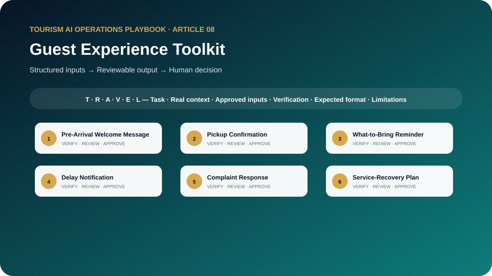

# The Guest Experience AI Toolkit: 10 Prompts for Communication, Complaints, and Service Recovery

**Ready-to-Use AI Templates for Pre-Arrival Messages, Tour Updates, Guest Complaints, Review Analysis, and Post-Experience Follow-Up**



> **Edition:** 1.0.0  
> **Author:** Ahmed Mahmoud  
> **Prompt templates:** 10  
> **Primary audience:** Guest-experience teams, operations managers, service teams and supervisors  
> **Web edition:** https://ahmedqualityops.com/guest-experience-ai-prompts.html

**Direct answer**

## Guest Experience Toolkit: the professional principle

AI can support consistent guest communication and feedback analysis, while facts, privacy, empathy, recovery authority and accountability remain human responsibilities.

**Who this guide is for**

## Target audience

Guest-experience teams, tour operators, DMC service teams, attraction teams, hotel representatives, quality managers and customer-care leaders.

This is a working guide for people who already understand that tourism is delivered through connected handovers. The prompts are designed to improve preparation, consistency and visibility; they do not transfer authority from the trained employee to the AI system.

**Operational value**

## Why this topic matters in tourism

Guest experience is created across many handovers, not only during the tour. AI can help a company create consistent messages and analyse patterns, but it should not reduce a guest to a generic response or commit to compensation before the case is understood and authorised.

This article focuses on the complete customer-experience system. The prompts move from pre-arrival expectation setting to live updates, complaint investigation, recovery, public review response and journey-level improvement. The front-line toolkit remains focused on employee preparation and execution.

**The central control**

AI may organise information and propose a structure. It must not manufacture the confirmed operational reality. When the source of truth changes, the employee must update the inputs and verify the output again.

**Before copying a prompt**

## Responsible AI rules for this toolkit

- Use the minimum guest information required for the task.
- Establish confirmed facts before drafting a complaint response.
- Do not promise refunds, compensation or supplier action without authority.
- Match urgency, channel, language and accessibility to the guest situation.
- Escalate safety, discrimination, privacy and serious service incidents immediately.

Companies should adapt these rules to approved tools, information-security controls, local law, supplier contracts and internal authority. When the implications are legal, privacy-related or cybersecurity-related, qualified specialists should be consulted.

**Shared method**

## The TRAVEL prompting framework

Every template in this playbook follows one memorable structure. The aim is not to make prompts longer for their own sake. It is to place the information, controls and approval points that a tourism professional needs in the right order.

- **T — Task and tourism role**: state the professional perspective and the business decision to support.
- **R — Real operational context**: include the destination, service type, timing, guest journey stage and confirmed constraints.
- **A — Audience and approved inputs**: define the guest or client profile and provide only verified, permitted information.
- **V — Verifiable output rules**: require source labels, assumptions, uncertainty flags and a check against official or approved records.
- **E — Expected format and exceptions**: specify the exact structure, priority order, tone, length and escalation path.
- **L — Limitations, privacy and human sign-off**: prohibit invention, protect data and identify who approves the final output.

**In one sentence:** a professional tourism prompt identifies the task, supplies the real operating context, defines the audience and approved inputs, demands a verifiable structure, explains exceptions and keeps privacy plus final authority with a human.

**Copy-ready working library**

## Ten professional prompt templates

Each prompt contains editable placeholders and a built-in stop rule for missing information. Copy it, replace the placeholders with approved facts and keep the verification and human-approval sections intact. The templates are intentionally detailed because the omitted detail is often where a tourism failure begins.

**Prompt 01**

## Pre-Arrival Welcome Message

Prepare a clear welcome that sets expectations before arrival.

### When to use it

Use it for a controlled draft before information reaches a guest, supplier, colleague or manager.

**Example:** A small group receives its final welcome message 48 hours before arrival.

### Required inputs

- guest segment anonymised
- destination
- arrival date
- confirmed service
- meeting process
- support channel
- weather source
- cultural notes
- required action

### Expected outputs

- email and chat versions
- action checklist
- timing
- verification notes
- accessible-language review

**Copy-and-Paste Template**

### Pre-Arrival Welcome Message

```
ROLE
Act as a tourism guest-journey communication manager in a professional tourism organisation.

TASK
Prepare a clear welcome that sets expectations before arrival.

CONTEXT
Destination/service: [Insert confirmed details]
Date, operating stage and guest/client profile: [Insert approved information]
Sources of truth: [List approved systems, confirmations, SOPs or official sources]

INPUTS
Provide: guest segment anonymised; destination; arrival date; confirmed service; meeting process; support channel; weather source; cultural notes; required action.
If an essential input is missing, contradictory or unconfirmed, stop and list what is required, its owner and source. Do not guess.

OUTPUT
Return: email and chat versions; action checklist; timing; verification notes; accessible-language review. Separate confirmed facts, assumptions, recommendations and pending items. Label dynamic facts with their source and verification date when supplied.

LIMITS
Do not include unverified visa, weather, transport or attraction information.

PRIVACY AND APPROVAL
Exclude unnecessary personal data, identity or payment details, confidential rates, contracts and security information. Finish with verification actions, unresolved questions and the final approver’s role. The output remains a draft until that person checks it against approved sources.
```

**Professional tourism trainer’s note**

Replace every placeholder and keep unresolved items visible until an authorised professional reviews them.

**Prompt 02**

## Pickup Confirmation

Draft a pickup confirmation that reduces missed connections.

### When to use it

Use it for a controlled draft before information reaches a guest, supplier, colleague or manager.

**Example:** Airport guests need a clear meeting-point and delayed-flight instruction.

### Required inputs

- date
- confirmed time/window
- verified location
- meeting sign
- representative
- vehicle information allowed
- luggage
- guest action
- emergency channel

### Expected outputs

- concise message
- location steps
- what to do if delayed
- accessibility note
- internal check

**Copy-and-Paste Template**

### Pickup Confirmation

```
ROLE
Act as a DMC guest communications coordinator in a professional tourism organisation.

TASK
Draft a pickup confirmation that reduces missed connections.

CONTEXT
Destination/service: [Insert confirmed details]
Date, operating stage and guest/client profile: [Insert approved information]
Sources of truth: [List approved systems, confirmations, SOPs or official sources]

INPUTS
Provide: date; confirmed time/window; verified location; meeting sign; representative; vehicle information allowed; luggage; guest action; emergency channel.
If an essential input is missing, contradictory or unconfirmed, stop and list what is required, its owner and source. Do not guess.

OUTPUT
Return: concise message; location steps; what to do if delayed; accessibility note; internal check. Separate confirmed facts, assumptions, recommendations and pending items. Label dynamic facts with their source and verification date when supplied.

LIMITS
Do not expose driver personal details beyond policy or invent a precise time from a window.

PRIVACY AND APPROVAL
Exclude unnecessary personal data, identity or payment details, confidential rates, contracts and security information. Finish with verification actions, unresolved questions and the final approver’s role. The output remains a draft until that person checks it against approved sources.
```

**Professional tourism trainer’s note**

Replace every placeholder and keep unresolved items visible until an authorised professional reviews them.

**Prompt 03**

## What-to-Bring Reminder

Create a practical reminder based only on verified activity requirements.

### When to use it

Use it for a controlled draft before information reaches a guest, supplier, colleague or manager.

**Example:** Guests prepare for a desert safari followed by dinner.

### Required inputs

- activity
- date
- weather source
- supplier requirements
- dress code
- footwear
- documents
- health/safety guidance approved
- storage
- prohibited items

### Expected outputs

- priority packing list
- mandatory versus recommended
- reason
- guest questions
- verification date

**Copy-and-Paste Template**

### What-to-Bring Reminder

```
ROLE
Act as a tour experience preparation specialist in a professional tourism organisation.

TASK
Create a practical reminder based only on verified activity requirements.

CONTEXT
Destination/service: [Insert confirmed details]
Date, operating stage and guest/client profile: [Insert approved information]
Sources of truth: [List approved systems, confirmations, SOPs or official sources]

INPUTS
Provide: activity; date; weather source; supplier requirements; dress code; footwear; documents; health/safety guidance approved; storage; prohibited items.
If an essential input is missing, contradictory or unconfirmed, stop and list what is required, its owner and source. Do not guess.

OUTPUT
Return: priority packing list; mandatory versus recommended; reason; guest questions; verification date. Separate confirmed facts, assumptions, recommendations and pending items. Label dynamic facts with their source and verification date when supplied.

LIMITS
Do not give medical advice or invent supplier restrictions.

PRIVACY AND APPROVAL
Exclude unnecessary personal data, identity or payment details, confidential rates, contracts and security information. Finish with verification actions, unresolved questions and the final approver’s role. The output remains a draft until that person checks it against approved sources.
```

**Professional tourism trainer’s note**

Replace every placeholder and keep unresolved items visible until an authorised professional reviews them.

**Prompt 04**

## Delay Notification

Prepare transparent staged updates during a service delay.

### When to use it

Use it for a controlled draft before information reaches a guest, supplier, colleague or manager.

**Example:** A group waits at an attraction because tickets are not yet released.

### Required inputs

- service
- confirmed delay
- cause confirmed or unknown
- guest impact
- current action
- next update
- alternatives approved
- support channel

### Expected outputs

- immediate alert
- update message
- resolved message
- call script
- internal log points

**Copy-and-Paste Template**

### Delay Notification

```
ROLE
Act as a guest service duty manager in a professional tourism organisation.

TASK
Prepare transparent staged updates during a service delay.

CONTEXT
Destination/service: [Insert confirmed details]
Date, operating stage and guest/client profile: [Insert approved information]
Sources of truth: [List approved systems, confirmations, SOPs or official sources]

INPUTS
Provide: service; confirmed delay; cause confirmed or unknown; guest impact; current action; next update; alternatives approved; support channel.
If an essential input is missing, contradictory or unconfirmed, stop and list what is required, its owner and source. Do not guess.

OUTPUT
Return: immediate alert; update message; resolved message; call script; internal log points. Separate confirmed facts, assumptions, recommendations and pending items. Label dynamic facts with their source and verification date when supplied.

LIMITS
Do not create a new ETA, blame a supplier or promise recovery without approval.

PRIVACY AND APPROVAL
Exclude unnecessary personal data, identity or payment details, confidential rates, contracts and security information. Finish with verification actions, unresolved questions and the final approver’s role. The output remains a draft until that person checks it against approved sources.
```

**Professional tourism trainer’s note**

Replace every placeholder and keep unresolved items visible until an authorised professional reviews them.

**Prompt 05**

## Complaint Response

Draft a personalised response after reviewing confirmed complaint facts.

### When to use it

Use it for a controlled draft before information reaches a guest, supplier, colleague or manager.

**Example:** A guest complains that a shared tour departed without enough waiting time.

### Required inputs

- complaint anonymised
- timeline
- evidence
- service standard
- company finding
- guest impact
- authorised remedy
- pending investigation
- tone

### Expected outputs

- acknowledgement
- factual response
- action
- remedy wording
- next step
- privacy check

**Copy-and-Paste Template**

### Complaint Response

```
ROLE
Act as a senior tourism customer-care specialist in a professional tourism organisation.

TASK
Draft a personalised response after reviewing confirmed complaint facts.

CONTEXT
Destination/service: [Insert confirmed details]
Date, operating stage and guest/client profile: [Insert approved information]
Sources of truth: [List approved systems, confirmations, SOPs or official sources]

INPUTS
Provide: complaint anonymised; timeline; evidence; service standard; company finding; guest impact; authorised remedy; pending investigation; tone.
If an essential input is missing, contradictory or unconfirmed, stop and list what is required, its owner and source. Do not guess.

OUTPUT
Return: acknowledgement; factual response; action; remedy wording; next step; privacy check. Separate confirmed facts, assumptions, recommendations and pending items. Label dynamic facts with their source and verification date when supplied.

LIMITS
Do not disclose employee details, admit unverified liability or invent compensation.

PRIVACY AND APPROVAL
Exclude unnecessary personal data, identity or payment details, confidential rates, contracts and security information. Finish with verification actions, unresolved questions and the final approver’s role. The output remains a draft until that person checks it against approved sources.
```

**Professional tourism trainer’s note**

Replace every placeholder and keep unresolved items visible until an authorised professional reviews them.

**Prompt 06**

## Service-Recovery Plan

Design a proportionate recovery plan that restores control and protects future trust.

### When to use it

Use it for a controlled draft before information reaches a guest, supplier, colleague or manager.

**Example:** A private tour uses the wrong language guide and replacement is possible after one hour.

### Required inputs

- failure
- affected guests
- severity
- immediate safety
- confirmed facts
- available remedies
- authority
- supplier role
- communication
- prevention

### Expected outputs

- stabilisation
- guest options
- decision authority
- message plan
- documentation
- follow-up
- prevention owner

**Copy-and-Paste Template**

### Service-Recovery Plan

```
ROLE
Act as a guest experience recovery manager in a professional tourism organisation.

TASK
Design a proportionate recovery plan that restores control and protects future trust.

CONTEXT
Destination/service: [Insert confirmed details]
Date, operating stage and guest/client profile: [Insert approved information]
Sources of truth: [List approved systems, confirmations, SOPs or official sources]

INPUTS
Provide: failure; affected guests; severity; immediate safety; confirmed facts; available remedies; authority; supplier role; communication; prevention.
If an essential input is missing, contradictory or unconfirmed, stop and list what is required, its owner and source. Do not guess.

OUTPUT
Return: stabilisation; guest options; decision authority; message plan; documentation; follow-up; prevention owner. Separate confirmed facts, assumptions, recommendations and pending items. Label dynamic facts with their source and verification date when supplied.

LIMITS
Escalate safety, discrimination, privacy or major financial cases immediately.

PRIVACY AND APPROVAL
Exclude unnecessary personal data, identity or payment details, confidential rates, contracts and security information. Finish with verification actions, unresolved questions and the final approver’s role. The output remains a draft until that person checks it against approved sources.
```

**Professional tourism trainer’s note**

Replace every placeholder and keep unresolved items visible until an authorised professional reviews them.

**Prompt 07**

## Post-Tour Thank-You Message

Write a warm follow-up that reflects the actual experience and invites useful feedback.

### When to use it

Use it for a controlled draft before information reaches a guest, supplier, colleague or manager.

**Example:** A family completes a three-day private programme.

### Required inputs

- tour
- guest segment
- positive moments confirmed
- issue resolved if appropriate
- feedback channel
- review policy
- future relevance

### Expected outputs

- email and chat versions
- feedback questions
- optional review request
- CRM note
- privacy check

**Copy-and-Paste Template**

### Post-Tour Thank-You Message

```
ROLE
Act as a tourism relationship manager in a professional tourism organisation.

TASK
Write a warm follow-up that reflects the actual experience and invites useful feedback.

CONTEXT
Destination/service: [Insert confirmed details]
Date, operating stage and guest/client profile: [Insert approved information]
Sources of truth: [List approved systems, confirmations, SOPs or official sources]

INPUTS
Provide: tour; guest segment; positive moments confirmed; issue resolved if appropriate; feedback channel; review policy; future relevance.
If an essential input is missing, contradictory or unconfirmed, stop and list what is required, its owner and source. Do not guess.

OUTPUT
Return: email and chat versions; feedback questions; optional review request; CRM note; privacy check. Separate confirmed facts, assumptions, recommendations and pending items. Label dynamic facts with their source and verification date when supplied.

LIMITS
Do not pressure for a positive review or offer undisclosed incentives.

PRIVACY AND APPROVAL
Exclude unnecessary personal data, identity or payment details, confidential rates, contracts and security information. Finish with verification actions, unresolved questions and the final approver’s role. The output remains a draft until that person checks it against approved sources.
```

**Professional tourism trainer’s note**

Replace every placeholder and keep unresolved items visible until an authorised professional reviews them.

**Prompt 08**

## Public Review Response

Draft a public response that is human, private and evidence-aware.

### When to use it

Use it for a controlled draft before information reaches a guest, supplier, colleague or manager.

**Example:** A two-star review alleges a long pickup delay and poor communication.

### Required inputs

- review text
- rating
- known facts suitable for public use
- investigation status
- service values
- private contact
- authorised next step

### Expected outputs

- public reply
- private follow-up outline
- facts not to disclose
- escalation recommendation

**Copy-and-Paste Template**

### Public Review Response

```
ROLE
Act as a online reputation manager for a tourism company in a professional tourism organisation.

TASK
Draft a public response that is human, private and evidence-aware.

CONTEXT
Destination/service: [Insert confirmed details]
Date, operating stage and guest/client profile: [Insert approved information]
Sources of truth: [List approved systems, confirmations, SOPs or official sources]

INPUTS
Provide: review text; rating; known facts suitable for public use; investigation status; service values; private contact; authorised next step.
If an essential input is missing, contradictory or unconfirmed, stop and list what is required, its owner and source. Do not guess.

OUTPUT
Return: public reply; private follow-up outline; facts not to disclose; escalation recommendation. Separate confirmed facts, assumptions, recommendations and pending items. Label dynamic facts with their source and verification date when supplied.

LIMITS
Never reveal booking, health, staff or contact details in public.

PRIVACY AND APPROVAL
Exclude unnecessary personal data, identity or payment details, confidential rates, contracts and security information. Finish with verification actions, unresolved questions and the final approver’s role. The output remains a draft until that person checks it against approved sources.
```

**Professional tourism trainer’s note**

Replace every placeholder and keep unresolved items visible until an authorised professional reviews them.

**Prompt 09**

## Guest-Feedback Analysis

Analyse anonymised feedback for themes, severity, journey stage and controllable causes.

### When to use it

Use it for a controlled draft before information reaches a guest, supplier, colleague or manager.

**Example:** A DMC reviews 300 comments from tours and transfers.

### Required inputs

- feedback set
- dates
- products
- channels
- rating
- complaint categories
- operational data
- coding rules

### Expected outputs

- theme table
- frequency
- severity
- representative paraphrases
- journey hotspots
- hypotheses
- actions
- data limits

**Copy-and-Paste Template**

### Guest-Feedback Analysis

```
ROLE
Act as a tourism voice-of-customer analyst in a professional tourism organisation.

TASK
Analyse anonymised feedback for themes, severity, journey stage and controllable causes.

CONTEXT
Destination/service: [Insert confirmed details]
Date, operating stage and guest/client profile: [Insert approved information]
Sources of truth: [List approved systems, confirmations, SOPs or official sources]

INPUTS
Provide: feedback set; dates; products; channels; rating; complaint categories; operational data; coding rules.
If an essential input is missing, contradictory or unconfirmed, stop and list what is required, its owner and source. Do not guess.

OUTPUT
Return: theme table; frequency; severity; representative paraphrases; journey hotspots; hypotheses; actions; data limits. Separate confirmed facts, assumptions, recommendations and pending items. Label dynamic facts with their source and verification date when supplied.

LIMITS
Do not identify individuals or claim causation from comments alone.

PRIVACY AND APPROVAL
Exclude unnecessary personal data, identity or payment details, confidential rates, contracts and security information. Finish with verification actions, unresolved questions and the final approver’s role. The output remains a draft until that person checks it against approved sources.
```

**Professional tourism trainer’s note**

Replace every placeholder and keep unresolved items visible until an authorised professional reviews them.

**Prompt 10**

## Guest-Journey Improvement Report

Turn journey evidence into prioritised improvements across departments.

### When to use it

Use it for a controlled draft before information reaches a guest, supplier, colleague or manager.

**Example:** Management wants to reduce arrival confusion and first-day complaints.

### Required inputs

- journey map
- feedback
- incidents
- timing
- contact data
- handovers
- SOPs
- costs if approved
- business objective

### Expected outputs

- current-state summary
- moments of truth
- failure modes
- root-cause questions
- actions
- owners
- measures
- roadmap

**Copy-and-Paste Template**

### Guest-Journey Improvement Report

```
ROLE
Act as a customer-experience and operations consultant in a professional tourism organisation.

TASK
Turn journey evidence into prioritised improvements across departments.

CONTEXT
Destination/service: [Insert confirmed details]
Date, operating stage and guest/client profile: [Insert approved information]
Sources of truth: [List approved systems, confirmations, SOPs or official sources]

INPUTS
Provide: journey map; feedback; incidents; timing; contact data; handovers; SOPs; costs if approved; business objective.
If an essential input is missing, contradictory or unconfirmed, stop and list what is required, its owner and source. Do not guess.

OUTPUT
Return: current-state summary; moments of truth; failure modes; root-cause questions; actions; owners; measures; roadmap. Separate confirmed facts, assumptions, recommendations and pending items. Label dynamic facts with their source and verification date when supplied.

LIMITS
Keep recommendations linked to evidence and operational ownership.

PRIVACY AND APPROVAL
Exclude unnecessary personal data, identity or payment details, confidential rates, contracts and security information. Finish with verification actions, unresolved questions and the final approver’s role. The output remains a draft until that person checks it against approved sources.
```

**Professional tourism trainer’s note**

Replace every placeholder and keep unresolved items visible until an authorised professional reviews them.

**Quality control**

## Common mistakes to avoid

1. **Mistake 1:** Sending a friendly message that does not explain what the guest must do.
2. **Mistake 2:** Apologising for an unverified event in a way that creates a false admission.
3. **Mistake 3:** Responding publicly with private booking details.
4. **Mistake 4:** Using identical recovery language for every level of failure.
5. **Mistake 5:** Analysing feedback without separating frequency, severity and operational cause.

A useful internal review question is: “Could a new employee read this output and mistake a proposal for a confirmation?” If the answer is yes, revise the prompt and output labels before use.

**From template to controlled workflow**

## Implementation guidance for tourism teams

Map the guest journey and assign message owners to each stage. Create approved templates for routine communication and escalation rules for exceptions. Use anonymised feedback in analysis prompts and review trends with operations, product and quality teams.

1**Select**

Choose a low-risk, frequent task with a clear owner and source of truth.

2**Test**

Run realistic anonymised cases, including missing data and operational exceptions.

3**Approve**

Document the prompt version, permitted users, tool, reviewer and release criteria.

4**Measure**

Track quality, time saved, defects, escalations and employee feedback.

5**Improve**

Update the prompt when the process, destination, supplier or risk changes.

**Professional release gate**

## Final verification checklist

The task and intended business decision are clear. Required information came from approved sources. Dynamic facts have a source and verification date. Missing information is visible and assigned to an owner. Personal and confidential data were minimised. The output respects role and commercial authority. Safety, accessibility and cultural considerations were checked. Assumptions are separated from confirmed facts. The relevant tourism professional reviewed the output. The final approval and version are recorded.

**Conclusion**

## Use AI to strengthen tourism judgement, not to bypass it

The best result is not the longest response or the most impressive wording. It is an output that helps a trained tourism professional see the situation clearly, find missing information early, communicate consistently and make a controlled decision. Keep the TRAVEL framework, verification table, privacy boundaries and human sign-off visible every time the prompt is adapted.

**Frequently asked questions**

## Questions tourism teams ask

Can AI answer guest complaints?

It can draft a response after the facts, authority and recovery options are supplied. A trained employee must review and send it.

How is a delay message made useful?

State what changed, what is confirmed, the next update time, what the guest should do and how urgent support can be reached.

Should guest reviews be pasted into AI?

Public review text may be analysed, but remove identifiers where possible and follow company policy. Private feedback requires stronger data controls.

What is service recovery?

A controlled response that stabilises the guest, addresses the immediate issue, communicates ownership, provides an authorised remedy and prevents recurrence.

How should public review replies differ?

They should acknowledge the experience, protect privacy, avoid arguments, explain genuine follow-up appropriately and invite a private channel when details are needed.

**Continue the knowledge path**

## Related reading and connected projects

[Article 02**Front-Line Toolkit**

Ten detailed AI prompt templates for tour preparation, storytelling, multilingual communication, delays, complaints, role-play and post-tour reporting.](./02-front-line-tourism-ai-toolkit.md)[Article 03**DMC Operations Toolkit**

Ten copy-ready prompts designed around real DMC tour files, assignments, supplier confirmations, movement plans, disruptions and handovers.](./03-dmc-operations-ai-toolkit.md)[Article 06**Itinerary Toolkit**

Ten copy-ready AI prompts for one-day, multi-day, stopover, cruise, family, luxury, accessible and weather-resilient itineraries.](./06-tourism-itinerary-ai-toolkit.md)[Article 09**Quality & SOP Toolkit**

Ten tourism-specific AI prompts for SOPs, process maps, Five Whys, fishbone analysis, incidents, CAPA, audits, training and quality reporting.](./09-tourism-quality-sop-ai-toolkit.md)[Existing insight or project**Article Destination Experience Journey Map**

Review the full guest journey and its operational handovers.](https://ahmedqualityops.com/article-destination-experience-journey-map.html)[Existing insight or project**Article Tour Guide Quality Index**

Connect guest feedback with guide-quality evidence.](https://ahmedqualityops.com/article-tour-guide-quality-index.html)[Existing insight or project**Article Tour Guide Storytelling System**

See how front-line interpretation shapes memorable experiences.](https://ahmedqualityops.com/article-tour-guide-storytelling-system.html)

[Series hub**Tourism AI Operations Playbook**](../README.md)

[Previous article**← Sales & Quotation Toolkit**](./07-tourism-sales-quotation-ai-toolkit.md)[Next article**Quality & SOP Toolkit →**](./09-tourism-quality-sop-ai-toolkit.md)

**Professional verification reminder:** Always compare AI output with approved internal systems, official sources and qualified human judgement before it affects a guest, supplier, employee or commercial commitment.
