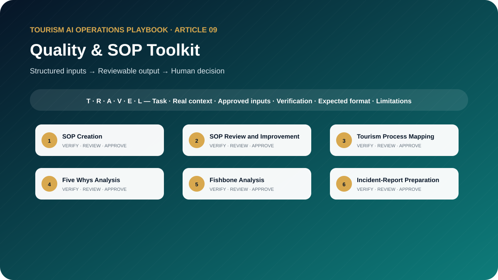

# The Tourism Quality and SOP AI Toolkit: 10 Prompts for Process Improvement and Operational Excellence

**Professional AI Templates for SOP Development, Root-Cause Analysis, Incident Reporting, Training, Audits, and Corrective Actions**



> **Edition:** 1.0.0  
> **Author:** Ahmed Mahmoud  
> **Prompt templates:** 10  
> **Primary audience:** Quality managers, trainers, process owners and tourism operations leaders  
> **Web edition:** https://ahmedqualityops.com/tourism-quality-sop-ai-prompts.html

**Direct answer**

## Quality & SOP Toolkit: the professional principle

AI can structure SOP and quality work from evidence, but process owners must observe the job, validate causes and confirm corrective-action effectiveness.

**Who this guide is for**

## Target audience

Tourism quality managers, operations leaders, DMC supervisors, trainers, process owners, internal auditors and Lean Six Sigma practitioners.

This is a working guide for people who already understand that tourism is delivered through connected handovers. The prompts are designed to improve preparation, consistency and visibility; they do not transfer authority from the trained employee to the AI system.

**Operational value**

## Why this topic matters in tourism

Tourism quality is measured in live service: the guest was found, the vehicle arrived, the attraction process worked, the guide was prepared and recovery was controlled. AI can help structure quality work, but it cannot establish evidence, determine accountability or approve a corrective action by itself.

The toolkit adapts process-improvement methods to tourism handovers, suppliers, movements and guest-facing service. Each prompt requires evidence, process ownership and practical field validation so the result does not sound like a generic manufacturing document.

**The central control**

AI may organise information and propose a structure. It must not manufacture the confirmed operational reality. When the source of truth changes, the employee must update the inputs and verify the output again.

**Before copying a prompt**

## Responsible AI rules for this toolkit

- Base analysis on records, observations and confirmed statements.
- Separate immediate correction, root cause, corrective action and preventive action.
- Do not name or blame employees without verified evidence and due process.
- Test SOP steps with the people who perform the work.
- Require process-owner approval and a review date.

Companies should adapt these rules to approved tools, information-security controls, local law, supplier contracts and internal authority. When the implications are legal, privacy-related or cybersecurity-related, qualified specialists should be consulted.

**Shared method**

## The TRAVEL prompting framework

Every template in this playbook follows one memorable structure. The aim is not to make prompts longer for their own sake. It is to place the information, controls and approval points that a tourism professional needs in the right order.

- **T — Task and tourism role**: state the professional perspective and the business decision to support.
- **R — Real operational context**: include the destination, service type, timing, guest journey stage and confirmed constraints.
- **A — Audience and approved inputs**: define the guest or client profile and provide only verified, permitted information.
- **V — Verifiable output rules**: require source labels, assumptions, uncertainty flags and a check against official or approved records.
- **E — Expected format and exceptions**: specify the exact structure, priority order, tone, length and escalation path.
- **L — Limitations, privacy and human sign-off**: prohibit invention, protect data and identify who approves the final output.

**In one sentence:** a professional tourism prompt identifies the task, supplies the real operating context, defines the audience and approved inputs, demands a verifiable structure, explains exceptions and keeps privacy plus final authority with a human.

**Copy-ready working library**

## Ten professional prompt templates

Each prompt contains editable placeholders and a built-in stop rule for missing information. Copy it, replace the placeholders with approved facts and keep the verification and human-approval sections intact. The templates are intentionally detailed because the omitted detail is often where a tourism failure begins.

**Prompt 01**

## SOP Creation

Create a field-ready sop from a verified current process and control requirements.

### When to use it

Use it for a controlled draft before information reaches a guest, supplier, colleague or manager.

**Example:** A DMC documents its airport representative arrival process.

### Required inputs

- process purpose
- trigger
- scope
- roles
- observed steps
- systems
- forms
- timing
- exceptions
- safety
- approvals
- records

### Expected outputs

- document control
- purpose
- roles
- step table
- decision points
- exceptions
- records
- KPIs
- training
- review

**Copy-and-Paste Template**

### SOP Creation

```
ROLE
Act as a tourism process owner and SOP facilitator in a professional tourism organisation.

TASK
Create a field-ready sop from a verified current process and control requirements.

CONTEXT
Destination/service: [Insert confirmed details]
Date, operating stage and guest/client profile: [Insert approved information]
Sources of truth: [List approved systems, confirmations, SOPs or official sources]

INPUTS
Provide: process purpose; trigger; scope; roles; observed steps; systems; forms; timing; exceptions; safety; approvals; records.
If an essential input is missing, contradictory or unconfirmed, stop and list what is required, its owner and source. Do not guess.

OUTPUT
Return: document control; purpose; roles; step table; decision points; exceptions; records; KPIs; training; review. Separate confirmed facts, assumptions, recommendations and pending items. Label dynamic facts with their source and verification date when supplied.

LIMITS
Do not invent steps. Mark every area requiring observation or process-owner validation.

PRIVACY AND APPROVAL
Exclude unnecessary personal data, identity or payment details, confidential rates, contracts and security information. Finish with verification actions, unresolved questions and the final approver’s role. The output remains a draft until that person checks it against approved sources.
```

**Professional tourism trainer’s note**

Replace every placeholder and keep unresolved items visible until an authorised professional reviews them.

**Prompt 02**

## SOP Review and Improvement

Audit an existing sop against actual practice, risk and usability.

### When to use it

Use it for a controlled draft before information reaches a guest, supplier, colleague or manager.

**Example:** A pickup SOP no longer matches the dispatch application used by the team.

### Required inputs

- current SOP
- observation notes
- employee feedback
- incidents
- system changes
- policy
- metrics
- version history

### Expected outputs

- gap matrix
- obsolete steps
- hidden work
- control failures
- revised sections
- validation plan

**Copy-and-Paste Template**

### SOP Review and Improvement

```
ROLE
Act as a tourism quality manager in a professional tourism organisation.

TASK
Audit an existing sop against actual practice, risk and usability.

CONTEXT
Destination/service: [Insert confirmed details]
Date, operating stage and guest/client profile: [Insert approved information]
Sources of truth: [List approved systems, confirmations, SOPs or official sources]

INPUTS
Provide: current SOP; observation notes; employee feedback; incidents; system changes; policy; metrics; version history.
If an essential input is missing, contradictory or unconfirmed, stop and list what is required, its owner and source. Do not guess.

OUTPUT
Return: gap matrix; obsolete steps; hidden work; control failures; revised sections; validation plan. Separate confirmed facts, assumptions, recommendations and pending items. Label dynamic facts with their source and verification date when supplied.

LIMITS
Do not change controlled requirements without authorised review.

PRIVACY AND APPROVAL
Exclude unnecessary personal data, identity or payment details, confidential rates, contracts and security information. Finish with verification actions, unresolved questions and the final approver’s role. The output remains a draft until that person checks it against approved sources.
```

**Professional tourism trainer’s note**

Replace every placeholder and keep unresolved items visible until an authorised professional reviews them.

**Prompt 03**

## Tourism Process Mapping

Map a guest-facing process across roles, handovers and systems.

### When to use it

Use it for a controlled draft before information reaches a guest, supplier, colleague or manager.

**Example:** The team maps booking handover from sales to operations to the guide.

### Required inputs

- start/end
- customer
- suppliers
- inputs
- observed steps
- decisions
- queues
- systems
- defects
- timing
- owners

### Expected outputs

- SIPOC
- swimlane narrative
- value/non-value analysis
- failure points
- data needs
- future-state questions

**Copy-and-Paste Template**

### Tourism Process Mapping

```
ROLE
Act as a Lean Six Sigma tourism facilitator in a professional tourism organisation.

TASK
Map a guest-facing process across roles, handovers and systems.

CONTEXT
Destination/service: [Insert confirmed details]
Date, operating stage and guest/client profile: [Insert approved information]
Sources of truth: [List approved systems, confirmations, SOPs or official sources]

INPUTS
Provide: start/end; customer; suppliers; inputs; observed steps; decisions; queues; systems; defects; timing; owners.
If an essential input is missing, contradictory or unconfirmed, stop and list what is required, its owner and source. Do not guess.

OUTPUT
Return: SIPOC; swimlane narrative; value/non-value analysis; failure points; data needs; future-state questions. Separate confirmed facts, assumptions, recommendations and pending items. Label dynamic facts with their source and verification date when supplied.

LIMITS
Represent the current state honestly before proposing improvements.

PRIVACY AND APPROVAL
Exclude unnecessary personal data, identity or payment details, confidential rates, contracts and security information. Finish with verification actions, unresolved questions and the final approver’s role. The output remains a draft until that person checks it against approved sources.
```

**Professional tourism trainer’s note**

Replace every placeholder and keep unresolved items visible until an authorised professional reviews them.

**Prompt 04**

## Five Whys Analysis

Lead an evidence-based five whys analysis that goes beyond blame.

### When to use it

Use it for a controlled draft before information reaches a guest, supplier, colleague or manager.

**Example:** Guests repeatedly receive the pickup message too late.

### Required inputs

- problem statement
- when/where
- scale
- timeline
- records
- interviews
- controls
- prior incidents

### Expected outputs

- validated problem
- why chain with evidence
- branches
- root-cause confidence
- missing evidence
- actions

**Copy-and-Paste Template**

### Five Whys Analysis

```
ROLE
Act as a tourism root-cause facilitator in a professional tourism organisation.

TASK
Lead an evidence-based five whys analysis that goes beyond blame.

CONTEXT
Destination/service: [Insert confirmed details]
Date, operating stage and guest/client profile: [Insert approved information]
Sources of truth: [List approved systems, confirmations, SOPs or official sources]

INPUTS
Provide: problem statement; when/where; scale; timeline; records; interviews; controls; prior incidents.
If an essential input is missing, contradictory or unconfirmed, stop and list what is required, its owner and source. Do not guess.

OUTPUT
Return: validated problem; why chain with evidence; branches; root-cause confidence; missing evidence; actions. Separate confirmed facts, assumptions, recommendations and pending items. Label dynamic facts with their source and verification date when supplied.

LIMITS
Do not force exactly five levels or stop at “staff forgot”.

PRIVACY AND APPROVAL
Exclude unnecessary personal data, identity or payment details, confidential rates, contracts and security information. Finish with verification actions, unresolved questions and the final approver’s role. The output remains a draft until that person checks it against approved sources.
```

**Professional tourism trainer’s note**

Replace every placeholder and keep unresolved items visible until an authorised professional reviews them.

**Prompt 05**

## Fishbone Analysis

Organise possible causes across service-relevant categories and create a validation plan.

### When to use it

Use it for a controlled draft before information reaches a guest, supplier, colleague or manager.

**Example:** Coaches repeatedly arrive late at one attraction.

### Required inputs

- problem
- evidence
- people
- process
- systems
- supplier
- environment
- information
- measurement
- management

### Expected outputs

- fishbone categories
- possible causes
- evidence status
- test method
- priority hypotheses
- workshop questions

**Copy-and-Paste Template**

### Fishbone Analysis

```
ROLE
Act as a tourism quality workshop facilitator in a professional tourism organisation.

TASK
Organise possible causes across service-relevant categories and create a validation plan.

CONTEXT
Destination/service: [Insert confirmed details]
Date, operating stage and guest/client profile: [Insert approved information]
Sources of truth: [List approved systems, confirmations, SOPs or official sources]

INPUTS
Provide: problem; evidence; people; process; systems; supplier; environment; information; measurement; management.
If an essential input is missing, contradictory or unconfirmed, stop and list what is required, its owner and source. Do not guess.

OUTPUT
Return: fishbone categories; possible causes; evidence status; test method; priority hypotheses; workshop questions. Separate confirmed facts, assumptions, recommendations and pending items. Label dynamic facts with their source and verification date when supplied.

LIMITS
Possible causes are not confirmed root causes.

PRIVACY AND APPROVAL
Exclude unnecessary personal data, identity or payment details, confidential rates, contracts and security information. Finish with verification actions, unresolved questions and the final approver’s role. The output remains a draft until that person checks it against approved sources.
```

**Professional tourism trainer’s note**

Replace every placeholder and keep unresolved items visible until an authorised professional reviews them.

**Prompt 06**

## Incident-Report Preparation

Turn factual notes into a neutral, chronological incident report.

### When to use it

Use it for a controlled draft before information reaches a guest, supplier, colleague or manager.

**Example:** A guest is temporarily separated from a group at a busy attraction.

### Required inputs

- date/time
- location
- people by role or anonymised ID
- observed facts
- actions
- guest impact
- evidence
- notifications
- open items

### Expected outputs

- summary
- chronology
- immediate controls
- statements separated
- evidence list
- escalation
- follow-up

**Copy-and-Paste Template**

### Incident-Report Preparation

```
ROLE
Act as a tourism incident documentation specialist in a professional tourism organisation.

TASK
Turn factual notes into a neutral, chronological incident report.

CONTEXT
Destination/service: [Insert confirmed details]
Date, operating stage and guest/client profile: [Insert approved information]
Sources of truth: [List approved systems, confirmations, SOPs or official sources]

INPUTS
Provide: date/time; location; people by role or anonymised ID; observed facts; actions; guest impact; evidence; notifications; open items.
If an essential input is missing, contradictory or unconfirmed, stop and list what is required, its owner and source. Do not guess.

OUTPUT
Return: summary; chronology; immediate controls; statements separated; evidence list; escalation; follow-up. Separate confirmed facts, assumptions, recommendations and pending items. Label dynamic facts with their source and verification date when supplied.

LIMITS
Do not speculate, assign blame or remove inconvenient facts.

PRIVACY AND APPROVAL
Exclude unnecessary personal data, identity or payment details, confidential rates, contracts and security information. Finish with verification actions, unresolved questions and the final approver’s role. The output remains a draft until that person checks it against approved sources.
```

**Professional tourism trainer’s note**

Replace every placeholder and keep unresolved items visible until an authorised professional reviews them.

**Prompt 07**

## Corrective and Preventive Action Planning

Create a controlled capa plan after a supported root-cause finding.

### When to use it

Use it for a controlled draft before information reaches a guest, supplier, colleague or manager.

**Example:** An attraction voucher error recurs across two products.

### Required inputs

- incident
- root cause
- affected processes
- immediate correction
- risk
- proposed actions
- owners
- resources
- measures
- due dates

### Expected outputs

- correction
- corrective actions
- preventive actions
- owner
- milestone
- verification
- effectiveness check
- closure rule

**Copy-and-Paste Template**

### Corrective and Preventive Action Planning

```
ROLE
Act as a tourism CAPA coordinator in a professional tourism organisation.

TASK
Create a controlled capa plan after a supported root-cause finding.

CONTEXT
Destination/service: [Insert confirmed details]
Date, operating stage and guest/client profile: [Insert approved information]
Sources of truth: [List approved systems, confirmations, SOPs or official sources]

INPUTS
Provide: incident; root cause; affected processes; immediate correction; risk; proposed actions; owners; resources; measures; due dates.
If an essential input is missing, contradictory or unconfirmed, stop and list what is required, its owner and source. Do not guess.

OUTPUT
Return: correction; corrective actions; preventive actions; owner; milestone; verification; effectiveness check; closure rule. Separate confirmed facts, assumptions, recommendations and pending items. Label dynamic facts with their source and verification date when supplied.

LIMITS
Do not close an action because training was delivered; require effectiveness evidence.

PRIVACY AND APPROVAL
Exclude unnecessary personal data, identity or payment details, confidential rates, contracts and security information. Finish with verification actions, unresolved questions and the final approver’s role. The output remains a draft until that person checks it against approved sources.
```

**Professional tourism trainer’s note**

Replace every placeholder and keep unresolved items visible until an authorised professional reviews them.

**Prompt 08**

## Operational Audit Checklist

Design a risk-based audit checklist that tests evidence rather than only asking yes/no questions.

### When to use it

Use it for a controlled draft before information reaches a guest, supplier, colleague or manager.

**Example:** Quality audits the morning dispatch process during peak season.

### Required inputs

- process
- SOP
- critical controls
- records
- sampling period
- roles
- known risks
- regulatory or company criteria

### Expected outputs

- audit objective
- sample
- questions
- evidence expected
- scoring
- critical failures
- interview prompts
- report format

**Copy-and-Paste Template**

### Operational Audit Checklist

```
ROLE
Act as a tourism internal auditor in a professional tourism organisation.

TASK
Design a risk-based audit checklist that tests evidence rather than only asking yes/no questions.

CONTEXT
Destination/service: [Insert confirmed details]
Date, operating stage and guest/client profile: [Insert approved information]
Sources of truth: [List approved systems, confirmations, SOPs or official sources]

INPUTS
Provide: process; SOP; critical controls; records; sampling period; roles; known risks; regulatory or company criteria.
If an essential input is missing, contradictory or unconfirmed, stop and list what is required, its owner and source. Do not guess.

OUTPUT
Return: audit objective; sample; questions; evidence expected; scoring; critical failures; interview prompts; report format. Separate confirmed facts, assumptions, recommendations and pending items. Label dynamic facts with their source and verification date when supplied.

LIMITS
Do not include a criterion unless its source and owner are known.

PRIVACY AND APPROVAL
Exclude unnecessary personal data, identity or payment details, confidential rates, contracts and security information. Finish with verification actions, unresolved questions and the final approver’s role. The output remains a draft until that person checks it against approved sources.
```

**Professional tourism trainer’s note**

Replace every placeholder and keep unresolved items visible until an authorised professional reviews them.

**Prompt 09**

## Training-Needs Analysis

Identify whether a performance gap requires training, process change, tools or management action.

### When to use it

Use it for a controlled draft before information reaches a guest, supplier, colleague or manager.

**Example:** New guides make inconsistent post-tour reports.

### Required inputs

- performance standard
- observed results
- incidents
- employee feedback
- task frequency
- knowledge
- resources
- supervision
- systems

### Expected outputs

- gap analysis
- cause categories
- learner groups
- training objectives
- non-training actions
- evaluation plan

**Copy-and-Paste Template**

### Training-Needs Analysis

```
ROLE
Act as a tourism learning and performance consultant in a professional tourism organisation.

TASK
Identify whether a performance gap requires training, process change, tools or management action.

CONTEXT
Destination/service: [Insert confirmed details]
Date, operating stage and guest/client profile: [Insert approved information]
Sources of truth: [List approved systems, confirmations, SOPs or official sources]

INPUTS
Provide: performance standard; observed results; incidents; employee feedback; task frequency; knowledge; resources; supervision; systems.
If an essential input is missing, contradictory or unconfirmed, stop and list what is required, its owner and source. Do not guess.

OUTPUT
Return: gap analysis; cause categories; learner groups; training objectives; non-training actions; evaluation plan. Separate confirmed facts, assumptions, recommendations and pending items. Label dynamic facts with their source and verification date when supplied.

LIMITS
Do not prescribe training when the main cause is missing information, workload, system design or authority.

PRIVACY AND APPROVAL
Exclude unnecessary personal data, identity or payment details, confidential rates, contracts and security information. Finish with verification actions, unresolved questions and the final approver’s role. The output remains a draft until that person checks it against approved sources.
```

**Professional tourism trainer’s note**

Replace every placeholder and keep unresolved items visible until an authorised professional reviews them.

**Prompt 10**

## Monthly Quality-Performance Summary

Prepare a management summary from verified operational and guest-experience evidence.

### When to use it

Use it for a controlled draft before information reaches a guest, supplier, colleague or manager.

**Example:** A DMC quality manager reports to operations and product leaders.

### Required inputs

- month
- KPIs
- targets
- incidents
- complaints
- audits
- CAPA
- supplier issues
- training
- prior trend
- data quality

### Expected outputs

- executive summary
- KPI table
- trend
- top risks
- successes
- overdue actions
- next-month priorities
- caveats

**Copy-and-Paste Template**

### Monthly Quality-Performance Summary

```
ROLE
Act as a tourism quality performance analyst in a professional tourism organisation.

TASK
Prepare a management summary from verified operational and guest-experience evidence.

CONTEXT
Destination/service: [Insert confirmed details]
Date, operating stage and guest/client profile: [Insert approved information]
Sources of truth: [List approved systems, confirmations, SOPs or official sources]

INPUTS
Provide: month; KPIs; targets; incidents; complaints; audits; CAPA; supplier issues; training; prior trend; data quality.
If an essential input is missing, contradictory or unconfirmed, stop and list what is required, its owner and source. Do not guess.

OUTPUT
Return: executive summary; KPI table; trend; top risks; successes; overdue actions; next-month priorities; caveats. Separate confirmed facts, assumptions, recommendations and pending items. Label dynamic facts with their source and verification date when supplied.

LIMITS
Do not hide low sample sizes or combine unlike measures.

PRIVACY AND APPROVAL
Exclude unnecessary personal data, identity or payment details, confidential rates, contracts and security information. Finish with verification actions, unresolved questions and the final approver’s role. The output remains a draft until that person checks it against approved sources.
```

**Professional tourism trainer’s note**

Replace every placeholder and keep unresolved items visible until an authorised professional reviews them.

**Quality control**

## Common mistakes to avoid

1. **Mistake 1:** Writing an SOP from management assumptions without observing the job.
2. **Mistake 2:** Stopping a Five Whys analysis at “human error”.
3. **Mistake 3:** Mixing facts, opinions and proposed actions in an incident report.
4. **Mistake 4:** Creating a long audit checklist that misses critical controls.
5. **Mistake 5:** Closing corrective action without effectiveness evidence.

A useful internal review question is: “Could a new employee read this output and mistake a proposal for a confirmation?” If the answer is yes, revise the prompt and output labels before use.

**From template to controlled workflow**

## Implementation guidance for tourism teams

Select one recurring operational failure and collect real evidence. Map the current process with front-line employees, use the relevant prompt to structure analysis and assign an owner, due date and effectiveness measure. Update the SOP only after the improved process is tested.

1**Select**

Choose a low-risk, frequent task with a clear owner and source of truth.

2**Test**

Run realistic anonymised cases, including missing data and operational exceptions.

3**Approve**

Document the prompt version, permitted users, tool, reviewer and release criteria.

4**Measure**

Track quality, time saved, defects, escalations and employee feedback.

5**Improve**

Update the prompt when the process, destination, supplier or risk changes.

**Professional release gate**

## Final verification checklist

The task and intended business decision are clear. Required information came from approved sources. Dynamic facts have a source and verification date. Missing information is visible and assigned to an owner. Personal and confidential data were minimised. The output respects role and commercial authority. Safety, accessibility and cultural considerations were checked. Assumptions are separated from confirmed facts. The relevant tourism professional reviewed the output. The final approval and version are recorded.

**Conclusion**

## Use AI to strengthen tourism judgement, not to bypass it

The best result is not the longest response or the most impressive wording. It is an output that helps a trained tourism professional see the situation clearly, find missing information early, communicate consistently and make a controlled decision. Keep the TRAVEL framework, verification table, privacy boundaries and human sign-off visible every time the prompt is adapted.

**Frequently asked questions**

## Questions tourism teams ask

Can AI write an SOP?

It can structure a draft from verified process information. The process owner and employees who perform the work must validate every step.

How does Lean Six Sigma apply to tourism?

It helps teams define service problems, measure evidence, identify causes, improve handovers and control the new process while protecting guest experience.

What is wrong with “human error” as a root cause?

It does not explain why the system allowed the error. Training, workload, information, interface, procedure, supervision and environment should be examined.

What is CAPA?

Corrective and preventive action is a controlled plan to remove causes of an existing issue and reduce the risk of similar issues elsewhere.

How is effectiveness checked?

Use a defined indicator, sample, observation period and acceptance criterion after implementation rather than relying on completion alone.

**Continue the knowledge path**

## Related reading and connected projects

[Article 03**DMC Operations Toolkit**

Ten copy-ready prompts designed around real DMC tour files, assignments, supplier confirmations, movement plans, disruptions and handovers.](./03-dmc-operations-ai-toolkit.md)[Article 04**Transport & Dispatch Toolkit**

Ten detailed prompts for hotel pickup sequencing, zone planning, vehicle checks, driver briefings, late vehicles, drop-offs and fleet reporting.](./04-tourism-transport-dispatch-ai-toolkit.md)[Article 08**Guest Experience Toolkit**

Ten practical prompts covering pre-arrival communication, pickup reminders, delays, complaints, recovery, reviews and journey improvement.](./08-guest-experience-ai-toolkit.md)[Article 10**Responsible AI Guide**

A practical tourism governance guide with ten templates for risk, verification, privacy, cultural sensitivity, approvals, policies and AI reviews.](./10-responsible-ai-for-tourism.md)[Existing insight or project**Article Tour Guide Quality Index**

Apply measurable quality thinking to tour-guide delivery.](https://ahmedqualityops.com/article-tour-guide-quality-index.html)[Existing insight or project**Article Assignment Engine Dmc Operations**

See how structured assignment controls reduce operational mismatch.](https://ahmedqualityops.com/article-assignment-engine-dmc-operations.html)[Existing insight or project**Article Fleet Control Tower Operations Dashboard**

Turn operational evidence into visible control signals.](https://ahmedqualityops.com/article-fleet-control-tower-operations-dashboard.html)

[Series hub**Tourism AI Operations Playbook**](../README.md)

[Previous article**← Guest Experience Toolkit**](./08-guest-experience-ai-toolkit.md)[Next article**Responsible AI Guide →**](./10-responsible-ai-for-tourism.md)

**Professional verification reminder:** Always compare AI output with approved internal systems, official sources and qualified human judgement before it affects a guest, supplier, employee or commercial commitment.
