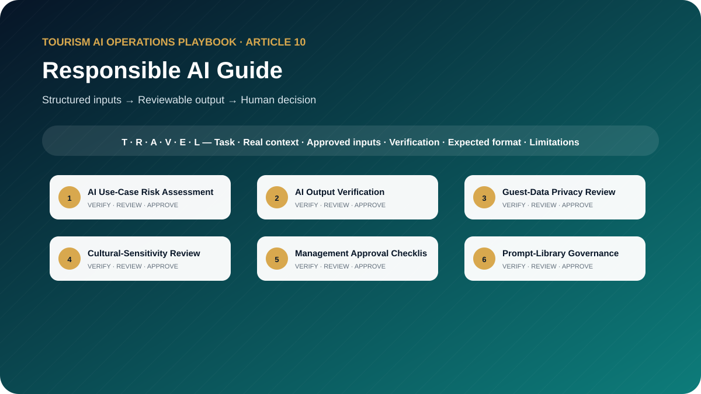

# Responsible AI for Tourism: A Practical Governance Guide for Travel Companies

**How to Protect Guest Data, Verify AI Outputs, Control Prompt Usage, Reduce Risk, and Maintain Human Accountability**



> **Edition:** 1.0.0  
> **Author:** Ahmed Mahmoud  
> **Prompt templates:** 10  
> **Primary audience:** Tourism leaders, managers, trainers, privacy teams and AI governance owners  
> **Web edition:** https://ahmedqualityops.com/responsible-ai-tourism-guide.html

**Direct answer**

## Responsible AI Guide: the professional principle

Responsible AI in tourism means approved use cases, minimum necessary data, verifiable outputs, clear access, trained employees and a named human accountable for decisions.

**Who this guide is for**

## Target audience

Tourism executives, operations and quality leaders, data and privacy teams, HR and training teams, department managers, product owners and small travel-business owners.

This is a working guide for people who already understand that tourism is delivered through connected handovers. The prompts are designed to improve preparation, consistency and visibility; they do not transfer authority from the trained employee to the AI system.

**Operational value**

## Why this topic matters in tourism

Tourism companies handle guest data, supplier information, live operational decisions and culturally sensitive communication. Responsible AI is therefore an operating discipline, not a disclaimer. Companies need clear use cases, approved tools, access rules, verification, incident handling and accountable human decisions.

The guide translates recognised risk and ethics principles into practical controls for travel companies. It is not legal advice. Organisations should obtain qualified legal, privacy and cybersecurity guidance when their jurisdiction, systems or data require it.

**The central control**

AI may organise information and propose a structure. It must not manufacture the confirmed operational reality. When the source of truth changes, the employee must update the inputs and verify the output again.

**Before copying a prompt**

## Responsible AI rules for this toolkit

- Minimise data and use only approved tools, accounts and use cases.
- Classify the risk before deployment and increase controls for guest-impacting decisions.
- Keep a named human accountable for every operational or commercial output.
- Log prompt versions, material outputs, incidents and corrective actions where appropriate.
- Review cultural sensitivity, accessibility and potential bias with relevant expertise.

Companies should adapt these rules to approved tools, information-security controls, local law, supplier contracts and internal authority. When the implications are legal, privacy-related or cybersecurity-related, qualified specialists should be consulted.

**Shared method**

## The TRAVEL prompting framework

Every template in this playbook follows one memorable structure. The aim is not to make prompts longer for their own sake. It is to place the information, controls and approval points that a tourism professional needs in the right order.

- **T — Task and tourism role**: state the professional perspective and the business decision to support.
- **R — Real operational context**: include the destination, service type, timing, guest journey stage and confirmed constraints.
- **A — Audience and approved inputs**: define the guest or client profile and provide only verified, permitted information.
- **V — Verifiable output rules**: require source labels, assumptions, uncertainty flags and a check against official or approved records.
- **E — Expected format and exceptions**: specify the exact structure, priority order, tone, length and escalation path.
- **L — Limitations, privacy and human sign-off**: prohibit invention, protect data and identify who approves the final output.

**In one sentence:** a professional tourism prompt identifies the task, supplies the real operating context, defines the audience and approved inputs, demands a verifiable structure, explains exceptions and keeps privacy plus final authority with a human.

**Copy-ready working library**

## Ten professional prompt templates

Each prompt contains editable placeholders and a built-in stop rule for missing information. Copy it, replace the placeholders with approved facts and keep the verification and human-approval sections intact. The templates are intentionally detailed because the omitted detail is often where a tourism failure begins.

**Prompt 01**

## AI Use-Case Risk Assessment

Classify a proposed ai use case and define proportionate controls before approval.

### When to use it

Use it for a controlled draft before information reaches a guest, supplier, colleague or manager.

**Example:** A DMC considers AI-assisted guide assignment recommendations.

### Required inputs

- use case
- users
- affected people
- decision
- data
- tool
- model access
- output destination
- consequences
- frequency
- alternatives

### Expected outputs

- risk classification
- harm scenarios
- privacy
- bias
- accuracy
- security
- controls
- residual risk
- decision gate

**Copy-and-Paste Template**

### AI Use-Case Risk Assessment

```
ROLE
Act as a responsible AI risk lead for a tourism company in a professional tourism organisation.

TASK
Classify a proposed ai use case and define proportionate controls before approval.

CONTEXT
Destination/service: [Insert confirmed details]
Date, operating stage and guest/client profile: [Insert approved information]
Sources of truth: [List approved systems, confirmations, SOPs or official sources]

INPUTS
Provide: use case; users; affected people; decision; data; tool; model access; output destination; consequences; frequency; alternatives.
If an essential input is missing, contradictory or unconfirmed, stop and list what is required, its owner and source. Do not guess.

OUTPUT
Return: risk classification; harm scenarios; privacy; bias; accuracy; security; controls; residual risk; decision gate. Separate confirmed facts, assumptions, recommendations and pending items. Label dynamic facts with their source and verification date when supplied.

LIMITS
Do not approve the use case. Present evidence gaps and required accountable reviewers.

PRIVACY AND APPROVAL
Exclude unnecessary personal data, identity or payment details, confidential rates, contracts and security information. Finish with verification actions, unresolved questions and the final approver’s role. The output remains a draft until that person checks it against approved sources.
```

**Professional tourism trainer’s note**

Replace every placeholder and keep unresolved items visible until an authorised professional reviews them.

**Prompt 02**

## AI Output Verification

Verify a material ai output against supplied approved evidence and release criteria.

### When to use it

Use it for a controlled draft before information reaches a guest, supplier, colleague or manager.

**Example:** An AI-generated itinerary is being prepared for a client proposal.

### Required inputs

- prompt version
- output
- source pack
- dynamic facts
- business rules
- intended use
- reviewer competence
- deadline

### Expected outputs

- claim register
- source match
- uncertainty
- contradictions
- correction
- final human decision record

**Copy-and-Paste Template**

### AI Output Verification

```
ROLE
Act as a tourism AI assurance reviewer in a professional tourism organisation.

TASK
Verify a material ai output against supplied approved evidence and release criteria.

CONTEXT
Destination/service: [Insert confirmed details]
Date, operating stage and guest/client profile: [Insert approved information]
Sources of truth: [List approved systems, confirmations, SOPs or official sources]

INPUTS
Provide: prompt version; output; source pack; dynamic facts; business rules; intended use; reviewer competence; deadline.
If an essential input is missing, contradictory or unconfirmed, stop and list what is required, its owner and source. Do not guess.

OUTPUT
Return: claim register; source match; uncertainty; contradictions; correction; final human decision record. Separate confirmed facts, assumptions, recommendations and pending items. Label dynamic facts with their source and verification date when supplied.

LIMITS
Fluency and confidence are not evidence.

PRIVACY AND APPROVAL
Exclude unnecessary personal data, identity or payment details, confidential rates, contracts and security information. Finish with verification actions, unresolved questions and the final approver’s role. The output remains a draft until that person checks it against approved sources.
```

**Professional tourism trainer’s note**

Replace every placeholder and keep unresolved items visible until an authorised professional reviews them.

**Prompt 03**

## Guest-Data Privacy Review

Check whether an ai workflow uses the minimum necessary guest data and approved controls.

### When to use it

Use it for a controlled draft before information reaches a guest, supplier, colleague or manager.

**Example:** A complaint-analysis workflow would process emails and booking notes.

### Required inputs

- purpose
- data fields
- sensitivity
- source
- tool
- account
- location
- retention
- access
- sharing
- deletion
- alternatives

### Expected outputs

- data inventory
- necessity test
- prohibited fields
- de-identification
- access controls
- retention questions
- escalation

**Copy-and-Paste Template**

### Guest-Data Privacy Review

```
ROLE
Act as a tourism privacy operations coordinator in a professional tourism organisation.

TASK
Check whether an ai workflow uses the minimum necessary guest data and approved controls.

CONTEXT
Destination/service: [Insert confirmed details]
Date, operating stage and guest/client profile: [Insert approved information]
Sources of truth: [List approved systems, confirmations, SOPs or official sources]

INPUTS
Provide: purpose; data fields; sensitivity; source; tool; account; location; retention; access; sharing; deletion; alternatives.
If an essential input is missing, contradictory or unconfirmed, stop and list what is required, its owner and source. Do not guess.

OUTPUT
Return: data inventory; necessity test; prohibited fields; de-identification; access controls; retention questions; escalation. Separate confirmed facts, assumptions, recommendations and pending items. Label dynamic facts with their source and verification date when supplied.

LIMITS
Do not provide legal conclusions; refer jurisdiction-specific questions to qualified counsel.

PRIVACY AND APPROVAL
Exclude unnecessary personal data, identity or payment details, confidential rates, contracts and security information. Finish with verification actions, unresolved questions and the final approver’s role. The output remains a draft until that person checks it against approved sources.
```

**Professional tourism trainer’s note**

Replace every placeholder and keep unresolved items visible until an authorised professional reviews them.

**Prompt 04**

## Cultural-Sensitivity Review

Review ai-generated tourism content for bias, stereotyping, disrespect and context loss.

### When to use it

Use it for a controlled draft before information reaches a guest, supplier, colleague or manager.

**Example:** A guide-training module contains generated examples about local customs.

### Required inputs

- content
- audience
- destination
- language
- cultural guidance
- affected communities
- purpose
- channel

### Expected outputs

- risk passages
- reasons
- respectful alternatives
- facts requiring local review
- accessibility and inclusion notes

**Copy-and-Paste Template**

### Cultural-Sensitivity Review

```
ROLE
Act as a destination culture and inclusion reviewer in a professional tourism organisation.

TASK
Review ai-generated tourism content for bias, stereotyping, disrespect and context loss.

CONTEXT
Destination/service: [Insert confirmed details]
Date, operating stage and guest/client profile: [Insert approved information]
Sources of truth: [List approved systems, confirmations, SOPs or official sources]

INPUTS
Provide: content; audience; destination; language; cultural guidance; affected communities; purpose; channel.
If an essential input is missing, contradictory or unconfirmed, stop and list what is required, its owner and source. Do not guess.

OUTPUT
Return: risk passages; reasons; respectful alternatives; facts requiring local review; accessibility and inclusion notes. Separate confirmed facts, assumptions, recommendations and pending items. Label dynamic facts with their source and verification date when supplied.

LIMITS
Do not present one reviewer as speaking for an entire culture.

PRIVACY AND APPROVAL
Exclude unnecessary personal data, identity or payment details, confidential rates, contracts and security information. Finish with verification actions, unresolved questions and the final approver’s role. The output remains a draft until that person checks it against approved sources.
```

**Professional tourism trainer’s note**

Replace every placeholder and keep unresolved items visible until an authorised professional reviews them.

**Prompt 05**

## Management Approval Checklist

Prepare the approval pack required before a department launches an ai use case.

### When to use it

Use it for a controlled draft before information reaches a guest, supplier, colleague or manager.

**Example:** Guest services wants to launch an AI drafting assistant for routine messages.

### Required inputs

- use case
- owner
- risk assessment
- tool approval
- data review
- prompt
- tests
- training
- monitoring
- incident route
- rollback

### Expected outputs

- approval checklist
- required sign-offs
- unresolved blockers
- launch conditions
- review date
- evidence archive

**Copy-and-Paste Template**

### Management Approval Checklist

```
ROLE
Act as a AI governance programme manager in a professional tourism organisation.

TASK
Prepare the approval pack required before a department launches an ai use case.

CONTEXT
Destination/service: [Insert confirmed details]
Date, operating stage and guest/client profile: [Insert approved information]
Sources of truth: [List approved systems, confirmations, SOPs or official sources]

INPUTS
Provide: use case; owner; risk assessment; tool approval; data review; prompt; tests; training; monitoring; incident route; rollback.
If an essential input is missing, contradictory or unconfirmed, stop and list what is required, its owner and source. Do not guess.

OUTPUT
Return: approval checklist; required sign-offs; unresolved blockers; launch conditions; review date; evidence archive. Separate confirmed facts, assumptions, recommendations and pending items. Label dynamic facts with their source and verification date when supplied.

LIMITS
No checkbox may be marked complete without supplied evidence.

PRIVACY AND APPROVAL
Exclude unnecessary personal data, identity or payment details, confidential rates, contracts and security information. Finish with verification actions, unresolved questions and the final approver’s role. The output remains a draft until that person checks it against approved sources.
```

**Professional tourism trainer’s note**

Replace every placeholder and keep unresolved items visible until an authorised professional reviews them.

**Prompt 06**

## Prompt-Library Governance

Design governance for an approved prompt library across departments.

### When to use it

Use it for a controlled draft before information reaches a guest, supplier, colleague or manager.

**Example:** A travel company has 60 prompts created informally by employees.

### Required inputs

- departments
- use cases
- roles
- risk tiers
- repository
- access
- versioning
- tests
- review cadence
- retirement
- audit needs

### Expected outputs

- operating model
- metadata standard
- workflow
- access matrix
- version control
- review
- retirement
- KPIs

**Copy-and-Paste Template**

### Prompt-Library Governance

```
ROLE
Act as a tourism knowledge and AI controls manager in a professional tourism organisation.

TASK
Design governance for an approved prompt library across departments.

CONTEXT
Destination/service: [Insert confirmed details]
Date, operating stage and guest/client profile: [Insert approved information]
Sources of truth: [List approved systems, confirmations, SOPs or official sources]

INPUTS
Provide: departments; use cases; roles; risk tiers; repository; access; versioning; tests; review cadence; retirement; audit needs.
If an essential input is missing, contradictory or unconfirmed, stop and list what is required, its owner and source. Do not guess.

OUTPUT
Return: operating model; metadata standard; workflow; access matrix; version control; review; retirement; KPIs. Separate confirmed facts, assumptions, recommendations and pending items. Label dynamic facts with their source and verification date when supplied.

LIMITS
Do not allow unrestricted editing of approved high-risk prompts.

PRIVACY AND APPROVAL
Exclude unnecessary personal data, identity or payment details, confidential rates, contracts and security information. Finish with verification actions, unresolved questions and the final approver’s role. The output remains a draft until that person checks it against approved sources.
```

**Professional tourism trainer’s note**

Replace every placeholder and keep unresolved items visible until an authorised professional reviews them.

**Prompt 07**

## AI Incident Reporting

Create a report and response workflow for harmful, incorrect or unauthorised ai use.

### When to use it

Use it for a controlled draft before information reaches a guest, supplier, colleague or manager.

**Example:** An employee pastes identifiable passport information into an unapproved chatbot.

### Required inputs

- incident
- time
- tool
- use case
- output
- affected people
- data
- action taken
- evidence
- reporting duties unknown
- owner

### Expected outputs

- classification
- containment
- factual chronology
- impact
- notifications for expert decision
- root-cause questions
- CAPA
- closure

**Copy-and-Paste Template**

### AI Incident Reporting

```
ROLE
Act as a tourism AI incident coordinator in a professional tourism organisation.

TASK
Create a report and response workflow for harmful, incorrect or unauthorised ai use.

CONTEXT
Destination/service: [Insert confirmed details]
Date, operating stage and guest/client profile: [Insert approved information]
Sources of truth: [List approved systems, confirmations, SOPs or official sources]

INPUTS
Provide: incident; time; tool; use case; output; affected people; data; action taken; evidence; reporting duties unknown; owner.
If an essential input is missing, contradictory or unconfirmed, stop and list what is required, its owner and source. Do not guess.

OUTPUT
Return: classification; containment; factual chronology; impact; notifications for expert decision; root-cause questions; CAPA; closure. Separate confirmed facts, assumptions, recommendations and pending items. Label dynamic facts with their source and verification date when supplied.

LIMITS
Preserve evidence and avoid unsupported legal or technical conclusions.

PRIVACY AND APPROVAL
Exclude unnecessary personal data, identity or payment details, confidential rates, contracts and security information. Finish with verification actions, unresolved questions and the final approver’s role. The output remains a draft until that person checks it against approved sources.
```

**Professional tourism trainer’s note**

Replace every placeholder and keep unresolved items visible until an authorised professional reviews them.

**Prompt 08**

## Employee AI Usage Policy

Draft a practical internal ai usage policy aligned with supplied company decisions.

### When to use it

Use it for a controlled draft before information reaches a guest, supplier, colleague or manager.

**Example:** A mid-sized DMC needs its first employee AI policy.

### Required inputs

- approved tools
- permitted uses
- prohibited data
- human review
- high-risk decisions
- intellectual property
- records
- incidents
- training
- sanctions process

### Expected outputs

- purpose
- scope
- permitted/prohibited
- data rules
- review
- disclosure
- incidents
- training
- ownership
- version

**Copy-and-Paste Template**

### Employee AI Usage Policy

```
ROLE
Act as a tourism policy and operations specialist in a professional tourism organisation.

TASK
Draft a practical internal ai usage policy aligned with supplied company decisions.

CONTEXT
Destination/service: [Insert confirmed details]
Date, operating stage and guest/client profile: [Insert approved information]
Sources of truth: [List approved systems, confirmations, SOPs or official sources]

INPUTS
Provide: approved tools; permitted uses; prohibited data; human review; high-risk decisions; intellectual property; records; incidents; training; sanctions process.
If an essential input is missing, contradictory or unconfirmed, stop and list what is required, its owner and source. Do not guess.

OUTPUT
Return: purpose; scope; permitted/prohibited; data rules; review; disclosure; incidents; training; ownership; version. Separate confirmed facts, assumptions, recommendations and pending items. Label dynamic facts with their source and verification date when supplied.

LIMITS
State that legal, privacy, HR and cybersecurity specialists must review the policy where required.

PRIVACY AND APPROVAL
Exclude unnecessary personal data, identity or payment details, confidential rates, contracts and security information. Finish with verification actions, unresolved questions and the final approver’s role. The output remains a draft until that person checks it against approved sources.
```

**Professional tourism trainer’s note**

Replace every placeholder and keep unresolved items visible until an authorised professional reviews them.

**Prompt 09**

## AI Training Assessment

Assess whether employees can use approved ai tools safely in tourism scenarios.

### When to use it

Use it for a controlled draft before information reaches a guest, supplier, colleague or manager.

**Example:** Guides, sales staff and operations coordinators complete role-specific AI training.

### Required inputs

- policy
- learning objectives
- roles
- risk tiers
- allowed tools
- prohibited data
- verification standard
- incident process

### Expected outputs

- knowledge questions
- scenario tasks
- scoring
- critical-fail items
- answer guide
- remediation
- reassessment

**Copy-and-Paste Template**

### AI Training Assessment

```
ROLE
Act as a responsible AI training designer in a professional tourism organisation.

TASK
Assess whether employees can use approved ai tools safely in tourism scenarios.

CONTEXT
Destination/service: [Insert confirmed details]
Date, operating stage and guest/client profile: [Insert approved information]
Sources of truth: [List approved systems, confirmations, SOPs or official sources]

INPUTS
Provide: policy; learning objectives; roles; risk tiers; allowed tools; prohibited data; verification standard; incident process.
If an essential input is missing, contradictory or unconfirmed, stop and list what is required, its owner and source. Do not guess.

OUTPUT
Return: knowledge questions; scenario tasks; scoring; critical-fail items; answer guide; remediation; reassessment. Separate confirmed facts, assumptions, recommendations and pending items. Label dynamic facts with their source and verification date when supplied.

LIMITS
Do not certify competence when a learner fails a privacy, safety or accountability control.

PRIVACY AND APPROVAL
Exclude unnecessary personal data, identity or payment details, confidential rates, contracts and security information. Finish with verification actions, unresolved questions and the final approver’s role. The output remains a draft until that person checks it against approved sources.
```

**Professional tourism trainer’s note**

Replace every placeholder and keep unresolved items visible until an authorised professional reviews them.

**Prompt 10**

## Quarterly AI Governance Review

Prepare a quarterly review of use cases, incidents, performance and control effectiveness.

### When to use it

Use it for a controlled draft before information reaches a guest, supplier, colleague or manager.

**Example:** Leadership reviews ten approved use cases after the first quarter.

### Required inputs

- AI register
- owners
- usage
- tests
- incidents
- complaints
- privacy issues
- model changes
- prompt versions
- training
- audits
- regulations for counsel

### Expected outputs

- dashboard
- material changes
- control failures
- overdue reviews
- use-case decisions
- actions
- next-quarter agenda

**Copy-and-Paste Template**

### Quarterly AI Governance Review

```
ROLE
Act as a tourism executive AI governance secretary in a professional tourism organisation.

TASK
Prepare a quarterly review of use cases, incidents, performance and control effectiveness.

CONTEXT
Destination/service: [Insert confirmed details]
Date, operating stage and guest/client profile: [Insert approved information]
Sources of truth: [List approved systems, confirmations, SOPs or official sources]

INPUTS
Provide: AI register; owners; usage; tests; incidents; complaints; privacy issues; model changes; prompt versions; training; audits; regulations for counsel.
If an essential input is missing, contradictory or unconfirmed, stop and list what is required, its owner and source. Do not guess.

OUTPUT
Return: dashboard; material changes; control failures; overdue reviews; use-case decisions; actions; next-quarter agenda. Separate confirmed facts, assumptions, recommendations and pending items. Label dynamic facts with their source and verification date when supplied.

LIMITS
Do not claim regulatory compliance; identify questions for qualified legal, privacy and security advice.

PRIVACY AND APPROVAL
Exclude unnecessary personal data, identity or payment details, confidential rates, contracts and security information. Finish with verification actions, unresolved questions and the final approver’s role. The output remains a draft until that person checks it against approved sources.
```

**Professional tourism trainer’s note**

Replace every placeholder and keep unresolved items visible until an authorised professional reviews them.

**Quality control**

## Common mistakes to avoid

1. **Mistake 1:** Publishing a policy without controlling tools or access.
2. **Mistake 2:** Assuming anonymisation is achieved by removing only the guest name.
3. **Mistake 3:** Allowing AI to make a high-impact decision without meaningful review.
4. **Mistake 4:** Keeping no record of approved prompt versions or incidents.
5. **Mistake 5:** Treating governance as an IT responsibility instead of a cross-functional operating model.

A useful internal review question is: “Could a new employee read this output and mistake a proposal for a confirmation?” If the answer is yes, revise the prompt and output labels before use.

**From template to controlled workflow**

## Implementation guidance for tourism teams

Create an AI register listing each use case, owner, tool, data category, affected people, decision impact, controls and review date. Approve low-risk cases first. Train employees on prohibited data and verification. Establish an incident route and conduct quarterly governance reviews.

1**Select**

Choose a low-risk, frequent task with a clear owner and source of truth.

2**Test**

Run realistic anonymised cases, including missing data and operational exceptions.

3**Approve**

Document the prompt version, permitted users, tool, reviewer and release criteria.

4**Measure**

Track quality, time saved, defects, escalations and employee feedback.

5**Improve**

Update the prompt when the process, destination, supplier or risk changes.

**Professional release gate**

## Final verification checklist

The task and intended business decision are clear. Required information came from approved sources. Dynamic facts have a source and verification date. Missing information is visible and assigned to an owner. Personal and confidential data were minimised. The output respects role and commercial authority. Safety, accessibility and cultural considerations were checked. Assumptions are separated from confirmed facts. The relevant tourism professional reviewed the output. The final approval and version are recorded.

**Conclusion**

## Use AI to strengthen tourism judgement, not to bypass it

The best result is not the longest response or the most impressive wording. It is an output that helps a trained tourism professional see the situation clearly, find missing information early, communicate consistently and make a controlled decision. Keep the TRAVEL framework, verification table, privacy boundaries and human sign-off visible every time the prompt is adapted.

**External references**

## Authoritative guidance to consult

These sources provide recognised risk, ethics and data-protection context. They do not replace professional advice for a company’s specific jurisdiction, systems or contracts.

[**NIST AI Risk Management Framework**A voluntary framework for managing risks in the design, development, use and evaluation of AI systems.](https://www.nist.gov/itl/ai-risk-management-framework)[**NIST Generative AI Profile**A companion profile addressing risks that are especially relevant to generative AI.](https://www.nist.gov/publications/artificial-intelligence-risk-management-framework-generative-artificial-intelligence)[**OECD AI Principles**International principles for innovative, trustworthy AI that respects human rights and democratic values.](https://oecd.ai/en/ai-principles)[**UNESCO Recommendation on the Ethics of Artificial Intelligence**A global ethical framework covering human rights, transparency, fairness and accountability.](https://www.unesco.org/en/artificial-intelligence/recommendation-ethics)[**UAE Government Data Protection Laws Overview**An official UAE portal overview of the country’s personal-data protection framework.](https://u.ae/en/about-the-uae/digital-uae/data/data-protection-laws)

**Frequently asked questions**

## Questions tourism teams ask

What information should not be entered into public AI tools?

Unnecessary personal data, identity documents, payment details, confidential contracts, private rates, security information and any information restricted by law or company policy.

Who is accountable for AI output?

The authorised human and organisation using the output remain accountable. A model cannot accept operational, legal or managerial responsibility.

What is prompt version control?

It is a record of the approved prompt text, owner, scope, changes, test evidence and review date so employees use the correct controlled version.

How often should AI governance be reviewed?

At a planned interval and whenever the tool, data, use case, regulation, risk or operating process changes materially.

Is this guide legal advice?

No. It provides operational guidance. Companies should consult qualified legal, privacy and cybersecurity professionals for applicable obligations.

**Continue the knowledge path**

## Related reading and connected projects

[Article 01**Prompting Framework**

Learn the TRAVEL prompting framework and use ten professional templates to create safer, clearer and more useful AI instructions for tourism work.](./01-tourism-prompting-framework.md)[Article 03**DMC Operations Toolkit**

Ten copy-ready prompts designed around real DMC tour files, assignments, supplier confirmations, movement plans, disruptions and handovers.](./03-dmc-operations-ai-toolkit.md)[Article 07**Sales & Quotation Toolkit**

Ten detailed prompts for tourism quotations, B2B proposals, discovery, follow-ups, objections, reactivation and commercial quality review.](./07-tourism-sales-quotation-ai-toolkit.md)[Article 09**Quality & SOP Toolkit**

Ten tourism-specific AI prompts for SOPs, process maps, Five Whys, fishbone analysis, incidents, CAPA, audits, training and quality reporting.](./09-tourism-quality-sop-ai-toolkit.md)[Existing insight or project**Article Rfi Rfq Rfp Erfp Nda Tourism Sales**

Understand how formal information and commitments move through tourism sales.](https://ahmedqualityops.com/article-rfi-rfq-rfp-erfp-nda-tourism-sales.html)[Existing insight or project**Article Destination Experience Journey Map**

Identify where AI-supported actions can affect the guest journey.](https://ahmedqualityops.com/article-destination-experience-journey-map.html)[Existing insight or project**Article Tour Guide Quality Index**

Keep human service quality and accountability visible.](https://ahmedqualityops.com/article-tour-guide-quality-index.html)

[Series hub**Tourism AI Operations Playbook**](../README.md)

[Previous article**← Quality & SOP Toolkit**](./09-tourism-quality-sop-ai-toolkit.md)

**Professional verification reminder:** Always compare AI output with approved internal systems, official sources and qualified human judgement before it affects a guest, supplier, employee or commercial commitment.
